# mstar KV-admission A/B (BAGEL text-to-text)

Each config row is the mean over its reps (`n` = reps found; a metric a rep lacks is left out of that mean, `-` = no rep has it). Times in seconds from the client's bench.json; completed-request latencies only (a failed or timed-out request has no latency, so long E2E is optimistic where `timed out` > 0). Short/long = bench `cls`. Percentiles are per rep, then averaged.

- **STALLED**: a request timed out, or no request completed for > 60 s while one was outstanding (`max stall`; a timed-out request counts as outstanding until its timeout).
- *timed out* = failed with the client's empty-message error (`request failed`) or a timeout message; *failed* = every other error.
- holds / fail: / min free KV pages / GPU busy / decode bs come from step telemetry in the run's window (trace start to last request end + 5 s; the server's telemetry is shared by the runs it serves). GPU busy = sum of step `gpu_ms` / (trace start to last request end). decode bs = mean `bs` of ok `decode` steps. fail: columns count `admit_fail` events by `reason`.
- grant_deferred (adm log), planner_us: admission log, bench-peak configs only (`-` for main/ac).
- Ratio rows `X / ref` = X's mean divided by the reference's mean (E2E < 1 and tok/s > 1 favour X).

## bagel_control

| config | n | flags | completed | failed | timed out | duration (s) | out tok/s | max stall (s) | short E2E mean (s) | short E2E p50 (s) | short E2E p99 (s) | short TTFT mean (s) | short TTFT p99 (s) | long E2E mean (s) | long E2E max (s) | long TTFT mean (s) | holds | fail: GrantDeferred | grant_deferred (adm log) | min free KV pages | GPU busy | decode bs | planner_us p50 | planner_us p99 |
|---|---|---|---|---|---|---|---|---|---|---|---|---|---|---|---|---|---|---|---|---|---|---|---|---|
| main | 1 |  | 144 | 0 | 0 | 64.6 | 214.2 | 6.0 | 0.34 | 0.33 | 0.52 | 0.046 | 0.068 | 7.1 | 7.2 | 0.03 | 0 | 0 | - | 1275 | 75.8% | 1.9 | - | - |
| ac | 1 |  | 144 | 0 | 0 | 64.7 | 214.1 | 6.1 | 0.34 | 0.33 | 0.53 | 0.046 | 0.079 | 7.2 | 7.5 | 0.04 | 0 | 0 | - | 1283 | 75.2% | 2.0 | - | - |
| sum_bf | 1 |  | 144 | 0 | 0 | 64.6 | 214.1 | 6.0 | 0.34 | 0.33 | 0.52 | 0.045 | 0.072 | 7.1 | 7.4 | 0.04 | 0 | 0 | 0 | 1283 | 75.7% | 1.9 | 113.9 | 215.4 |
| peak_fifo | 1 |  | 144 | 0 | 0 | 64.6 | 214.3 | 6.0 | 0.34 | 0.33 | 0.53 | 0.046 | 0.080 | 7.0 | 7.3 | 0.04 | 0 | 0 | 0 | 1283 | 75.5% | 1.9 | 389.5 | 540.3 |
| peak_bf | 1 |  | 144 | 0 | 0 | 64.6 | 214.1 | 6.0 | 0.34 | 0.33 | 0.52 | 0.047 | 0.074 | 7.1 | 7.4 | 0.04 | 0 | 0 | 0 | 1283 | 75.7% | 1.9 | 445.4 | 727.2 |
| *main / ac* |  |  |  |  |  |  | 1.00 |  | 0.99 |  |  |  |  | 0.98 |  |  |  |  |  |  |  |  |  |  |
| *sum_bf / ac* |  |  |  |  |  |  | 1.00 |  | 0.99 |  |  |  |  | 0.98 |  |  |  |  |  |  |  |  |  |  |
| *peak_fifo / ac* |  |  |  |  |  |  | 1.00 |  | 0.99 |  |  |  |  | 0.97 |  |  |  |  |  |  |  |  |  |  |
| *peak_bf / ac* |  |  |  |  |  |  | 1.00 |  | 0.99 |  |  |  |  | 0.98 |  |  |  |  |  |  |  |  |  |  |
| *ac / main* |  |  |  |  |  |  | 1.00 |  | 1.01 |  |  |  |  | 1.02 |  |  |  |  |  |  |  |  |  |  |
| *sum_bf / main* |  |  |  |  |  |  | 1.00 |  | 1.00 |  |  |  |  | 1.01 |  |  |  |  |  |  |  |  |  |  |
| *peak_fifo / main* |  |  |  |  |  |  | 1.00 |  | 1.00 |  |  |  |  | 1.00 |  |  |  |  |  |  |  |  |  |  |
| *peak_bf / main* |  |  |  |  |  |  | 1.00 |  | 1.01 |  |  |  |  | 1.01 |  |  |  |  |  |  |  |  |  |  |

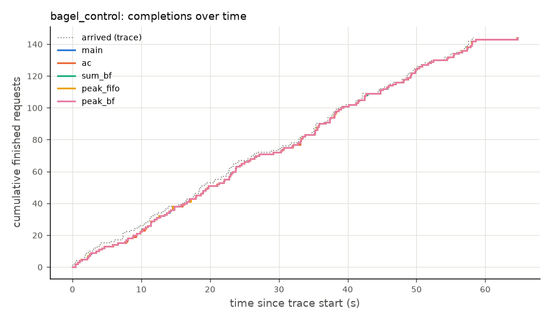
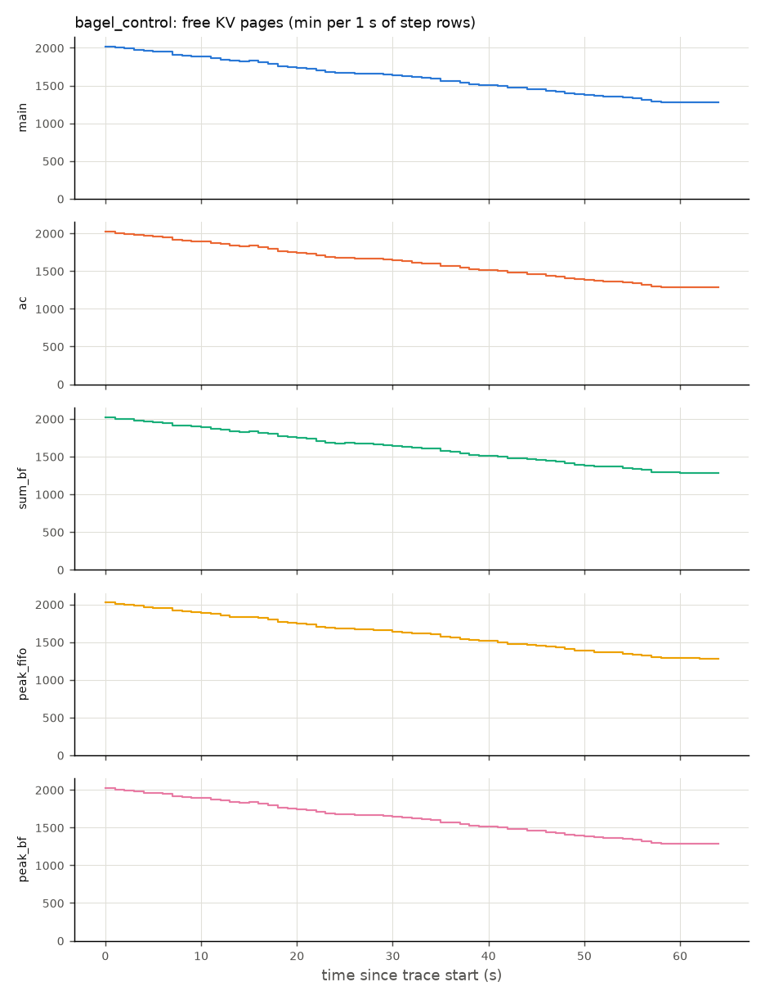
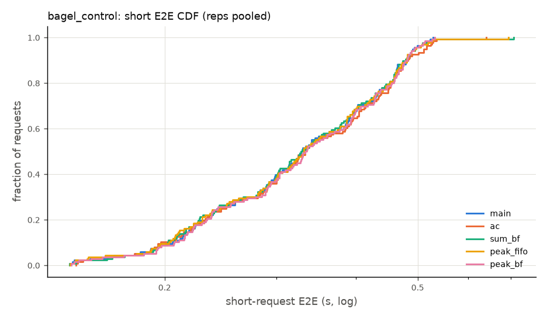
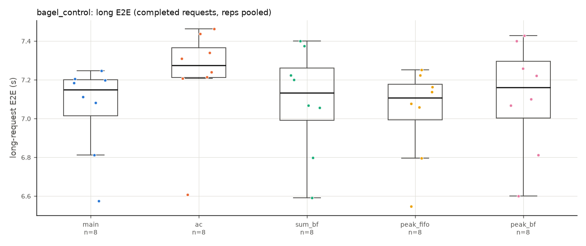

## bagel_burst

| config | n | flags | completed | failed | timed out | duration (s) | out tok/s | max stall (s) | short E2E mean (s) | short E2E p50 (s) | short E2E p99 (s) | short TTFT mean (s) | short TTFT p99 (s) | long E2E mean (s) | long E2E max (s) | long TTFT mean (s) | holds | fail: GrantDeferred | grant_deferred (adm log) | min free KV pages | GPU busy | decode bs | planner_us p50 | planner_us p99 |
|---|---|---|---|---|---|---|---|---|---|---|---|---|---|---|---|---|---|---|---|---|---|---|---|---|
| main | 2 |  | 2700 | 0 | 0 | 305.1 | 654.9 | 3.3 | 0.69 | 0.46 | 3.01 | 0.095 | 0.959 | 68.5 | 68.6 | 0.50 | 0 | 0 | - | 0 | 82.3% | 7.1 | - | - |
| ac | 2 |  | 2686 | 14 | 0 | 305.1 | 653.1 | 47.7 | 10.09 | 0.52 | 59.74 | 7.687 | 47.695 | 75.2 | 121.9 | 17.69 | 0 | 0 | - | 0 | 76.8% | 7.9 | - | - |
| sum_bf | 2 |  | 2693 | 7 | 0 | 305.1 | 654.0 | 6.0 | 7.61 | 0.54 | 46.62 | 5.284 | 31.416 | 88.4 | 133.7 | 22.43 | 0 | 0 | 0 | 0 | 74.7% | 8.4 | 390.2 | 1931.9 |
| peak_fifo | 2 | STALLED 1/2 | 2661 | 39 | 0 | 307.5 | 644.6 | 75.9 | 35.90 | 29.64 | 105.97 | 24.811 | 76.140 | 126.1 | 214.6 | 28.18 | 1.5 | 1.5 | 3 | 0 | 58.2% | 15.9 | 1647.9 | 5169.7 |
| peak_bf | 2 |  | 2700 | 0 | 0 | 305.1 | 654.9 | 2.9 | 0.66 | 0.48 | 2.48 | 0.088 | 0.618 | 72.3 | 93.1 | 22.09 | 0 | 0 | 0 | 0 | 81.2% | 7.2 | 782.3 | 1588.0 |
| *main / ac* |  |  |  |  |  |  | 1.00 |  | 0.07 |  |  |  |  | 0.91 |  |  |  |  |  |  |  |  |  |  |
| *sum_bf / ac* |  |  |  |  |  |  | 1.00 |  | 0.75 |  |  |  |  | 1.18 |  |  |  |  |  |  |  |  |  |  |
| *peak_fifo / ac* |  |  |  |  |  |  | 0.99 |  | 3.56 |  |  |  |  | 1.68 |  |  |  |  |  |  |  |  |  |  |
| *peak_bf / ac* |  |  |  |  |  |  | 1.00 |  | 0.06 |  |  |  |  | 0.96 |  |  |  |  |  |  |  |  |  |  |
| *ac / main* |  |  |  |  |  |  | 1.00 |  | 14.63 |  |  |  |  | 1.10 |  |  |  |  |  |  |  |  |  |  |
| *sum_bf / main* |  |  |  |  |  |  | 1.00 |  | 11.04 |  |  |  |  | 1.29 |  |  |  |  |  |  |  |  |  |  |
| *peak_fifo / main* |  |  |  |  |  |  | 0.98 |  | 52.06 |  |  |  |  | 1.84 |  |  |  |  |  |  |  |  |  |  |
| *peak_bf / main* |  |  |  |  |  |  | 1.00 |  | 0.95 |  |  |  |  | 1.06 |  |  |  |  |  |  |  |  |  |  |

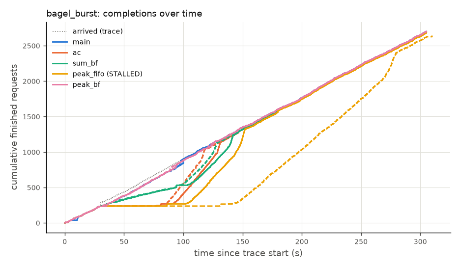
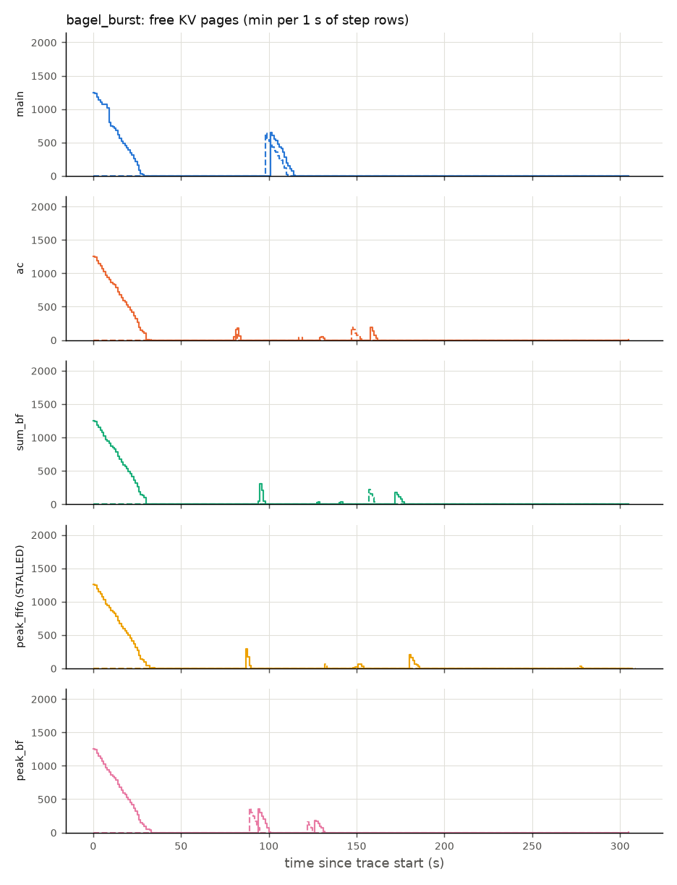
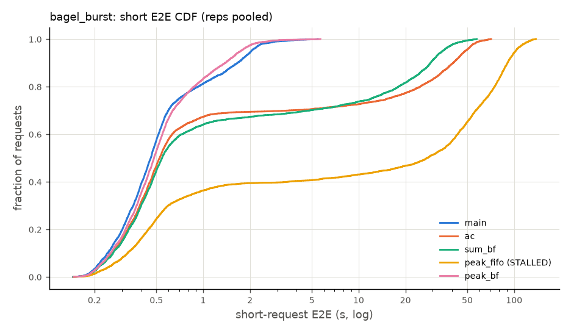
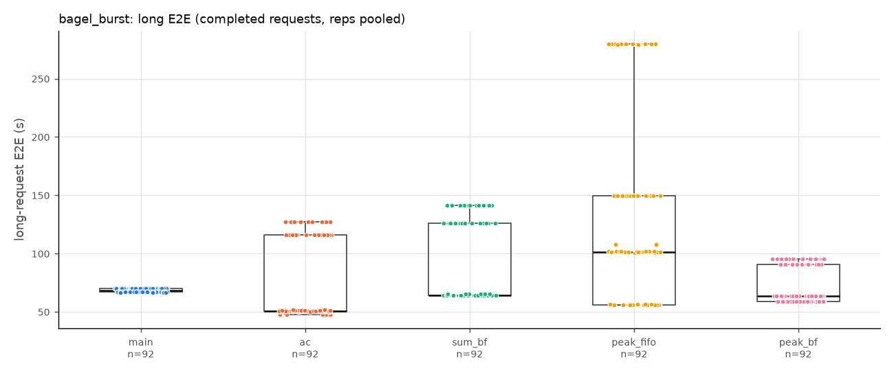

## bagel_stag_r1

| config | n | flags | completed | failed | timed out | duration (s) | out tok/s | max stall (s) | short E2E mean (s) | short E2E p50 (s) | short E2E p99 (s) | short TTFT mean (s) | short TTFT p99 (s) | long E2E mean (s) | long E2E max (s) | long TTFT mean (s) | holds | fail: GrantDeferred | grant_deferred (adm log) | min free KV pages | GPU busy | decode bs | planner_us p50 | planner_us p99 |
|---|---|---|---|---|---|---|---|---|---|---|---|---|---|---|---|---|---|---|---|---|---|---|---|---|
| main | 1 |  | 600 | 0 | 0 | 595.6 | 307.2 | 8.6 | 0.33 | 0.33 | 0.52 | 0.046 | 0.075 | 14.0 | 14.9 | 0.04 | 0 | 0 | - | 0 | 86.7% | 2.4 | - | - |
| ac | 1 |  | 600 | 0 | 0 | 595.7 | 307.2 | 8.7 | 0.33 | 0.33 | 0.59 | 0.047 | 0.080 | 13.9 | 14.4 | 0.04 | 0 | 0 | - | 0 | 86.8% | 2.4 | - | - |
| sum_bf | 1 |  | 600 | 0 | 0 | 595.7 | 307.2 | 8.6 | 0.33 | 0.33 | 0.52 | 0.046 | 0.080 | 13.9 | 14.8 | 0.04 | 0 | 0 | 0 | 0 | 86.8% | 2.4 | 435.0 | 705.7 |
| peak_fifo | 1 |  | 600 | 0 | 0 | 595.7 | 307.2 | 8.6 | 0.33 | 0.33 | 0.54 | 0.048 | 0.078 | 13.8 | 14.2 | 0.04 | 0 | 0 | 0 | 0 | 87.0% | 2.3 | 720.4 | 1046.6 |
| peak_bf | 1 |  | 600 | 0 | 0 | 595.6 | 307.2 | 8.6 | 0.33 | 0.33 | 0.54 | 0.047 | 0.075 | 13.9 | 15.1 | 0.04 | 0 | 0 | 0 | 0 | 86.7% | 2.4 | 714.7 | 1031.6 |
| *main / ac* |  |  |  |  |  |  | 1.00 |  | 0.99 |  |  |  |  | 1.01 |  |  |  |  |  |  |  |  |  |  |
| *sum_bf / ac* |  |  |  |  |  |  | 1.00 |  | 0.99 |  |  |  |  | 1.00 |  |  |  |  |  |  |  |  |  |  |
| *peak_fifo / ac* |  |  |  |  |  |  | 1.00 |  | 0.99 |  |  |  |  | 0.99 |  |  |  |  |  |  |  |  |  |  |
| *peak_bf / ac* |  |  |  |  |  |  | 1.00 |  | 1.00 |  |  |  |  | 1.00 |  |  |  |  |  |  |  |  |  |  |
| *ac / main* |  |  |  |  |  |  | 1.00 |  | 1.01 |  |  |  |  | 0.99 |  |  |  |  |  |  |  |  |  |  |
| *sum_bf / main* |  |  |  |  |  |  | 1.00 |  | 1.00 |  |  |  |  | 0.99 |  |  |  |  |  |  |  |  |  |  |
| *peak_fifo / main* |  |  |  |  |  |  | 1.00 |  | 1.00 |  |  |  |  | 0.99 |  |  |  |  |  |  |  |  |  |  |
| *peak_bf / main* |  |  |  |  |  |  | 1.00 |  | 1.01 |  |  |  |  | 1.00 |  |  |  |  |  |  |  |  |  |  |

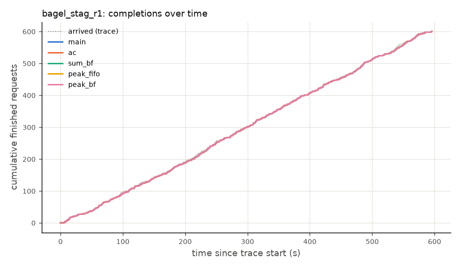
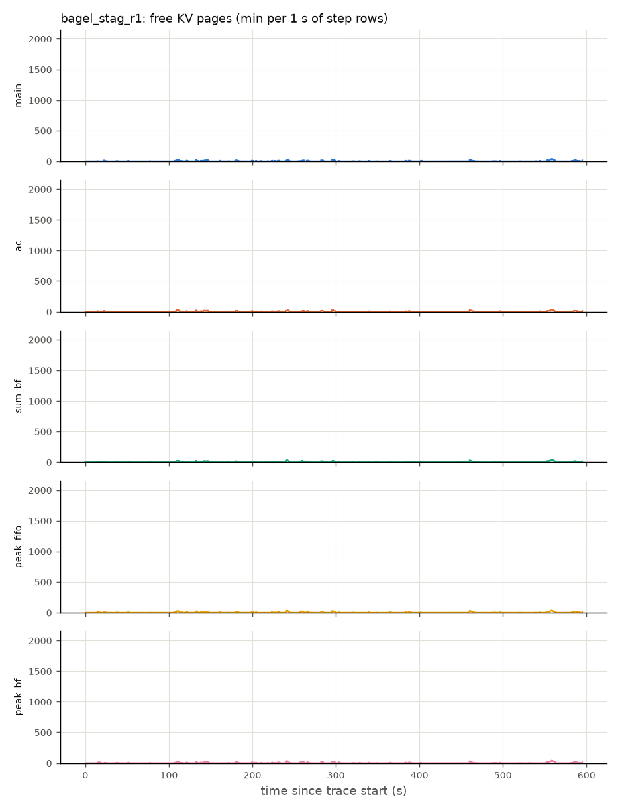
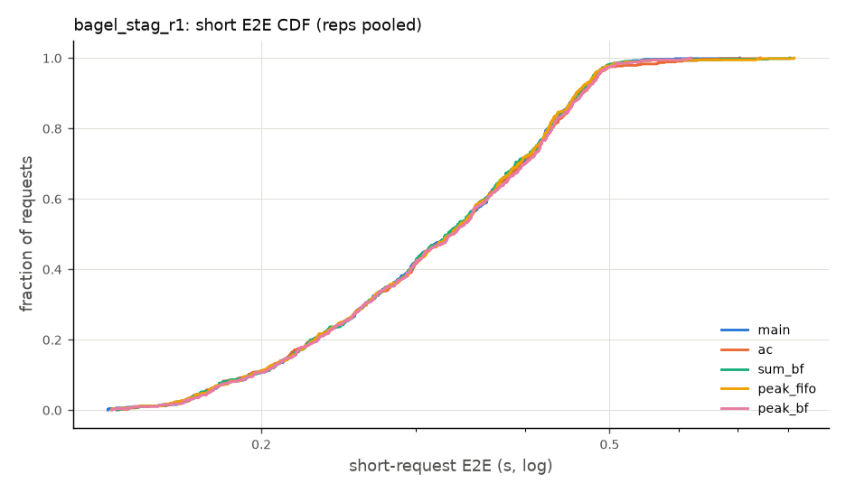
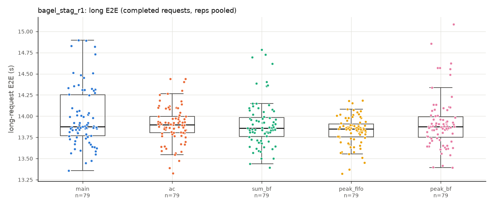

## bagel_stag_r1.5

| config | n | flags | completed | failed | timed out | duration (s) | out tok/s | max stall (s) | short E2E mean (s) | short E2E p50 (s) | short E2E p99 (s) | short TTFT mean (s) | short TTFT p99 (s) | long E2E mean (s) | long E2E max (s) | long TTFT mean (s) | holds | fail: GrantDeferred | grant_deferred (adm log) | min free KV pages | GPU busy | decode bs | planner_us p50 | planner_us p99 |
|---|---|---|---|---|---|---|---|---|---|---|---|---|---|---|---|---|---|---|---|---|---|---|---|---|
| main | 1 |  | 899 | 1 | 0 | 613.9 | 460.5 | 5.6 | 0.33 | 0.33 | 0.54 | 0.048 | 0.079 | 14.3 | 15.2 | 0.04 | 0 | 0 | - | 0 | 92.3% | 3.4 | - | - |
| ac | 1 |  | 900 | 0 | 0 | 613.8 | 460.6 | 5.6 | 0.33 | 0.33 | 0.53 | 0.048 | 0.083 | 14.2 | 15.5 | 0.04 | 0 | 0 | - | 0 | 92.4% | 3.4 | - | - |
| sum_bf | 1 |  | 899 | 1 | 0 | 613.8 | 457.3 | 5.6 | 0.33 | 0.33 | 0.54 | 0.048 | 0.082 | 14.2 | 15.6 | 0.04 | 0 | 0 | 0 | 0 | 92.5% | 3.3 | 481.9 | 688.8 |
| peak_fifo | 1 |  | 900 | 0 | 0 | 613.8 | 460.6 | 5.6 | 0.33 | 0.33 | 0.53 | 0.047 | 0.083 | 14.2 | 15.3 | 0.04 | 0 | 0 | 0 | 0 | 92.4% | 3.4 | 723.8 | 1054.5 |
| peak_bf | 1 |  | 900 | 0 | 0 | 614.1 | 460.4 | 5.9 | 0.34 | 0.33 | 0.60 | 0.050 | 0.085 | 14.3 | 15.9 | 0.04 | 0 | 0 | 0 | 0 | 92.4% | 3.4 | 754.2 | 1075.6 |
| *main / ac* |  |  |  |  |  |  | 1.00 |  | 1.00 |  |  |  |  | 1.00 |  |  |  |  |  |  |  |  |  |  |
| *sum_bf / ac* |  |  |  |  |  |  | 0.99 |  | 1.01 |  |  |  |  | 1.00 |  |  |  |  |  |  |  |  |  |  |
| *peak_fifo / ac* |  |  |  |  |  |  | 1.00 |  | 1.00 |  |  |  |  | 1.00 |  |  |  |  |  |  |  |  |  |  |
| *peak_bf / ac* |  |  |  |  |  |  | 1.00 |  | 1.02 |  |  |  |  | 1.01 |  |  |  |  |  |  |  |  |  |  |
| *ac / main* |  |  |  |  |  |  | 1.00 |  | 1.00 |  |  |  |  | 1.00 |  |  |  |  |  |  |  |  |  |  |
| *sum_bf / main* |  |  |  |  |  |  | 0.99 |  | 1.00 |  |  |  |  | 1.00 |  |  |  |  |  |  |  |  |  |  |
| *peak_fifo / main* |  |  |  |  |  |  | 1.00 |  | 1.00 |  |  |  |  | 1.00 |  |  |  |  |  |  |  |  |  |  |
| *peak_bf / main* |  |  |  |  |  |  | 1.00 |  | 1.02 |  |  |  |  | 1.00 |  |  |  |  |  |  |  |  |  |  |

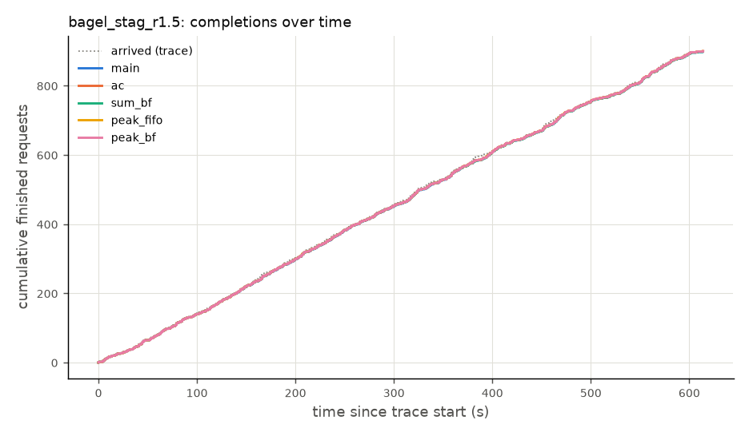
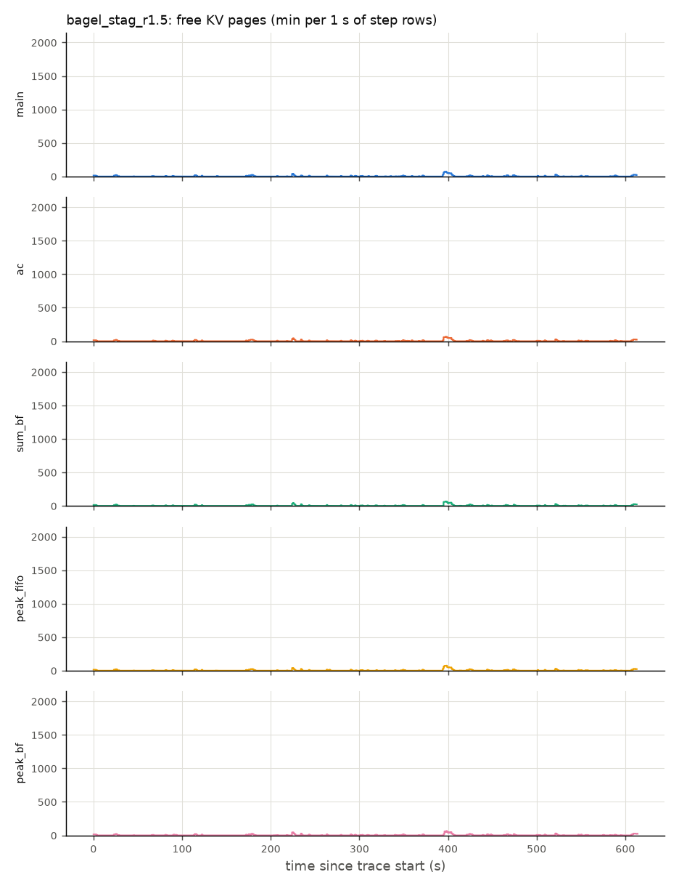
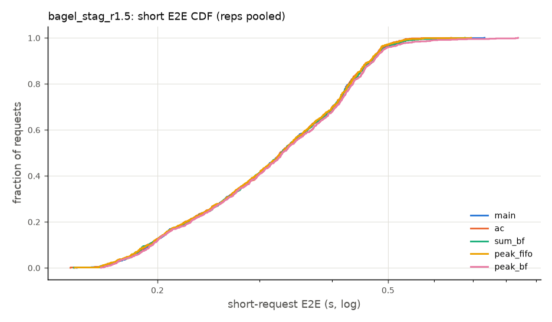
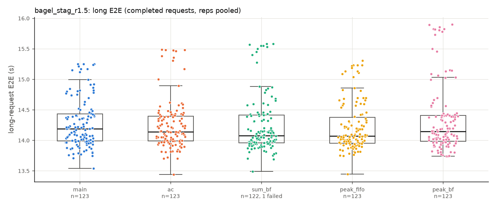

## bagel_stag_r2

| config | n | flags | completed | failed | timed out | duration (s) | out tok/s | max stall (s) | short E2E mean (s) | short E2E p50 (s) | short E2E p99 (s) | short TTFT mean (s) | short TTFT p99 (s) | long E2E mean (s) | long E2E max (s) | long TTFT mean (s) | holds | fail: GrantDeferred | grant_deferred (adm log) | min free KV pages | GPU busy | decode bs | planner_us p50 | planner_us p99 |
|---|---|---|---|---|---|---|---|---|---|---|---|---|---|---|---|---|---|---|---|---|---|---|---|---|
| main | 1 |  | 1200 | 0 | 0 | 627.9 | 691.1 | 5.0 | 0.36 | 0.36 | 0.70 | 0.052 | 0.103 | 15.1 | 19.5 | 0.05 | 0 | 0 | - | 0 | 96.3% | 5.0 | - | - |
| ac | 1 |  | 1200 | 0 | 0 | 627.2 | 691.8 | 4.7 | 0.35 | 0.35 | 0.62 | 0.050 | 0.095 | 14.7 | 18.2 | 0.05 | 0 | 0 | - | 0 | 97.7% | 4.9 | - | - |
| sum_bf | 1 |  | 1200 | 0 | 0 | 627.1 | 691.8 | 4.7 | 0.35 | 0.36 | 0.62 | 0.051 | 0.123 | 14.7 | 17.3 | 0.04 | 0 | 0 | 0 | 0 | 97.6% | 4.9 | 524.9 | 746.3 |
| peak_fifo | 1 |  | 1200 | 0 | 0 | 627.2 | 691.8 | 4.8 | 0.35 | 0.35 | 0.63 | 0.050 | 0.084 | 14.8 | 19.0 | 0.04 | 0 | 0 | 0 | 0 | 97.2% | 4.9 | 785.7 | 1200.1 |
| peak_bf | 1 |  | 1200 | 0 | 0 | 627.2 | 691.8 | 4.7 | 0.35 | 0.36 | 0.58 | 0.053 | 0.100 | 14.8 | 17.5 | 0.05 | 0 | 0 | 0 | 0 | 97.4% | 4.9 | 764.9 | 1229.2 |
| *main / ac* |  |  |  |  |  |  | 1.00 |  | 1.03 |  |  |  |  | 1.03 |  |  |  |  |  |  |  |  |  |  |
| *sum_bf / ac* |  |  |  |  |  |  | 1.00 |  | 1.01 |  |  |  |  | 1.00 |  |  |  |  |  |  |  |  |  |  |
| *peak_fifo / ac* |  |  |  |  |  |  | 1.00 |  | 1.01 |  |  |  |  | 1.01 |  |  |  |  |  |  |  |  |  |  |
| *peak_bf / ac* |  |  |  |  |  |  | 1.00 |  | 1.01 |  |  |  |  | 1.01 |  |  |  |  |  |  |  |  |  |  |
| *ac / main* |  |  |  |  |  |  | 1.00 |  | 0.97 |  |  |  |  | 0.97 |  |  |  |  |  |  |  |  |  |  |
| *sum_bf / main* |  |  |  |  |  |  | 1.00 |  | 0.98 |  |  |  |  | 0.97 |  |  |  |  |  |  |  |  |  |  |
| *peak_fifo / main* |  |  |  |  |  |  | 1.00 |  | 0.98 |  |  |  |  | 0.98 |  |  |  |  |  |  |  |  |  |  |
| *peak_bf / main* |  |  |  |  |  |  | 1.00 |  | 0.99 |  |  |  |  | 0.98 |  |  |  |  |  |  |  |  |  |  |

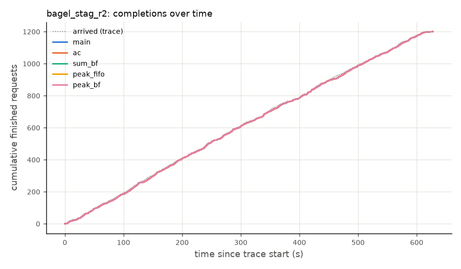
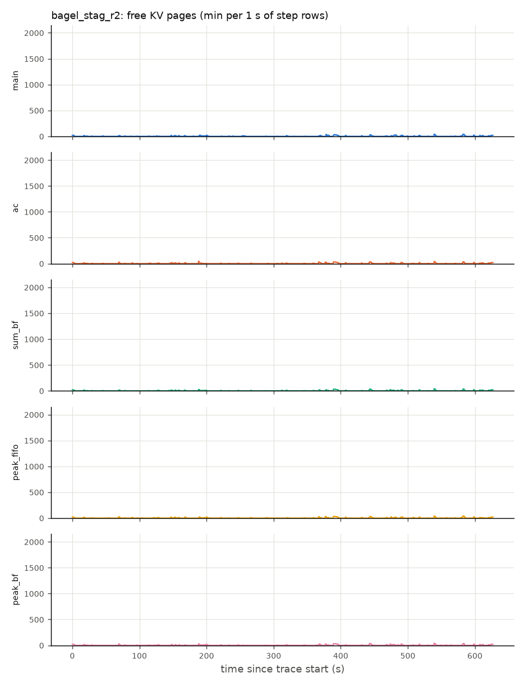
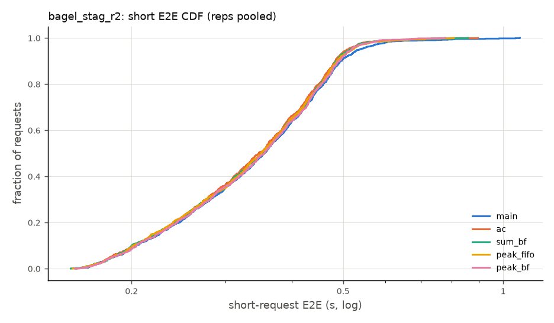
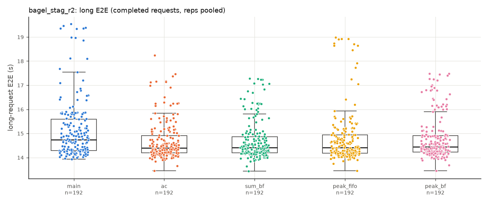

## Data problems

- `12786_peak_fifo/bagel_burst_r2` [STALLED]
  - STALLED: 0 request(s) timed out; longest stretch without a completion while requests were outstanding 99.2s, starting at t=31.7s
