# mstar KV-admission A/B (BAGEL text-to-text)

Each config row is the mean over its reps (`n` = reps found; a metric a rep lacks is left out of that mean, `-` = no rep has it). Times in seconds from the client's bench.json; completed-request latencies only (a failed or timed-out request has no latency, so long E2E is optimistic where `timed out` > 0). Short/long = bench `cls`. Percentiles are per rep, then averaged.

- **STALLED**: a request timed out, or no request completed for > 60 s while one was outstanding (`max stall`; a timed-out request counts as outstanding until its timeout).
- **TRUNCATED**: a completed request returned fewer output tokens than the trace asked for (`output_lens` < `intended_output_lens`; BAGEL's decode loop stops at 2,049 tokens), so the run's KV pressure is below the workload's plan; `truncated` in summary.json counts them.
- *timed out* = failed with the client's empty-message error (`request failed`) or a timeout message; *failed* = every other error.
- holds / fail: / min free KV pages / GPU busy / decode bs come from step telemetry in the run's window (trace start to last request end + 5 s; the server's telemetry is shared by the runs it serves). GPU busy = sum of step `gpu_ms` / (trace start to last request end). decode bs = mean `bs` of ok `decode` steps. fail: columns count `admit_fail` events by `reason`.
- grant_deferred (adm log), planner_us: admission log, bench-peak configs only (`-` for main/ac).
- Ratio rows `X / ref` = X's mean divided by the reference's mean (E2E < 1 and tok/s > 1 favour X).

## bagel_control

| config | n | flags | completed | failed | timed out | duration (s) | out tok/s | max stall (s) | short E2E mean (s) | short E2E p50 (s) | short E2E p99 (s) | short TTFT mean (s) | short TTFT p99 (s) | long E2E mean (s) | long E2E max (s) | long TTFT mean (s) | holds | fail: AllocationFailed | fail: GrantDeferred | grant_deferred (adm log) | min free KV pages | GPU busy | decode bs | planner_us p50 | planner_us p99 |
|---|---|---|---|---|---|---|---|---|---|---|---|---|---|---|---|---|---|---|---|---|---|---|---|---|---|
| main | 1 |  | 144 | 0 | 0 | 64.6 | 214.2 | 6.0 | 0.35 | 0.33 | 0.69 | 0.048 | 0.103 | 7.1 | 7.5 | 0.04 | 0 | 0 | 0 | - | 1275 | 75.8% | 1.9 | - | - |
| ac | 1 |  | 144 | 0 | 0 | 64.9 | 213.2 | 6.3 | 0.34 | 0.33 | 0.54 | 0.046 | 0.074 | 7.1 | 7.5 | 0.03 | 0 | 0 | 0 | - | 1283 | 75.1% | 1.9 | - | - |
| sum_bf | 1 |  | 144 | 0 | 0 | 64.7 | 214.1 | 6.1 | 0.34 | 0.33 | 0.52 | 0.044 | 0.067 | 7.1 | 7.3 | 0.04 | 0 | 0 | 0 | 0 | 1283 | 75.8% | 1.9 | 115.9 | 214.7 |
| peak_fifo | 1 |  | 144 | 0 | 0 | 64.6 | 214.2 | 6.0 | 0.34 | 0.33 | 0.53 | 0.047 | 0.098 | 7.2 | 7.4 | 0.04 | 0 | 0 | 0 | 0 | 1283 | 75.1% | 2.0 | 385.8 | 529.9 |
| peak_bf | 1 |  | 144 | 0 | 0 | 64.6 | 214.1 | 6.0 | 0.34 | 0.33 | 0.51 | 0.045 | 0.066 | 7.1 | 7.2 | 0.04 | 0 | 0 | 0 | 0 | 1283 | 75.7% | 1.9 | 384.1 | 559.6 |
| ac_fast | 1 |  | 144 | 0 | 0 | 65.0 | 212.9 | 6.4 | 0.34 | 0.33 | 0.52 | 0.046 | 0.083 | 7.1 | 7.2 | 0.03 | 0 | 0 | 0 | - | 1283 | 75.1% | 1.9 | - | - |
| peak_bf_fast | 1 |  | 144 | 0 | 0 | 64.6 | 214.1 | 6.0 | 0.34 | 0.33 | 0.51 | 0.045 | 0.068 | 7.1 | 7.3 | 0.03 | 0 | 0 | 0 | - | 1283 | 75.7% | 1.9 | - | - |
| *main / ac* |  |  |  |  |  |  | 1.00 |  | 1.02 |  |  |  |  | 0.99 |  |  |  |  |  |  |  |  |  |  |  |
| *peak_bf / ac* |  |  |  |  |  |  | 1.00 |  | 0.99 |  |  |  |  | 0.99 |  |  |  |  |  |  |  |  |  |  |  |
| *sum_bf / ac* |  |  |  |  |  |  | 1.00 |  | 0.99 |  |  |  |  | 0.99 |  |  |  |  |  |  |  |  |  |  |  |
| *peak_fifo / ac* |  |  |  |  |  |  | 1.00 |  | 1.01 |  |  |  |  | 1.01 |  |  |  |  |  |  |  |  |  |  |  |
| *peak_bf_fast / ac* |  |  |  |  |  |  | 1.00 |  | 0.99 |  |  |  |  | 0.99 |  |  |  |  |  |  |  |  |  |  |  |
| *ac_fast / ac* |  |  |  |  |  |  | 1.00 |  | 1.00 |  |  |  |  | 0.99 |  |  |  |  |  |  |  |  |  |  |  |
| *ac / main* |  |  |  |  |  |  | 1.00 |  | 0.98 |  |  |  |  | 1.01 |  |  |  |  |  |  |  |  |  |  |  |
| *peak_bf / main* |  |  |  |  |  |  | 1.00 |  | 0.97 |  |  |  |  | 0.99 |  |  |  |  |  |  |  |  |  |  |  |
| *sum_bf / main* |  |  |  |  |  |  | 1.00 |  | 0.97 |  |  |  |  | 1.00 |  |  |  |  |  |  |  |  |  |  |  |
| *peak_fifo / main* |  |  |  |  |  |  | 1.00 |  | 0.99 |  |  |  |  | 1.02 |  |  |  |  |  |  |  |  |  |  |  |
| *peak_bf_fast / main* |  |  |  |  |  |  | 1.00 |  | 0.97 |  |  |  |  | 1.00 |  |  |  |  |  |  |  |  |  |  |  |
| *ac_fast / main* |  |  |  |  |  |  | 0.99 |  | 0.98 |  |  |  |  | 1.00 |  |  |  |  |  |  |  |  |  |  |  |

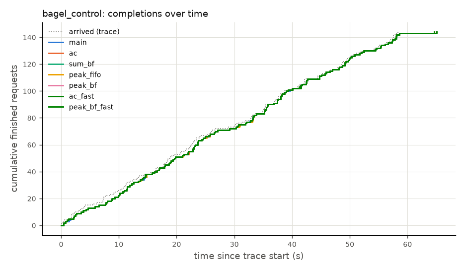
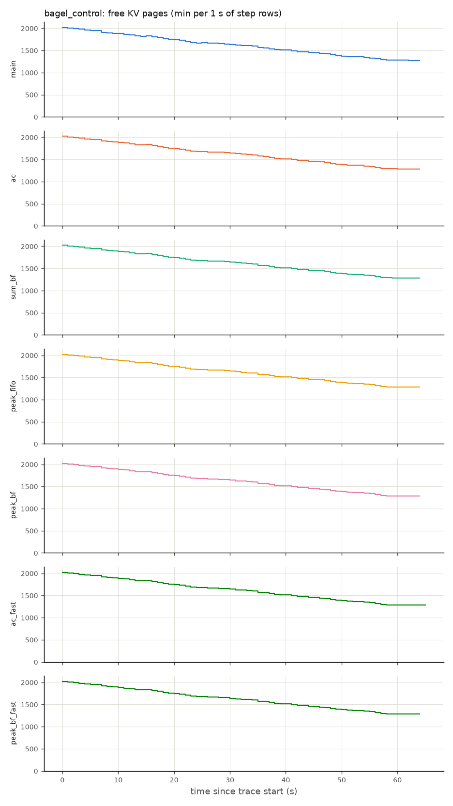
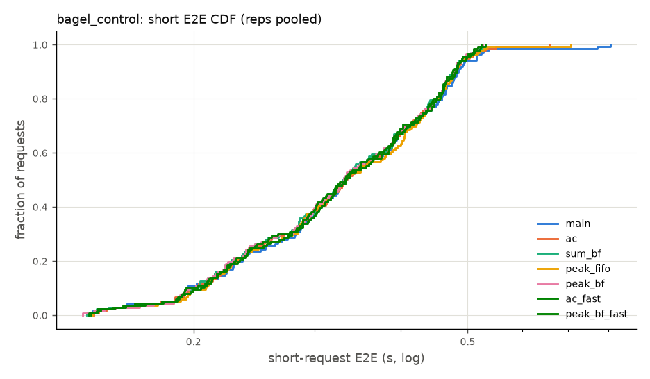
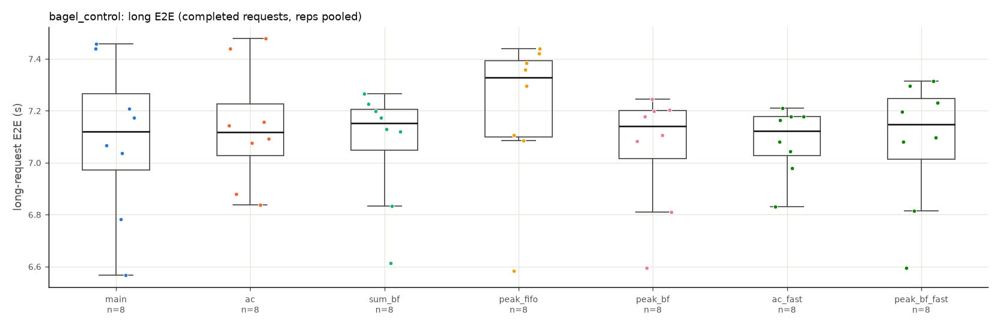

## bagel_burst_v2

| config | n | flags | completed | failed | timed out | duration (s) | out tok/s | max stall (s) | short E2E mean (s) | short E2E p50 (s) | short E2E p99 (s) | short TTFT mean (s) | short TTFT p99 (s) | long E2E mean (s) | long E2E max (s) | long TTFT mean (s) | holds | fail: AllocationFailed | fail: GrantDeferred | grant_deferred (adm log) | min free KV pages | GPU busy | decode bs | planner_us p50 | planner_us p99 |
|---|---|---|---|---|---|---|---|---|---|---|---|---|---|---|---|---|---|---|---|---|---|---|---|---|---|
| main | 2 | STALLED 2/2 | 1040.5 | 0 | 1659.5 | 836.2 | 48.0 | 718.3 | 431.01 | 552.03 | 599.26 | 402.486 | 576.274 | - | - | - | 119224 | 119224 | 0 | - | 0 | 8.7% | 11.6 | - | - |
| ac | 2 |  | 2700 | 0 | 0 | 305.1 | 647.6 | 51.5 | 15.43 | 0.60 | 72.42 | 12.281 | 59.716 | 90.3 | 146.8 | 24.60 | 0 | 0 | 0 | - | 0 | 78.1% | 8.8 | - | - |
| sum_bf | 2 |  | 2700 | 0 | 0 | 305.1 | 647.6 | 7.2 | 12.21 | 0.70 | 57.42 | 9.280 | 44.461 | 103.0 | 156.1 | 28.71 | 0 | 0 | 0 | 0 | 0 | 74.8% | 9.5 | 372.6 | 2187.4 |
| peak_fifo | 2 | STALLED 1/2 | 2700 | 0 | 0 | 305.1 | 647.6 | 62.9 | 23.51 | 10.05 | 89.20 | 18.400 | 70.645 | 109.0 | 179.6 | 28.30 | 2 | 0 | 2 | 4 | 0 | 70.4% | 10.7 | 1210.2 | 4951.4 |
| peak_bf | 2 |  | 2700 | 0 | 0 | 305.1 | 647.6 | 8.6 | 1.08 | 0.50 | 10.36 | 0.295 | 5.030 | 83.1 | 106.9 | 27.70 | 0 | 0 | 0 | 0 | 0 | 83.9% | 7.6 | 740.7 | 2464.0 |
| ac_fast | 2 | STALLED 1/2 | 2700 | 0 | 0 | 306.9 | 643.7 | 77.1 | 36.63 | 29.99 | 99.33 | 31.116 | 84.841 | 130.7 | 215.2 | 33.27 | 0 | 0 | 0 | - | 0 | 64.7% | 16.2 | - | - |
| peak_bf_fast | 2 |  | 2700 | 0 | 0 | 305.1 | 647.6 | 7.3 | 0.96 | 0.49 | 9.14 | 0.254 | 4.585 | 77.9 | 100.4 | 26.20 | 0 | 0 | 0 | - | 0 | 85.1% | 7.3 | - | - |
| *main / ac* |  |  |  |  |  |  | 0.07 |  | 27.93 |  |  |  |  | - |  |  |  |  |  |  |  |  |  |  |  |
| *peak_bf / ac* |  |  |  |  |  |  | 1.00 |  | 0.07 |  |  |  |  | 0.92 |  |  |  |  |  |  |  |  |  |  |  |
| *sum_bf / ac* |  |  |  |  |  |  | 1.00 |  | 0.79 |  |  |  |  | 1.14 |  |  |  |  |  |  |  |  |  |  |  |
| *peak_fifo / ac* |  |  |  |  |  |  | 1.00 |  | 1.52 |  |  |  |  | 1.21 |  |  |  |  |  |  |  |  |  |  |  |
| *peak_bf_fast / ac* |  |  |  |  |  |  | 1.00 |  | 0.06 |  |  |  |  | 0.86 |  |  |  |  |  |  |  |  |  |  |  |
| *ac_fast / ac* |  |  |  |  |  |  | 0.99 |  | 2.37 |  |  |  |  | 1.45 |  |  |  |  |  |  |  |  |  |  |  |
| *ac / main* |  |  |  |  |  |  | 13.48 |  | 0.04 |  |  |  |  | - |  |  |  |  |  |  |  |  |  |  |  |
| *peak_bf / main* |  |  |  |  |  |  | 13.48 |  | 0.00 |  |  |  |  | - |  |  |  |  |  |  |  |  |  |  |  |
| *sum_bf / main* |  |  |  |  |  |  | 13.48 |  | 0.03 |  |  |  |  | - |  |  |  |  |  |  |  |  |  |  |  |
| *peak_fifo / main* |  |  |  |  |  |  | 13.48 |  | 0.05 |  |  |  |  | - |  |  |  |  |  |  |  |  |  |  |  |
| *peak_bf_fast / main* |  |  |  |  |  |  | 13.48 |  | 0.00 |  |  |  |  | - |  |  |  |  |  |  |  |  |  |  |  |
| *ac_fast / main* |  |  |  |  |  |  | 13.40 |  | 0.08 |  |  |  |  | - |  |  |  |  |  |  |  |  |  |  |  |

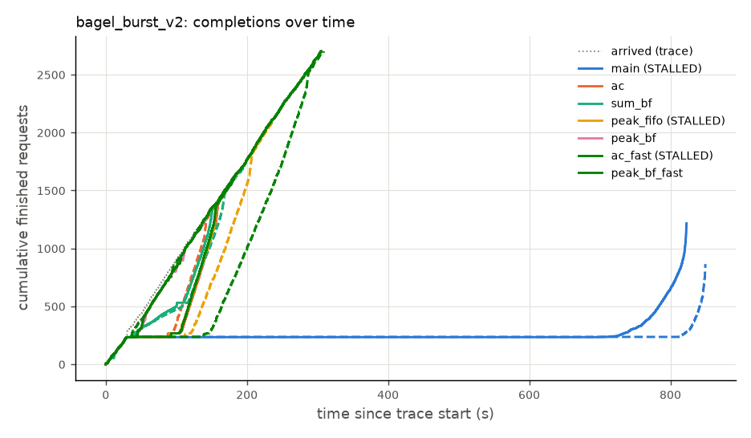
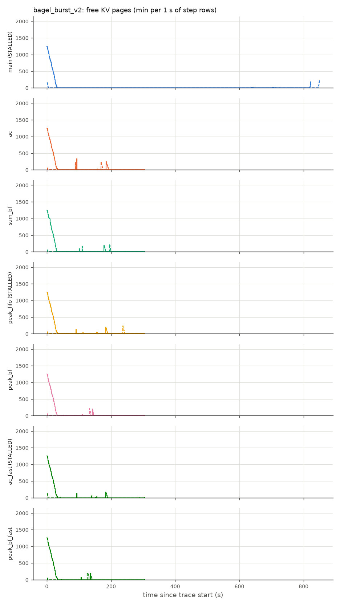
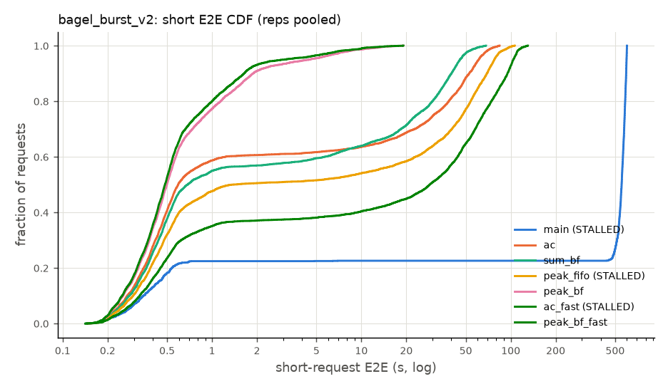
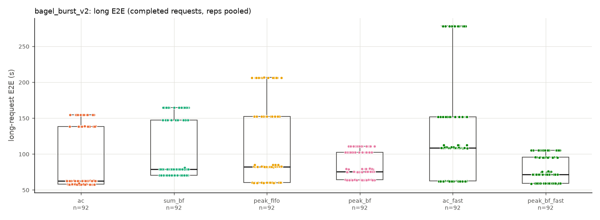

## bagel_stag_v2_r1.5

| config | n | flags | completed | failed | timed out | duration (s) | out tok/s | max stall (s) | short E2E mean (s) | short E2E p50 (s) | short E2E p99 (s) | short TTFT mean (s) | short TTFT p99 (s) | long E2E mean (s) | long E2E max (s) | long TTFT mean (s) | holds | fail: AllocationFailed | fail: GrantDeferred | grant_deferred (adm log) | min free KV pages | GPU busy | decode bs | planner_us p50 | planner_us p99 |
|---|---|---|---|---|---|---|---|---|---|---|---|---|---|---|---|---|---|---|---|---|---|---|---|---|---|
| main | 1 |  | 900 | 0 | 0 | 614.8 | 450.0 | 6.8 | 0.41 | 0.38 | 1.12 | 0.075 | 0.598 | 17.3 | 22.4 | 0.45 | 0 | 0 | 0 | - | 0 | 93.5% | 3.8 | - | - |
| ac | 1 |  | 900 | 0 | 0 | 614.8 | 450.0 | 6.8 | 0.41 | 0.38 | 1.13 | 0.073 | 0.507 | 17.5 | 22.6 | 0.46 | 0 | 0 | 0 | - | 0 | 93.1% | 3.9 | - | - |
| sum_bf | 1 |  | 900 | 0 | 0 | 615.4 | 449.6 | 7.1 | 0.40 | 0.37 | 1.05 | 0.072 | 0.546 | 17.5 | 22.6 | 0.46 | 0 | 0 | 0 | 0 | 0 | 93.5% | 3.9 | 520.1 | 740.2 |
| peak_fifo | 1 |  | 900 | 0 | 0 | 614.8 | 450.0 | 6.8 | 0.40 | 0.37 | 1.00 | 0.072 | 0.505 | 17.4 | 23.1 | 0.45 | 0 | 0 | 0 | 0 | 0 | 93.4% | 3.9 | 739.0 | 1152.0 |
| peak_bf | 1 |  | 900 | 0 | 0 | 615.4 | 449.6 | 7.2 | 0.41 | 0.38 | 1.12 | 0.074 | 0.522 | 17.4 | 22.6 | 0.45 | 0 | 0 | 0 | 0 | 0 | 93.4% | 3.9 | 742.4 | 1159.0 |
| ac_fast | 1 |  | 900 | 0 | 0 | 614.9 | 449.9 | 6.8 | 0.40 | 0.37 | 1.07 | 0.071 | 0.515 | 17.4 | 22.6 | 0.45 | 0 | 0 | 0 | - | 0 | 93.3% | 3.9 | - | - |
| peak_bf_fast | 1 |  | 900 | 0 | 0 | 615.3 | 449.7 | 6.9 | 0.40 | 0.37 | 1.08 | 0.072 | 0.502 | 17.4 | 22.5 | 0.45 | 0 | 0 | 0 | - | 0 | 93.4% | 3.9 | - | - |
| *main / ac* |  |  |  |  |  |  | 1.00 |  | 1.00 |  |  |  |  | 0.99 |  |  |  |  |  |  |  |  |  |  |  |
| *peak_bf / ac* |  |  |  |  |  |  | 1.00 |  | 1.00 |  |  |  |  | 1.00 |  |  |  |  |  |  |  |  |  |  |  |
| *sum_bf / ac* |  |  |  |  |  |  | 1.00 |  | 0.99 |  |  |  |  | 1.00 |  |  |  |  |  |  |  |  |  |  |  |
| *peak_fifo / ac* |  |  |  |  |  |  | 1.00 |  | 0.99 |  |  |  |  | 0.99 |  |  |  |  |  |  |  |  |  |  |  |
| *peak_bf_fast / ac* |  |  |  |  |  |  | 1.00 |  | 0.99 |  |  |  |  | 1.00 |  |  |  |  |  |  |  |  |  |  |  |
| *ac_fast / ac* |  |  |  |  |  |  | 1.00 |  | 0.99 |  |  |  |  | 0.99 |  |  |  |  |  |  |  |  |  |  |  |
| *ac / main* |  |  |  |  |  |  | 1.00 |  | 1.00 |  |  |  |  | 1.01 |  |  |  |  |  |  |  |  |  |  |  |
| *peak_bf / main* |  |  |  |  |  |  | 1.00 |  | 1.00 |  |  |  |  | 1.01 |  |  |  |  |  |  |  |  |  |  |  |
| *sum_bf / main* |  |  |  |  |  |  | 1.00 |  | 0.99 |  |  |  |  | 1.01 |  |  |  |  |  |  |  |  |  |  |  |
| *peak_fifo / main* |  |  |  |  |  |  | 1.00 |  | 0.99 |  |  |  |  | 1.01 |  |  |  |  |  |  |  |  |  |  |  |
| *peak_bf_fast / main* |  |  |  |  |  |  | 1.00 |  | 0.99 |  |  |  |  | 1.01 |  |  |  |  |  |  |  |  |  |  |  |
| *ac_fast / main* |  |  |  |  |  |  | 1.00 |  | 0.99 |  |  |  |  | 1.01 |  |  |  |  |  |  |  |  |  |  |  |

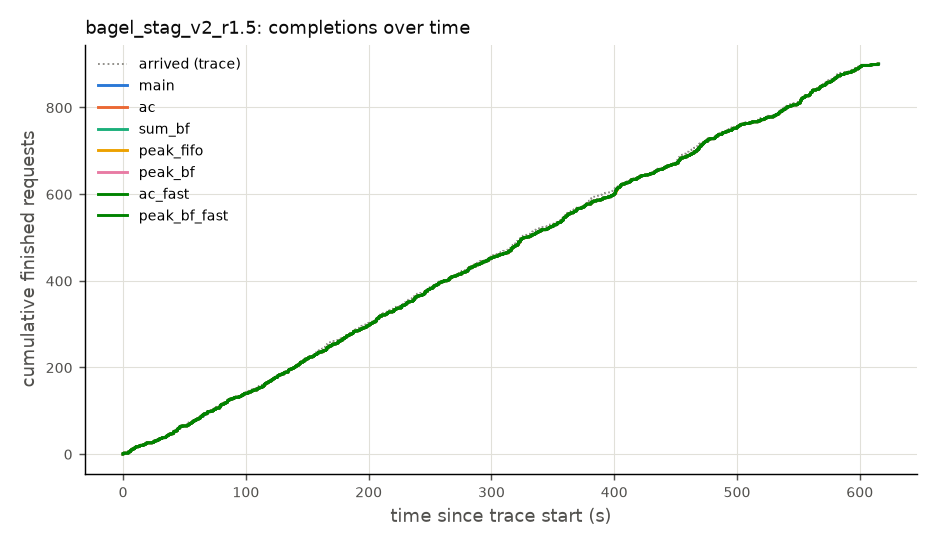
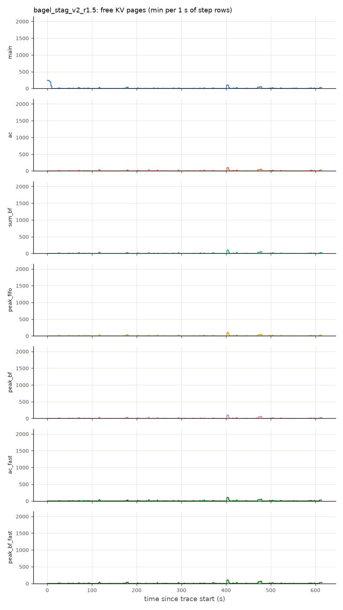
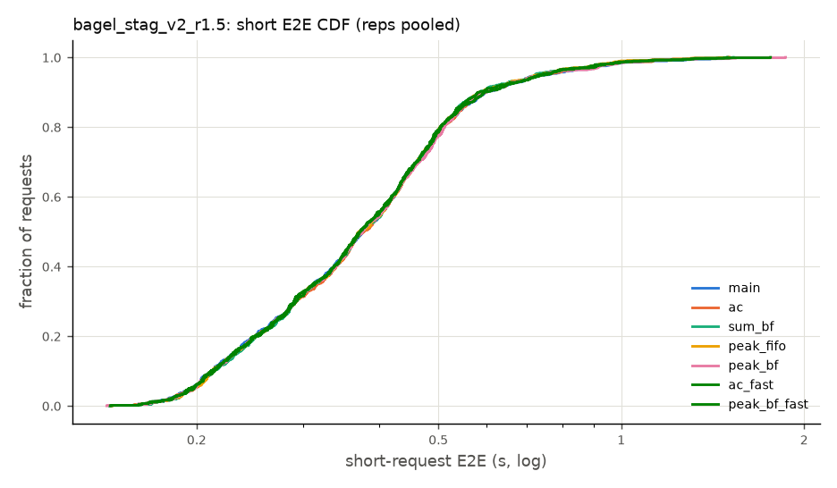
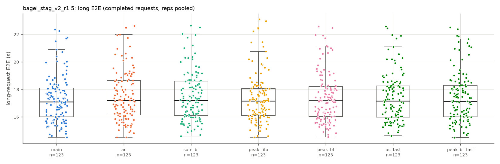

## bagel_stag_v2_r2.5

| config | n | flags | completed | failed | timed out | duration (s) | out tok/s | max stall (s) | short E2E mean (s) | short E2E p50 (s) | short E2E p99 (s) | short TTFT mean (s) | short TTFT p99 (s) | long E2E mean (s) | long E2E max (s) | long TTFT mean (s) | holds | fail: AllocationFailed | fail: GrantDeferred | grant_deferred (adm log) | min free KV pages | GPU busy | decode bs | planner_us p50 | planner_us p99 |
|---|---|---|---|---|---|---|---|---|---|---|---|---|---|---|---|---|---|---|---|---|---|---|---|---|---|
| main | 1 | STALLED 1/1 | 1286 | 0 | 214 | 1147.2 | 256.8 | 584.5 | 245.24 | 325.72 | 595.81 | 235.465 | 579.272 | 208.5 | 598.1 | 163.15 | 271752 | 271752 | 0 | - | 0 | 30.7% | 11.2 | - | - |
| ac | 1 |  | 1500 | 0 | 0 | 615.8 | 874.6 | 7.7 | 0.75 | 0.51 | 6.43 | 0.292 | 5.488 | 23.7 | 38.2 | 0.71 | 0 | 0 | 0 | - | 0 | 97.1% | 9.4 | - | - |
| sum_bf | 1 |  | 1500 | 0 | 0 | 618.5 | 870.8 | 4.0 | 0.60 | 0.52 | 1.65 | 0.114 | 0.666 | 24.6 | 42.6 | 0.94 | 0 | 0 | 0 | 0 | 0 | 96.3% | 9.5 | 623.9 | 939.6 |
| peak_fifo | 1 |  | 1500 | 0 | 0 | 615.5 | 874.9 | 4.5 | 0.69 | 0.51 | 5.37 | 0.224 | 4.277 | 23.8 | 37.2 | 0.60 | 0 | 0 | 0 | 0 | 0 | 97.0% | 9.4 | 843.5 | 1495.1 |
| peak_bf | 1 |  | 1500 | 0 | 0 | 617.3 | 872.4 | 4.6 | 0.62 | 0.52 | 1.98 | 0.135 | 0.917 | 24.7 | 41.2 | 0.77 | 0 | 0 | 0 | 0 | 0 | 96.2% | 9.6 | 902.7 | 1484.9 |
| ac_fast | 1 |  | 1500 | 0 | 0 | 619.7 | 869.1 | 9.3 | 0.96 | 0.52 | 9.24 | 0.459 | 7.825 | 24.7 | 43.7 | 0.89 | 0 | 0 | 0 | - | 0 | 96.2% | 9.5 | - | - |
| peak_bf_fast | 1 |  | 1500 | 0 | 0 | 614.8 | 875.9 | 3.1 | 0.57 | 0.50 | 1.59 | 0.116 | 0.689 | 23.2 | 34.0 | 0.56 | 0 | 0 | 0 | - | 0 | 97.4% | 9.3 | - | - |
| *main / ac* |  |  |  |  |  |  | 0.29 |  | 326.32 |  |  |  |  | 8.82 |  |  |  |  |  |  |  |  |  |  |  |
| *peak_bf / ac* |  |  |  |  |  |  | 1.00 |  | 0.82 |  |  |  |  | 1.04 |  |  |  |  |  |  |  |  |  |  |  |
| *sum_bf / ac* |  |  |  |  |  |  | 1.00 |  | 0.79 |  |  |  |  | 1.04 |  |  |  |  |  |  |  |  |  |  |  |
| *peak_fifo / ac* |  |  |  |  |  |  | 1.00 |  | 0.92 |  |  |  |  | 1.01 |  |  |  |  |  |  |  |  |  |  |  |
| *peak_bf_fast / ac* |  |  |  |  |  |  | 1.00 |  | 0.76 |  |  |  |  | 0.98 |  |  |  |  |  |  |  |  |  |  |  |
| *ac_fast / ac* |  |  |  |  |  |  | 0.99 |  | 1.28 |  |  |  |  | 1.04 |  |  |  |  |  |  |  |  |  |  |  |
| *ac / main* |  |  |  |  |  |  | 3.41 |  | 0.00 |  |  |  |  | 0.11 |  |  |  |  |  |  |  |  |  |  |  |
| *peak_bf / main* |  |  |  |  |  |  | 3.40 |  | 0.00 |  |  |  |  | 0.12 |  |  |  |  |  |  |  |  |  |  |  |
| *sum_bf / main* |  |  |  |  |  |  | 3.39 |  | 0.00 |  |  |  |  | 0.12 |  |  |  |  |  |  |  |  |  |  |  |
| *peak_fifo / main* |  |  |  |  |  |  | 3.41 |  | 0.00 |  |  |  |  | 0.11 |  |  |  |  |  |  |  |  |  |  |  |
| *peak_bf_fast / main* |  |  |  |  |  |  | 3.41 |  | 0.00 |  |  |  |  | 0.11 |  |  |  |  |  |  |  |  |  |  |  |
| *ac_fast / main* |  |  |  |  |  |  | 3.38 |  | 0.00 |  |  |  |  | 0.12 |  |  |  |  |  |  |  |  |  |  |  |

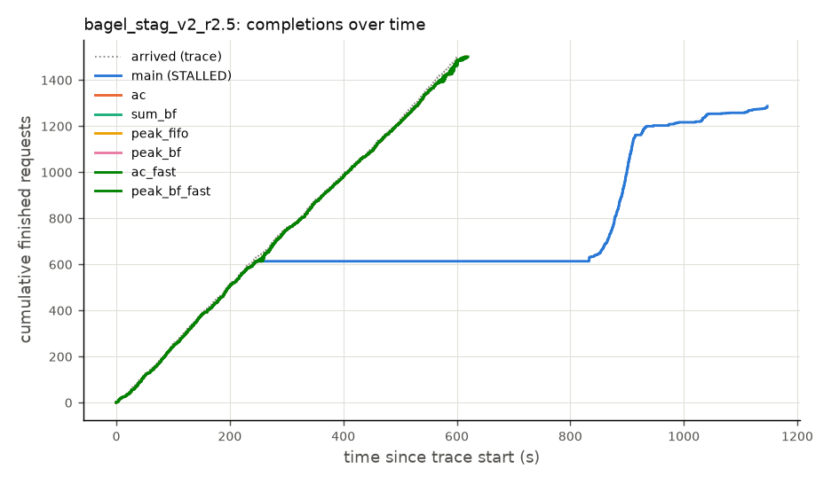
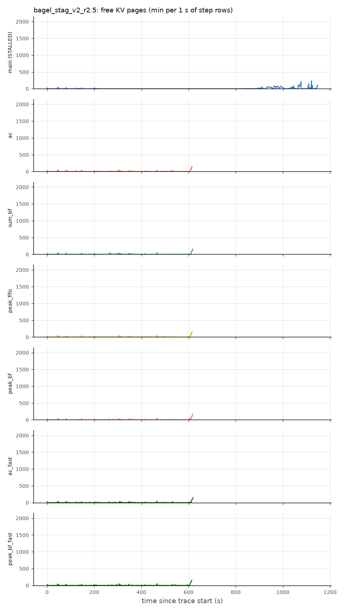
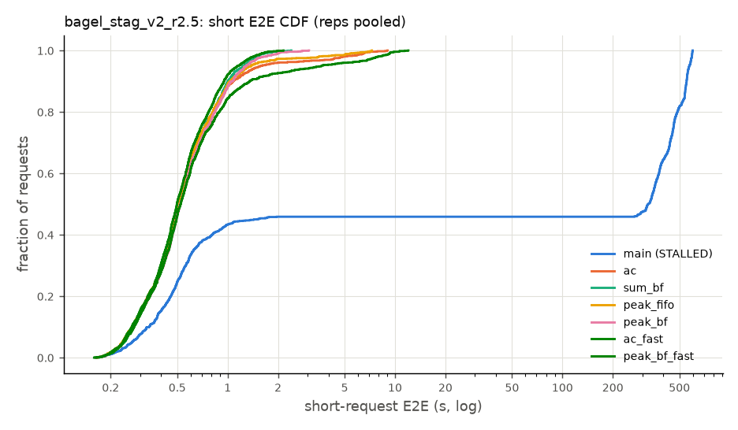
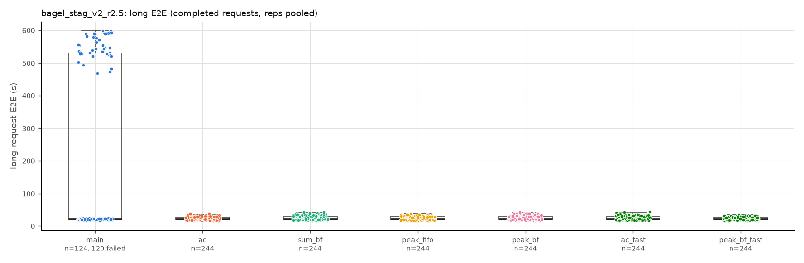

## bagel_stag_v2_r3

| config | n | flags | completed | failed | timed out | duration (s) | out tok/s | max stall (s) | short E2E mean (s) | short E2E p50 (s) | short E2E p99 (s) | short TTFT mean (s) | short TTFT p99 (s) | long E2E mean (s) | long E2E max (s) | long TTFT mean (s) | holds | fail: AllocationFailed | fail: GrantDeferred | grant_deferred (adm log) | min free KV pages | GPU busy | decode bs | planner_us p50 | planner_us p99 |
|---|---|---|---|---|---|---|---|---|---|---|---|---|---|---|---|---|---|---|---|---|---|---|---|---|---|
| main | 1 | STALLED 1/1 | 1324 | 0 | 476 | 1120.5 | 197.6 | 592.0 | 318.08 | 359.78 | 595.10 | 293.776 | 581.944 | 300.8 | 598.1 | 250.65 | 243944 | 243944 | 0 | - | 0 | 22.2% | 15.8 | - | - |
| ac | 1 |  | 1800 | 0 | 0 | 618.5 | 1051.2 | 11.6 | 5.22 | 1.44 | 18.30 | 4.492 | 17.216 | 35.0 | 55.3 | 5.06 | 0 | 0 | 0 | - | 0 | 94.1% | 14.8 | - | - |
| sum_bf | 1 |  | 1800 | 0 | 0 | 618.8 | 1050.6 | 3.9 | 1.20 | 0.79 | 6.49 | 0.534 | 5.621 | 38.8 | 62.2 | 7.74 | 0 | 0 | 0 | 0 | 0 | 92.8% | 15.3 | 216.0 | 936.3 |
| peak_fifo | 1 |  | 1800 | 0 | 0 | 618.5 | 1051.2 | 12.6 | 5.68 | 1.41 | 21.55 | 4.828 | 19.925 | 37.5 | 60.8 | 5.42 | 0 | 0 | 0 | 0 | 0 | 91.8% | 15.7 | 574.4 | 1952.0 |
| peak_bf | 1 |  | 1800 | 0 | 0 | 618.6 | 1050.9 | 3.5 | 0.89 | 0.74 | 3.38 | 0.232 | 2.415 | 37.4 | 60.2 | 6.10 | 0 | 0 | 0 | 0 | 0 | 92.7% | 15.2 | 665.4 | 1531.4 |
| ac_fast | 1 |  | 1800 | 0 | 0 | 740.4 | 878.1 | 21.0 | 41.21 | 18.81 | 123.89 | 40.009 | 122.329 | 78.1 | 178.5 | 36.76 | 0 | 0 | 0 | - | 0 | 76.7% | 17.0 | - | - |
| peak_bf_fast | 1 |  | 1800 | 0 | 0 | 618.3 | 1051.5 | 3.9 | 0.76 | 0.64 | 2.76 | 0.190 | 1.772 | 30.3 | 54.6 | 2.14 | 0 | 0 | 0 | - | 0 | 96.4% | 13.6 | - | - |
| *main / ac* |  |  |  |  |  |  | 0.19 |  | 60.88 |  |  |  |  | 8.60 |  |  |  |  |  |  |  |  |  |  |  |
| *peak_bf / ac* |  |  |  |  |  |  | 1.00 |  | 0.17 |  |  |  |  | 1.07 |  |  |  |  |  |  |  |  |  |  |  |
| *sum_bf / ac* |  |  |  |  |  |  | 1.00 |  | 0.23 |  |  |  |  | 1.11 |  |  |  |  |  |  |  |  |  |  |  |
| *peak_fifo / ac* |  |  |  |  |  |  | 1.00 |  | 1.09 |  |  |  |  | 1.07 |  |  |  |  |  |  |  |  |  |  |  |
| *peak_bf_fast / ac* |  |  |  |  |  |  | 1.00 |  | 0.15 |  |  |  |  | 0.86 |  |  |  |  |  |  |  |  |  |  |  |
| *ac_fast / ac* |  |  |  |  |  |  | 0.84 |  | 7.89 |  |  |  |  | 2.23 |  |  |  |  |  |  |  |  |  |  |  |
| *ac / main* |  |  |  |  |  |  | 5.32 |  | 0.02 |  |  |  |  | 0.12 |  |  |  |  |  |  |  |  |  |  |  |
| *peak_bf / main* |  |  |  |  |  |  | 5.32 |  | 0.00 |  |  |  |  | 0.12 |  |  |  |  |  |  |  |  |  |  |  |
| *sum_bf / main* |  |  |  |  |  |  | 5.32 |  | 0.00 |  |  |  |  | 0.13 |  |  |  |  |  |  |  |  |  |  |  |
| *peak_fifo / main* |  |  |  |  |  |  | 5.32 |  | 0.02 |  |  |  |  | 0.12 |  |  |  |  |  |  |  |  |  |  |  |
| *peak_bf_fast / main* |  |  |  |  |  |  | 5.32 |  | 0.00 |  |  |  |  | 0.10 |  |  |  |  |  |  |  |  |  |  |  |
| *ac_fast / main* |  |  |  |  |  |  | 4.44 |  | 0.13 |  |  |  |  | 0.26 |  |  |  |  |  |  |  |  |  |  |  |

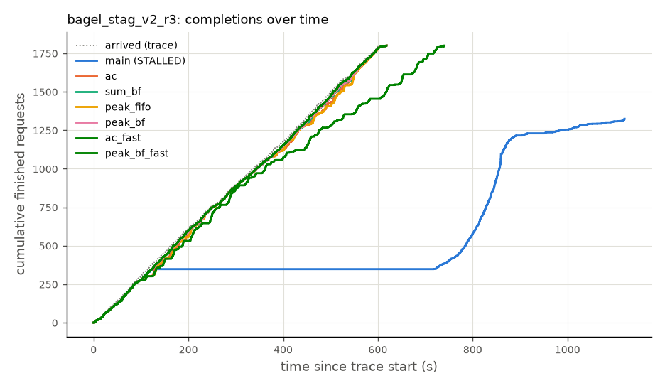
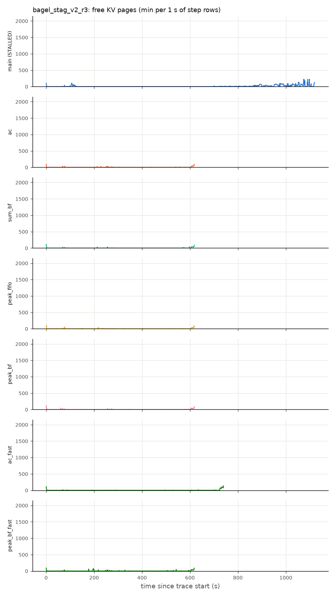
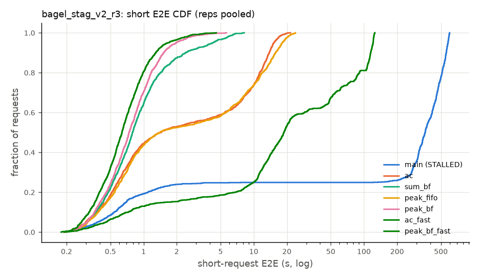
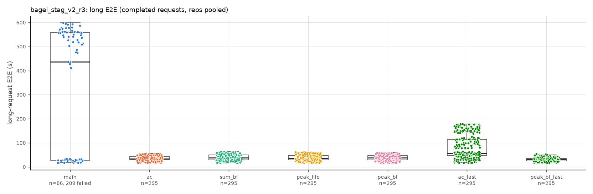

## Data problems

- `12935_main/bagel_burst_v2_r1` [STALLED]
  - server.log in the run window: 2968 line(s) with Traceback/OOM/fatal; first: Traceback (most recent call last):
  - STALLED: 1484 request(s) timed out; longest stretch without a completion while requests were outstanding 661.1s, starting at t=34.6s
- `12935_main/bagel_burst_v2_r2` [STALLED]
  - server.log in the run window: 3671 line(s) with Traceback/OOM/fatal; first: Traceback (most recent call last):
  - STALLED: 1835 request(s) timed out; longest stretch without a completion while requests were outstanding 775.5s, starting at t=36.8s
- `12951_peak_fifo/bagel_burst_v2_r2` [STALLED]
  - STALLED: 0 request(s) timed out; longest stretch without a completion while requests were outstanding 76.0s, starting at t=35.7s
- `12953_ac_fast/bagel_burst_v2_r2` [STALLED]
  - STALLED: 0 request(s) timed out; longest stretch without a completion while requests were outstanding 102.2s, starting at t=35.7s
- `12935_main/bagel_stag_v2_r2.5_r1` [STALLED]
  - server.log in the run window: 428 line(s) with Traceback/OOM/fatal; first: Traceback (most recent call last):
  - STALLED: 214 request(s) timed out; longest stretch without a completion while requests were outstanding 584.5s, starting at t=248.5s
- `12935_main/bagel_stag_v2_r3_r1` [STALLED]
  - server.log in the run window: 952 line(s) with Traceback/OOM/fatal; first: Traceback (most recent call last):
  - STALLED: 476 request(s) timed out; longest stretch without a completion while requests were outstanding 592.0s, starting at t=126.1s
