# mstar KV-admission A/B (BAGEL text-to-text)

Each config row is the mean over its reps (`n` = reps found; a metric a rep lacks is left out of that mean, `-` = no rep has it). Times in seconds from the client's bench.json; completed-request latencies only (a failed or timed-out request has no latency, so long E2E is optimistic where `timed out` > 0). Short/long = bench `cls`. Percentiles are per rep, then averaged.

- **STALLED**: a request timed out, or no request completed for > 60 s while one was outstanding (`max stall`; a timed-out request counts as outstanding until its timeout).
- **TRUNCATED**: a completed request returned fewer output tokens than the trace asked for (`output_lens` < `intended_output_lens`; BAGEL's decode loop stops at 2,049 tokens), so the run's KV pressure is below the workload's plan; `truncated` in summary.json counts them.
- *timed out* = failed with the client's empty-message error (`request failed`) or a timeout message; *failed* = every other error.
- holds / fail: / min free KV pages / GPU busy / decode bs come from step telemetry in the run's window (trace start to last request end + 5 s; the server's telemetry is shared by the runs it serves). GPU busy = sum of step `gpu_ms` / (trace start to last request end). decode bs = mean `bs` of ok `decode` steps. fail: columns count `admit_fail` events by `reason`.
- grant_deferred (adm log), planner_us: admission log, bench-peak configs only (`-` for main/ac).
- KV free lag: per request, ms from its decode `loop_stop` to its pages being back (its first `kv_release`, sent under MSTAR_KV_RELEASE_AT_COMPLETION=1, or `remove_done`); p50/p99 per rep, then averaged. kv_release = how many `kv_release` events the run has (0 when S8 is off).
- Ratio rows `X / ref` = X's mean divided by the reference's mean (E2E < 1 and tok/s > 1 favour X). **≈ (within noise)**: X's and the reference's [min–max] rep ranges of that metric overlap, so the spread between reps alone could give the difference (a min–max overlap, not a significance test; no mark means the ranges are apart, which with few reps is weak evidence). **(1 rep)**: either side has one rep, so the ranges are points.
- `reps` tables: per config, `mean [min–max]` over the reps (`n` = reps found; `(n=k)` = only k reps have that metric; one rep shows the mean alone). **host ms/step** = median over decode steps in the run window of (next step's tm - this step's tm) x 1000 - this step's gpu_ms, 0 < host < 500, split by the waiting depth at the step: requests with a `new_request` event whose handle has not yet appeared in a step's rids (`all` = every depth). A depth bin with fewer than 30 steps shows `-`.
- Cases dropped by `--exclude` and `warmup_*` dirs (the sbatch's warmup replay) are not in any table.

## bagel_burst_v2

| config | n | flags | completed | failed | timed out | duration (s) | out tok/s | max stall (s) | short E2E mean (s) | short E2E p50 (s) | short E2E p99 (s) | short TTFT mean (s) | short TTFT p99 (s) | long E2E mean (s) | long E2E max (s) | long TTFT mean (s) | holds | fail: AllocationFailed | fail: GrantDeferred | grant_deferred (adm log) | min free KV pages | GPU busy | decode bs | planner_us p50 | planner_us p99 | KV free lag p50 (ms) | KV free lag p99 (ms) | kv_release |
|---|---|---|---|---|---|---|---|---|---|---|---|---|---|---|---|---|---|---|---|---|---|---|---|---|---|---|---|---|
| main | 3 | STALLED 3/3 | 956 | 0 | 1744 | 839.2 | 43.9 | 737.2 | 422.32 | 553.21 | 598.56 | 388.708 | 570.732 | - | - | - | 120322 | 120322 | 0 | - | 0 | 7.6% | 11.3 | - | - | 60.7 | 633.4 | 0 |
| ac | 3 | STALLED 1/3 | 2700 | 0 | 0 | 305.1 | 647.5 | 57.0 | 15.90 | 0.62 | 73.14 | 12.754 | 61.390 | 93.4 | 150.2 | 23.98 | 0 | 0 | 0 | 0 | 0 | 75.2% | 9.0 | 184.2 | 2190.2 | 22.8 | 819.8 | 0 |
| ac_park | 3 |  | 2700 | 0 | 0 | 305.1 | 647.6 | 44.5 | 10.60 | 0.54 | 59.67 | 7.852 | 48.753 | 77.8 | 129.3 | 19.56 | 0 | 0 | 0 | 0 | 0 | 79.8% | 8.2 | 116.2 | 2100.3 | 18.9 | 567.2 | 0 |
| peak_bf | 3 |  | 2700 | 0 | 0 | 305.1 | 647.5 | 5.4 | 0.88 | 0.49 | 7.14 | 0.211 | 3.913 | 79.0 | 103.5 | 25.28 | 0 | 0 | 0 | 0 | 0 | 83.2% | 7.4 | 391.3 | 1956.8 | 15.4 | 397.8 | 0 |
| peak_bf_pc | 3 |  | 2700 | 0 | 0 | 305.1 | 647.5 | 5.3 | 0.86 | 0.49 | 6.79 | 0.199 | 3.858 | 78.0 | 102.3 | 25.00 | 0 | 0 | 0 | 0 | 0 | 83.7% | 7.4 | 347.5 | 1840.1 | 15.4 | 311.3 | 0 |
| peak_bf_pc_park | 3 |  | 2700 | 0 | 0 | 305.1 | 647.6 | 4.8 | 0.82 | 0.48 | 6.47 | 0.190 | 3.820 | 75.4 | 99.1 | 24.25 | 0 | 0 | 0 | 0 | 0 | 84.5% | 7.3 | 347.5 | 1640.3 | 15.2 | 493.6 | 0 |
| peak_bf_all | 3 |  | 2700 | 0 | 0 | 305.1 | 647.6 | 5.9 | 0.88 | 0.49 | 7.34 | 0.219 | 4.021 | 77.3 | 101.6 | 24.98 | 0.3 | 0 | 0.3 | 0.7 | 0 | 84.0% | 7.4 | 356.4 | 1792.5 | 9.3 | 144.8 | 2700 |
| *ac_park / ac* |  |  |  |  |  |  | 1.00 ≈ (within noise) |  | 0.67 |  |  |  |  | 0.83 |  |  |  |  |  |  |  |  |  |  |  |  |  |  |
| *peak_bf / ac* |  |  |  |  |  |  | 1.00 ≈ (within noise) |  | 0.06 |  |  |  |  | 0.85 |  |  |  |  |  |  |  |  |  |  |  |  |  |  |
| *peak_bf_pc / ac* |  |  |  |  |  |  | 1.00 ≈ (within noise) |  | 0.05 |  |  |  |  | 0.84 |  |  |  |  |  |  |  |  |  |  |  |  |  |  |
| *peak_bf_pc_park / ac* |  |  |  |  |  |  | 1.00 ≈ (within noise) |  | 0.05 |  |  |  |  | 0.81 |  |  |  |  |  |  |  |  |  |  |  |  |  |  |
| *peak_bf_all / ac* |  |  |  |  |  |  | 1.00 ≈ (within noise) |  | 0.06 |  |  |  |  | 0.83 |  |  |  |  |  |  |  |  |  |  |  |  |  |  |
| *main / ac* |  |  |  |  |  |  | 0.07 |  | 26.57 |  |  |  |  | - |  |  |  |  |  |  |  |  |  |  |  |  |  |  |
| *ac / main* |  |  |  |  |  |  | 14.76 |  | 0.04 |  |  |  |  | - |  |  |  |  |  |  |  |  |  |  |  |  |  |  |
| *ac_park / main* |  |  |  |  |  |  | 14.76 |  | 0.03 |  |  |  |  | - |  |  |  |  |  |  |  |  |  |  |  |  |  |  |
| *peak_bf / main* |  |  |  |  |  |  | 14.76 |  | 0.00 |  |  |  |  | - |  |  |  |  |  |  |  |  |  |  |  |  |  |  |
| *peak_bf_pc / main* |  |  |  |  |  |  | 14.76 |  | 0.00 |  |  |  |  | - |  |  |  |  |  |  |  |  |  |  |  |  |  |  |
| *peak_bf_pc_park / main* |  |  |  |  |  |  | 14.76 |  | 0.00 |  |  |  |  | - |  |  |  |  |  |  |  |  |  |  |  |  |  |  |
| *peak_bf_all / main* |  |  |  |  |  |  | 14.76 |  | 0.00 |  |  |  |  | - |  |  |  |  |  |  |  |  |  |  |  |  |  |  |

**reps: mean [min–max]**

| config | n | short E2E mean (s) | short E2E p50 (s) | short E2E p99 (s) | short TTFT p99 (s) | long E2E mean (s) | out tok/s | host ms/step all | host ms/step [0,50) | host ms/step [50,200) | host ms/step [200,400) | host ms/step [400,inf) |
|---|---|---|---|---|---|---|---|---|---|---|---|---|
| main | 3 | 422.32 [416.80–425.82] | 553.21 [548.14–560.68] | 598.56 [596.62–599.54] | 570.732 [553.250–580.986] | - | 43.9 [42.5–44.9] | 0.49 [0.46–0.55] | 0.49 [0.46–0.55] | - | - | - |
| ac | 3 | 15.90 [13.39–17.91] | 0.62 [0.57–0.67] | 73.14 [68.58–78.21] | 61.390 [57.739–66.463] | 93.4 [87.6–99.3] | 647.5 [647.5–647.6] | 0.73 [0.72–0.74] | 0.46 [0.45–0.47] | 10.80 [10.14–11.77] | 17.83 [15.50–20.09] | 24.10 [20.43–28.42] |
| ac_park | 3 | 10.60 [9.95–11.57] | 0.54 [0.53–0.56] | 59.67 [57.49–61.33] | 48.753 [47.953–49.463] | 77.8 [76.0–80.2] | 647.6 [647.5–647.6] | 0.68 [0.65–0.70] | 0.47 [0.45–0.49] | 8.57 [8.35–8.85] | 11.67 [11.52–11.79] | 13.04 [12.50–14.04] |
| peak_bf | 3 | 0.88 [0.85–0.92] | 0.49 [0.48–0.50] | 7.14 [6.78–7.61] | 3.913 [3.754–4.012] | 79.0 [77.5–81.2] | 647.5 [647.5–647.5] | 0.59 [0.55–0.64] | 0.59 [0.55–0.64] | - | - | - |
| peak_bf_pc | 3 | 0.86 [0.84–0.88] | 0.49 [0.49–0.49] | 6.79 [6.19–7.37] | 3.858 [3.430–4.129] | 78.0 [77.7–78.7] | 647.5 [647.5–647.6] | 0.59 [0.58–0.59] | 0.59 [0.58–0.59] | - | - | - |
| peak_bf_pc_park | 3 | 0.82 [0.77–0.85] | 0.48 [0.48–0.49] | 6.47 [6.07–6.84] | 3.820 [3.460–4.141] | 75.4 [73.1–76.6] | 647.6 [647.6–647.6] | 0.57 [0.55–0.58] | 0.57 [0.55–0.58] | - | - | - |
| peak_bf_all | 3 | 0.88 [0.78–0.96] | 0.49 [0.48–0.50] | 7.34 [6.09–8.13] | 4.021 [3.178–4.482] | 77.3 [73.6–81.3] | 647.6 [647.5–647.6] | 0.60 [0.57–0.64] | 0.60 [0.57–0.64] | - | - | - |

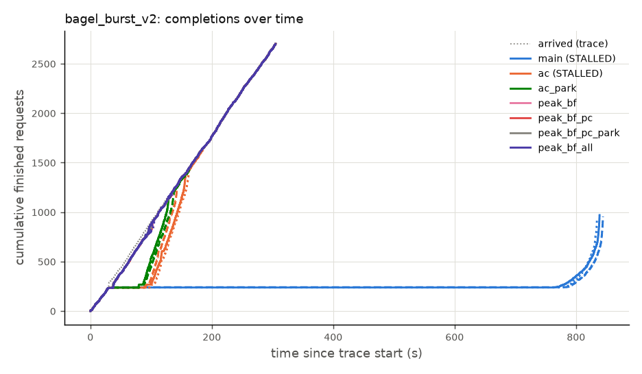
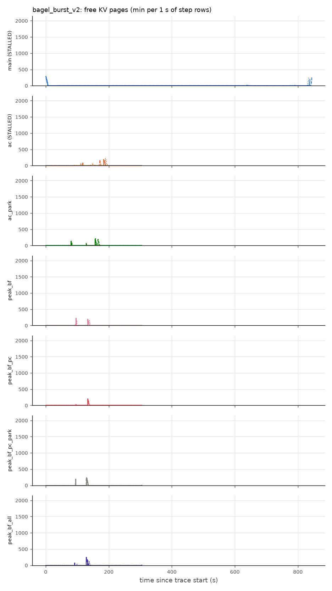
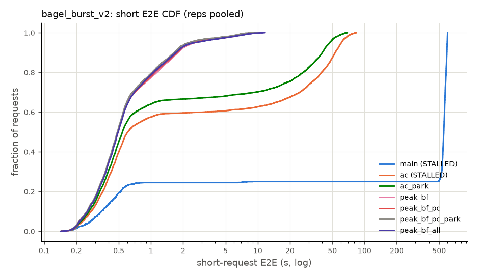
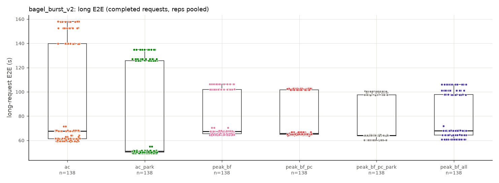

## bagel_stag_v2_r3

| config | n | flags | completed | failed | timed out | duration (s) | out tok/s | max stall (s) | short E2E mean (s) | short E2E p50 (s) | short E2E p99 (s) | short TTFT mean (s) | short TTFT p99 (s) | long E2E mean (s) | long E2E max (s) | long TTFT mean (s) | holds | fail: AllocationFailed | fail: GrantDeferred | grant_deferred (adm log) | min free KV pages | GPU busy | decode bs | planner_us p50 | planner_us p99 | KV free lag p50 (ms) | KV free lag p99 (ms) | kv_release |
|---|---|---|---|---|---|---|---|---|---|---|---|---|---|---|---|---|---|---|---|---|---|---|---|---|---|---|---|---|
| main | 3 | STALLED 3/3 | 1279.7 | 0 | 520.3 | 1121.7 | 183.4 | 585.0 | 311.94 | 350.36 | 593.25 | 285.650 | 576.888 | 277.1 | 599.5 | 220.13 | 247075.3 | 247075.3 | 0 | - | 0 | 20.8% | 15.5 | - | - | 58.9 | 564.8 | 0 |
| ac | 3 |  | 1800 | 0 | 0 | 618.8 | 1050.6 | 11.6 | 6.57 | 2.88 | 21.39 | 5.767 | 20.281 | 37.3 | 60.6 | 6.23 | 0 | 0 | 0 | 0 | 0 | 92.8% | 15.4 | 157.4 | 393.4 | 22.8 | 548.0 | 0 |
| ac_park | 3 |  | 1800 | 0 | 0 | 618.7 | 1050.8 | 10.9 | 4.89 | 1.38 | 17.46 | 4.152 | 16.202 | 34.4 | 55.1 | 4.74 | 0 | 0 | 0 | 0 | 0 | 94.3% | 14.6 | 150.3 | 367.8 | 21.7 | 532.1 | 0 |
| peak_bf | 3 |  | 1800 | 0 | 0 | 618.5 | 1051.2 | 3.6 | 0.83 | 0.68 | 3.79 | 0.226 | 2.650 | 32.0 | 56.0 | 2.88 | 0 | 0 | 0 | 0 | 0 | 95.1% | 14.1 | 514.9 | 1130.7 | 20.1 | 508.4 | 0 |
| peak_bf_pc | 3 |  | 1800 | 0 | 0 | 618.6 | 1051.0 | 3.5 | 0.80 | 0.67 | 2.69 | 0.194 | 1.753 | 31.9 | 55.7 | 2.79 | 0.3 | 0 | 0.3 | 0.7 | 0 | 95.4% | 14.1 | 422.5 | 954.5 | 20.0 | 524.5 | 0 |
| peak_bf_pc_park | 3 |  | 1800 | 0 | 0 | 618.6 | 1051.1 | 3.5 | 0.81 | 0.66 | 3.98 | 0.210 | 2.767 | 31.4 | 56.1 | 2.53 | 0.3 | 0 | 0.3 | 1 | 0 | 96.0% | 13.9 | 422.7 | 932.9 | 19.5 | 525.8 | 0 |
| peak_bf_all | 3 |  | 1800 | 0 | 0 | 618.6 | 1051.0 | 3.5 | 0.83 | 0.70 | 2.92 | 0.203 | 1.975 | 33.2 | 56.9 | 3.27 | 0 | 0 | 0 | 0 | 0 | 94.8% | 14.5 | 437.8 | 994.9 | 17.9 | 212.8 | 1800 |
| *ac_park / ac* |  |  |  |  |  |  | 1.00 ≈ (within noise) |  | 0.74 |  |  |  |  | 0.92 |  |  |  |  |  |  |  |  |  |  |  |  |  |  |
| *peak_bf / ac* |  |  |  |  |  |  | 1.00 ≈ (within noise) |  | 0.13 |  |  |  |  | 0.86 |  |  |  |  |  |  |  |  |  |  |  |  |  |  |
| *peak_bf_pc / ac* |  |  |  |  |  |  | 1.00 ≈ (within noise) |  | 0.12 |  |  |  |  | 0.85 |  |  |  |  |  |  |  |  |  |  |  |  |  |  |
| *peak_bf_pc_park / ac* |  |  |  |  |  |  | 1.00 ≈ (within noise) |  | 0.12 |  |  |  |  | 0.84 |  |  |  |  |  |  |  |  |  |  |  |  |  |  |
| *peak_bf_all / ac* |  |  |  |  |  |  | 1.00 ≈ (within noise) |  | 0.13 |  |  |  |  | 0.89 |  |  |  |  |  |  |  |  |  |  |  |  |  |  |
| *main / ac* |  |  |  |  |  |  | 0.17 |  | 47.51 |  |  |  |  | 7.43 |  |  |  |  |  |  |  |  |  |  |  |  |  |  |
| *ac / main* |  |  |  |  |  |  | 5.73 |  | 0.02 |  |  |  |  | 0.13 |  |  |  |  |  |  |  |  |  |  |  |  |  |  |
| *ac_park / main* |  |  |  |  |  |  | 5.73 |  | 0.02 |  |  |  |  | 0.12 |  |  |  |  |  |  |  |  |  |  |  |  |  |  |
| *peak_bf / main* |  |  |  |  |  |  | 5.73 |  | 0.00 |  |  |  |  | 0.12 |  |  |  |  |  |  |  |  |  |  |  |  |  |  |
| *peak_bf_pc / main* |  |  |  |  |  |  | 5.73 |  | 0.00 |  |  |  |  | 0.12 |  |  |  |  |  |  |  |  |  |  |  |  |  |  |
| *peak_bf_pc_park / main* |  |  |  |  |  |  | 5.73 |  | 0.00 |  |  |  |  | 0.11 |  |  |  |  |  |  |  |  |  |  |  |  |  |  |
| *peak_bf_all / main* |  |  |  |  |  |  | 5.73 |  | 0.00 |  |  |  |  | 0.12 |  |  |  |  |  |  |  |  |  |  |  |  |  |  |

**reps: mean [min–max]**

| config | n | short E2E mean (s) | short E2E p50 (s) | short E2E p99 (s) | short TTFT p99 (s) | long E2E mean (s) | out tok/s | host ms/step all | host ms/step [0,50) | host ms/step [50,200) | host ms/step [200,400) | host ms/step [400,inf) |
|---|---|---|---|---|---|---|---|---|---|---|---|---|
| main | 3 | 311.94 [310.84–313.25] | 350.36 [346.63–356.67] | 593.25 [592.27–593.75] | 576.888 [573.063–581.521] | 277.1 [268.5–287.3] | 183.4 [178.8–191.5] | 1.02 [0.92–1.21] | 1.02 [0.92–1.21] | - | - | - |
| ac | 3 | 6.57 [5.91–6.93] | 2.88 [1.71–3.50] | 21.39 [19.32–22.55] | 20.281 [18.137–21.538] | 37.3 [36.1–38.0] | 1050.6 [1050.1–1051.4] | 1.01 [0.94–1.06] | 0.92 [0.90–0.94] | 2.38 [2.00–2.59] | - | - |
| ac_park | 3 | 4.89 [4.58–5.34] | 1.38 [1.13–1.53] | 17.46 [16.76–18.61] | 16.202 [15.408–17.415] | 34.4 [33.7–35.5] | 1050.8 [1049.9–1051.6] | 0.82 [0.77–0.90] | 0.81 [0.77–0.88] | 1.43 [1.05–2.15] | - | - |
| peak_bf | 3 | 0.83 [0.77–0.87] | 0.68 [0.66–0.70] | 3.79 [2.58–4.83] | 2.650 [1.294–3.637] | 32.0 [31.6–32.8] | 1051.2 [1050.7–1051.6] | 0.71 [0.67–0.79] | 0.71 [0.67–0.79] | - | - | - |
| peak_bf_pc | 3 | 0.80 [0.76–0.82] | 0.67 [0.65–0.69] | 2.69 [2.50–2.95] | 1.753 [1.406–2.141] | 31.9 [30.9–33.4] | 1051.0 [1050.2–1051.4] | 0.72 [0.64–0.84] | 0.72 [0.64–0.84] | - | - | - |
| peak_bf_pc_park | 3 | 0.81 [0.77–0.84] | 0.66 [0.66–0.66] | 3.98 [2.35–4.90] | 2.767 [1.199–3.764] | 31.4 [31.0–31.9] | 1051.1 [1050.1–1051.6] | 0.65 [0.63–0.67] | 0.65 [0.63–0.67] | - | - | - |
| peak_bf_all | 3 | 0.83 [0.81–0.85] | 0.70 [0.70–0.71] | 2.92 [2.84–3.01] | 1.975 [1.625–2.233] | 33.2 [32.7–34.0] | 1051.0 [1050.1–1051.4] | 0.82 [0.74–0.88] | 0.82 [0.74–0.88] | - | - | - |

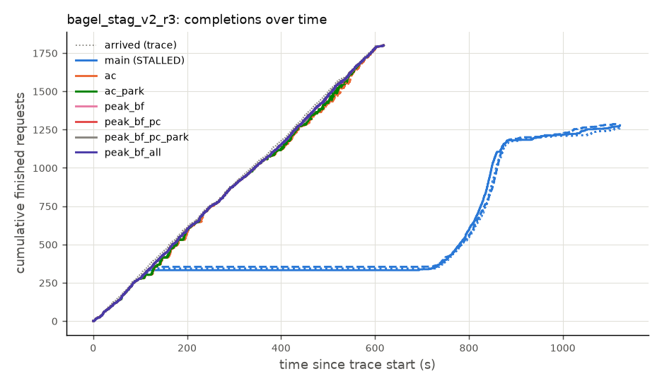
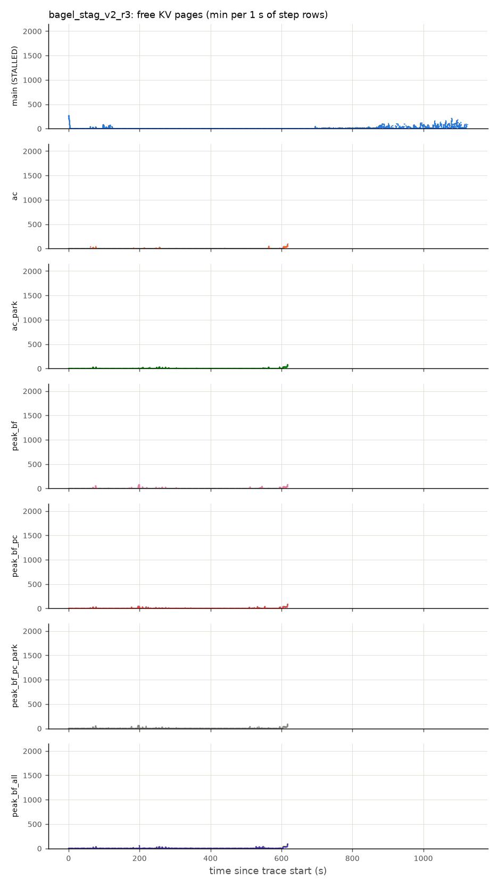
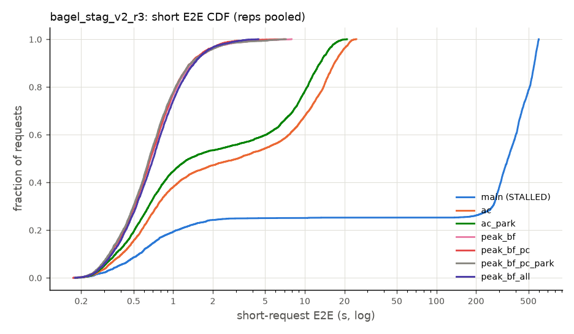
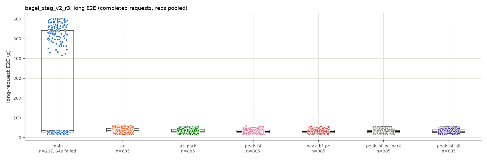

## bagel_burst_v3

| config | n | flags | completed | failed | timed out | duration (s) | out tok/s | max stall (s) | short E2E mean (s) | short E2E p50 (s) | short E2E p99 (s) | short TTFT mean (s) | short TTFT p99 (s) | long E2E mean (s) | long E2E max (s) | long TTFT mean (s) | holds | fail: AllocationFailed | fail: GrantDeferred | grant_deferred (adm log) | min free KV pages | GPU busy | decode bs | planner_us p50 | planner_us p99 | KV free lag p50 (ms) | KV free lag p99 (ms) | kv_release |
|---|---|---|---|---|---|---|---|---|---|---|---|---|---|---|---|---|---|---|---|---|---|---|---|---|---|---|---|---|
| main | 3 | STALLED 3/3 | 952.7 | 0 | 1747.3 | 840.6 | 43.9 | 732.6 | 414.40 | 554.22 | 598.90 | 385.521 | 572.600 | - | - | - | 116706 | 116706 | 0 | - | 0 | 7.8% | 12.1 | - | - | 62.0 | 468.0 | 0 |
| ac | 3 |  | 2700 | 0 | 0 | 305.2 | 633.7 | 9.3 | 12.13 | 0.57 | 48.79 | 9.333 | 43.120 | 79.8 | 135.4 | 7.49 | 0 | 0 | 0 | 0 | 0 | 72.7% | 8.6 | 200.2 | 2251.0 | 21.6 | 580.8 | 0 |
| ac_park | 3 |  | 2700 | 0 | 0 | 305.2 | 633.7 | 8.9 | 11.39 | 0.55 | 48.40 | 8.858 | 43.306 | 78.0 | 129.9 | 7.56 | 0 | 0 | 0 | 0 | 0 | 73.7% | 8.4 | 143.3 | 2225.3 | 20.0 | 739.8 | 0 |
| peak_bf | 3 |  | 2700 | 0 | 0 | 305.2 | 633.7 | 11.3 | 11.44 | 0.59 | 45.07 | 8.543 | 39.207 | 89.5 | 138.8 | 2.61 | 0 | 0 | 0 | 0 | 0 | 71.4% | 8.8 | 394.6 | 3598.5 | 23.1 | 473.4 | 0 |
| peak_bf_pc | 3 |  | 2700 | 0 | 0 | 305.2 | 633.7 | 10.4 | 10.60 | 0.56 | 43.88 | 7.983 | 38.196 | 84.5 | 130.7 | 2.53 | 45 | 0 | 45 | 85 | 0 | 72.9% | 8.5 | 329.7 | 2244.3 | 21.0 | 1230.8 | 0 |
| peak_bf_pc_park | 3 |  | 2700 | 0 | 0 | 305.2 | 633.7 | 11.3 | 9.32 | 0.53 | 42.92 | 7.132 | 37.909 | 81.4 | 122.6 | 2.80 | 1 | 0 | 1 | 2 | 0 | 74.8% | 8.2 | 321.5 | 2486.1 | 19.3 | 522.6 | 0 |
| peak_bf_all | 3 |  | 2700 | 0 | 0 | 305.2 | 633.7 | 11.6 | 10.11 | 0.55 | 43.80 | 7.672 | 38.165 | 83.5 | 128.0 | 2.76 | 0 | 0 | 0 | 0 | 0 | 73.5% | 8.4 | 339.5 | 2775.6 | 12.7 | 142.0 | 2700 |
| *ac_park / ac* |  |  |  |  |  |  | 1.00 ≈ (within noise) |  | 0.94 ≈ (within noise) |  |  |  |  | 0.98 ≈ (within noise) |  |  |  |  |  |  |  |  |  |  |  |  |  |  |
| *peak_bf / ac* |  |  |  |  |  |  | 1.00 ≈ (within noise) |  | 0.94 ≈ (within noise) |  |  |  |  | 1.12 |  |  |  |  |  |  |  |  |  |  |  |  |  |  |
| *peak_bf_pc / ac* |  |  |  |  |  |  | 1.00 ≈ (within noise) |  | 0.87 ≈ (within noise) |  |  |  |  | 1.06 ≈ (within noise) |  |  |  |  |  |  |  |  |  |  |  |  |  |  |
| *peak_bf_pc_park / ac* |  |  |  |  |  |  | 1.00 ≈ (within noise) |  | 0.77 ≈ (within noise) |  |  |  |  | 1.02 ≈ (within noise) |  |  |  |  |  |  |  |  |  |  |  |  |  |  |
| *peak_bf_all / ac* |  |  |  |  |  |  | 1.00 ≈ (within noise) |  | 0.83 ≈ (within noise) |  |  |  |  | 1.05 ≈ (within noise) |  |  |  |  |  |  |  |  |  |  |  |  |  |  |
| *main / ac* |  |  |  |  |  |  | 0.07 |  | 34.16 |  |  |  |  | - |  |  |  |  |  |  |  |  |  |  |  |  |  |  |
| *ac / main* |  |  |  |  |  |  | 14.44 |  | 0.03 |  |  |  |  | - |  |  |  |  |  |  |  |  |  |  |  |  |  |  |
| *ac_park / main* |  |  |  |  |  |  | 14.44 |  | 0.03 |  |  |  |  | - |  |  |  |  |  |  |  |  |  |  |  |  |  |  |
| *peak_bf / main* |  |  |  |  |  |  | 14.44 |  | 0.03 |  |  |  |  | - |  |  |  |  |  |  |  |  |  |  |  |  |  |  |
| *peak_bf_pc / main* |  |  |  |  |  |  | 14.44 |  | 0.03 |  |  |  |  | - |  |  |  |  |  |  |  |  |  |  |  |  |  |  |
| *peak_bf_pc_park / main* |  |  |  |  |  |  | 14.44 |  | 0.02 |  |  |  |  | - |  |  |  |  |  |  |  |  |  |  |  |  |  |  |
| *peak_bf_all / main* |  |  |  |  |  |  | 14.44 |  | 0.02 |  |  |  |  | - |  |  |  |  |  |  |  |  |  |  |  |  |  |  |

**reps: mean [min–max]**

| config | n | short E2E mean (s) | short E2E p50 (s) | short E2E p99 (s) | short TTFT p99 (s) | long E2E mean (s) | out tok/s | host ms/step all | host ms/step [0,50) | host ms/step [50,200) | host ms/step [200,400) | host ms/step [400,inf) |
|---|---|---|---|---|---|---|---|---|---|---|---|---|
| main | 3 | 414.40 [392.90–439.53] | 554.22 [539.90–561.71] | 598.90 [598.44–599.27] | 572.600 [567.203–575.397] | - | 43.9 [36.9–56.2] | 0.53 [0.50–0.55] | 0.50 [0.46–0.55] | 14.20 (n=1) | - | - |
| ac | 3 | 12.13 [9.39–13.74] | 0.57 [0.53–0.61] | 48.79 [43.48–52.01] | 43.120 [38.732–45.577] | 79.8 [72.3–84.5] | 633.7 [633.7–633.7] | 0.58 [0.55–0.60] | 0.42 [0.42–0.43] | 23.58 [22.27–25.85] | 26.47 [23.41–28.19] | 29.21 [24.84–33.58] (n=2) |
| ac_park | 3 | 11.39 [9.45–13.11] | 0.55 [0.52–0.60] | 48.40 [45.49–51.03] | 43.306 [41.348–45.151] | 78.0 [72.1–83.3] | 633.7 [633.7–633.7] | 0.56 [0.53–0.60] | 0.42 [0.41–0.43] | 25.04 [23.29–26.55] | 27.15 [24.97–29.23] | 32.26 (n=1) |
| peak_bf | 3 | 11.44 [10.68–11.85] | 0.59 [0.56–0.61] | 45.07 [44.29–46.48] | 39.207 [38.310–40.540] | 89.5 [87.7–90.8] | 633.7 [633.7–633.7] | 0.60 [0.57–0.62] | 0.44 [0.43–0.46] | 22.95 [22.33–23.46] | 25.89 [25.27–26.62] | - |
| peak_bf_pc | 3 | 10.60 [8.39–12.43] | 0.56 [0.52–0.61] | 43.88 [40.89–46.26] | 38.196 [34.983–41.326] | 84.5 [76.2–92.2] | 633.7 [633.7–633.7] | 0.60 [0.54–0.64] | 0.45 [0.43–0.47] | 21.53 [19.97–23.08] | 25.83 [23.99–27.45] | - |
| peak_bf_pc_park | 3 | 9.32 [8.99–9.52] | 0.53 [0.53–0.54] | 42.92 [41.25–43.78] | 37.909 [36.759–38.669] | 81.4 [80.4–82.4] | 633.7 [633.7–633.7] | 0.53 [0.52–0.55] | 0.42 [0.41–0.42] | 21.38 [20.78–21.73] | 24.52 [23.94–25.33] | - |
| peak_bf_all | 3 | 10.11 [8.40–11.65] | 0.55 [0.53–0.59] | 43.80 [41.26–45.18] | 38.165 [36.298–39.124] | 83.5 [77.6–89.2] | 633.7 [633.7–633.7] | 0.61 [0.58–0.64] | 0.45 [0.45–0.46] | 22.05 [21.96–22.12] | 25.01 [23.89–26.00] | - |

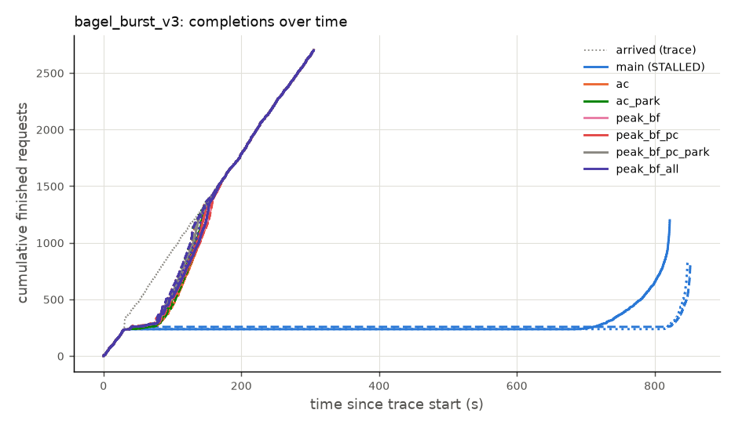
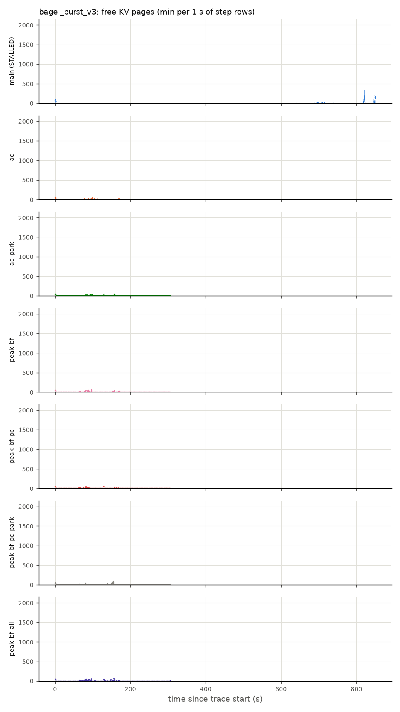
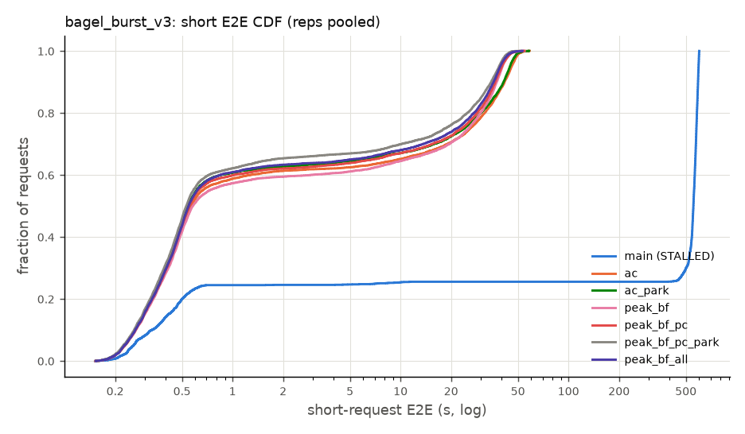
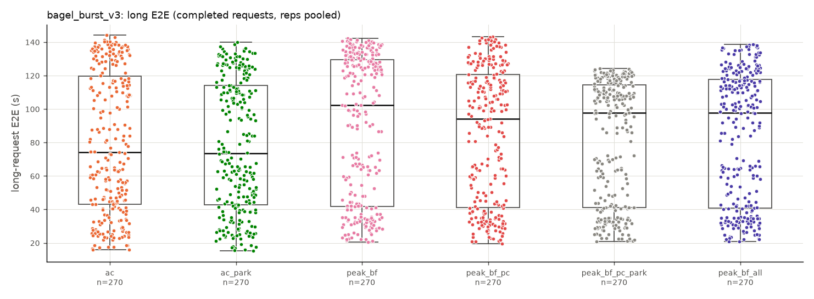

## bagel_stag_v3_r5.5

| config | n | flags | completed | failed | timed out | duration (s) | out tok/s | max stall (s) | short E2E mean (s) | short E2E p50 (s) | short E2E p99 (s) | short TTFT mean (s) | short TTFT p99 (s) | long E2E mean (s) | long E2E max (s) | long TTFT mean (s) | holds | fail: AllocationFailed | fail: GrantDeferred | grant_deferred (adm log) | min free KV pages | GPU busy | decode bs | planner_us p50 | planner_us p99 | KV free lag p50 (ms) | KV free lag p99 (ms) | kv_release |
|---|---|---|---|---|---|---|---|---|---|---|---|---|---|---|---|---|---|---|---|---|---|---|---|---|---|---|---|---|
| main | 3 | STALLED 2/3 | 2751 | 0 | 549 | 954.1 | 590.2 | 394.1 | 146.10 | 147.41 | 398.61 | 133.693 | 383.952 | 114.2 | 431.7 | 88.80 | 111540 | 111540 | 0 | - | 0 | 48.4% | 19.9 | - | - | 35.6 | 548.5 | 0 |
| ac | 3 |  | 3300 | 0 | 0 | 599.9 | 1101.4 | 4.2 | 1.62 | 0.87 | 8.76 | 0.838 | 7.347 | 22.7 | 56.7 | 1.11 | 0 | 0 | 0 | 0 | 0 | 86.1% | 18.3 | 191.7 | 487.4 | 23.8 | 454.3 | 0 |
| ac_park | 3 |  | 3300 | 0 | 0 | 599.6 | 1101.9 | 4.2 | 1.56 | 0.86 | 8.40 | 0.775 | 7.131 | 22.6 | 56.1 | 1.06 | 0 | 0 | 0 | 0 | 0 | 85.9% | 18.3 | 191.5 | 466.1 | 24.0 | 426.6 | 0 |
| peak_bf | 3 |  | 3300 | 0 | 0 | 599.7 | 1101.7 | 4.0 | 1.01 | 0.83 | 3.77 | 0.244 | 2.211 | 22.5 | 60.9 | 0.91 | 0 | 0 | 0 | 0 | 0 | 85.7% | 18.1 | 552.9 | 1335.6 | 24.2 | 402.3 | 0 |
| peak_bf_pc | 3 |  | 3300 | 0 | 0 | 599.8 | 1101.4 | 3.9 | 1.02 | 0.85 | 3.68 | 0.248 | 2.339 | 22.9 | 60.1 | 0.98 | 0.3 | 0 | 0.3 | 0.7 | 0 | 85.7% | 18.4 | 422.6 | 1115.6 | 25.5 | 418.0 | 0 |
| peak_bf_pc_park | 3 |  | 3300 | 0 | 0 | 599.4 | 1102.1 | 4.3 | 0.95 | 0.79 | 3.43 | 0.216 | 1.852 | 21.6 | 59.9 | 0.83 | 0.3 | 0 | 0.3 | 0.7 | 0 | 87.9% | 17.3 | 419.6 | 920.4 | 22.9 | 438.1 | 0 |
| peak_bf_all | 3 |  | 3300 | 0 | 0 | 599.7 | 1101.7 | 4.1 | 1.16 | 0.90 | 4.88 | 0.339 | 3.478 | 24.4 | 63.9 | 1.25 | 0 | 0 | 0 | 0 | 0 | 84.2% | 19.5 | 425.9 | 1133.8 | 21.1 | 150.4 | 3300 |
| *ac_park / ac* |  |  |  |  |  |  | 1.00 ≈ (within noise) |  | 0.96 ≈ (within noise) |  |  |  |  | 1.00 ≈ (within noise) |  |  |  |  |  |  |  |  |  |  |  |  |  |  |
| *peak_bf / ac* |  |  |  |  |  |  | 1.00 ≈ (within noise) |  | 0.62 |  |  |  |  | 0.99 ≈ (within noise) |  |  |  |  |  |  |  |  |  |  |  |  |  |  |
| *peak_bf_pc / ac* |  |  |  |  |  |  | 1.00 ≈ (within noise) |  | 0.63 |  |  |  |  | 1.01 ≈ (within noise) |  |  |  |  |  |  |  |  |  |  |  |  |  |  |
| *peak_bf_pc_park / ac* |  |  |  |  |  |  | 1.00 ≈ (within noise) |  | 0.59 |  |  |  |  | 0.95 ≈ (within noise) |  |  |  |  |  |  |  |  |  |  |  |  |  |  |
| *peak_bf_all / ac* |  |  |  |  |  |  | 1.00 ≈ (within noise) |  | 0.72 ≈ (within noise) |  |  |  |  | 1.08 ≈ (within noise) |  |  |  |  |  |  |  |  |  |  |  |  |  |  |
| *main / ac* |  |  |  |  |  |  | 0.54 ≈ (within noise) |  | 89.94 ≈ (within noise) |  |  |  |  | 5.04 ≈ (within noise) |  |  |  |  |  |  |  |  |  |  |  |  |  |  |
| *ac / main* |  |  |  |  |  |  | 1.87 ≈ (within noise) |  | 0.01 ≈ (within noise) |  |  |  |  | 0.20 ≈ (within noise) |  |  |  |  |  |  |  |  |  |  |  |  |  |  |
| *ac_park / main* |  |  |  |  |  |  | 1.87 |  | 0.01 ≈ (within noise) |  |  |  |  | 0.20 ≈ (within noise) |  |  |  |  |  |  |  |  |  |  |  |  |  |  |
| *peak_bf / main* |  |  |  |  |  |  | 1.87 ≈ (within noise) |  | 0.01 ≈ (within noise) |  |  |  |  | 0.20 ≈ (within noise) |  |  |  |  |  |  |  |  |  |  |  |  |  |  |
| *peak_bf_pc / main* |  |  |  |  |  |  | 1.87 ≈ (within noise) |  | 0.01 ≈ (within noise) |  |  |  |  | 0.20 ≈ (within noise) |  |  |  |  |  |  |  |  |  |  |  |  |  |  |
| *peak_bf_pc_park / main* |  |  |  |  |  |  | 1.87 |  | 0.01 ≈ (within noise) |  |  |  |  | 0.19 ≈ (within noise) |  |  |  |  |  |  |  |  |  |  |  |  |  |  |
| *peak_bf_all / main* |  |  |  |  |  |  | 1.87 ≈ (within noise) |  | 0.01 ≈ (within noise) |  |  |  |  | 0.21 ≈ (within noise) |  |  |  |  |  |  |  |  |  |  |  |  |  |  |

**reps: mean [min–max]**

| config | n | short E2E mean (s) | short E2E p50 (s) | short E2E p99 (s) | short TTFT p99 (s) | long E2E mean (s) | out tok/s | host ms/step all | host ms/step [0,50) | host ms/step [50,200) | host ms/step [200,400) | host ms/step [400,inf) |
|---|---|---|---|---|---|---|---|---|---|---|---|---|
| main | 3 | 146.10 [0.92–303.97] | 147.41 [0.76–440.42] | 398.61 [3.05–597.14] | 383.952 [1.672–575.589] | 114.2 [21.2–233.7] | 590.2 [205.9–1101.8] | 1.96 [1.48–2.67] | 1.96 [1.48–2.67] | - | - | - |
| ac | 3 | 1.62 [1.27–1.84] | 0.87 [0.80–0.90] | 8.76 [6.99–9.74] | 7.347 [5.666–8.456] | 22.7 [21.3–23.4] | 1101.4 [1100.9–1101.9] | 2.18 [1.88–2.33] | 2.17 [1.88–2.33] | 6.56 (n=1) | - | - |
| ac_park | 3 | 1.56 [1.23–2.15] | 0.86 [0.81–0.98] | 8.40 [6.49–11.70] | 7.131 [5.506–10.081] | 22.6 [21.3–25.2] | 1101.9 [1101.8–1102.0] | 2.28 [1.89–2.96] | 2.26 [1.89–2.91] | 7.49 (n=1) | - | - |
| peak_bf | 3 | 1.01 [0.95–1.12] | 0.83 [0.80–0.88] | 3.77 [3.24–4.71] | 2.211 [1.694–3.109] | 22.5 [22.0–23.7] | 1101.7 [1101.1–1102.2] | 2.22 [1.98–2.69] | 2.22 [1.98–2.69] | - | - | - |
| peak_bf_pc | 3 | 1.02 [0.90–1.22] | 0.85 [0.77–0.96] | 3.68 [2.88–4.79] | 2.339 [1.694–3.461] | 22.9 [20.9–25.6] | 1101.4 [1100.3–1102.2] | 2.34 [1.83–3.17] | 2.34 [1.83–3.17] | - | - | - |
| peak_bf_pc_park | 3 | 0.95 [0.90–1.02] | 0.79 [0.78–0.80] | 3.43 [2.88–4.19] | 1.852 [1.270–2.528] | 21.6 [21.0–22.0] | 1102.1 [1101.9–1102.3] | 1.85 [1.82–1.90] | 1.85 [1.82–1.90] | - | - | - |
| peak_bf_all | 3 | 1.16 [0.93–1.35] | 0.90 [0.80–0.97] | 4.88 [2.79–5.99] | 3.478 [1.430–4.607] | 24.4 [21.8–26.3] | 1101.7 [1101.4–1102.1] | 2.69 [1.95–3.22] | 2.69 [1.95–3.22] | - | - | - |

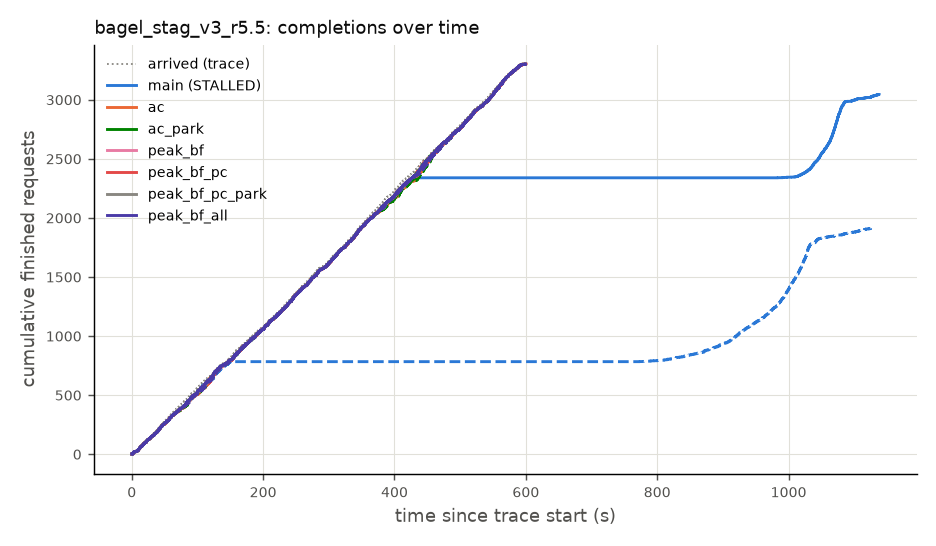
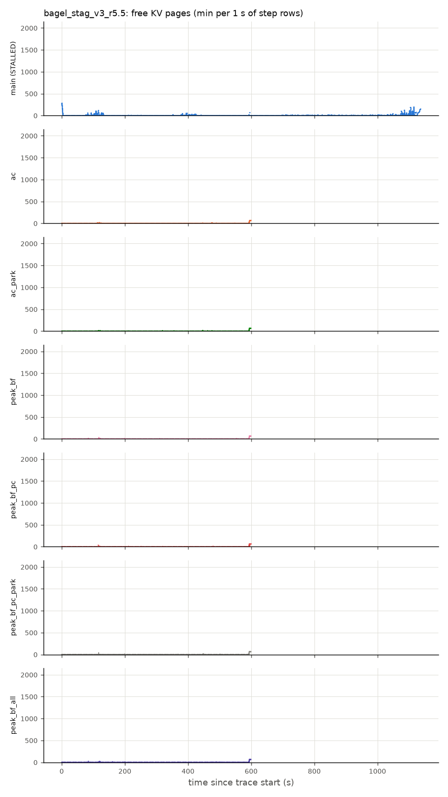
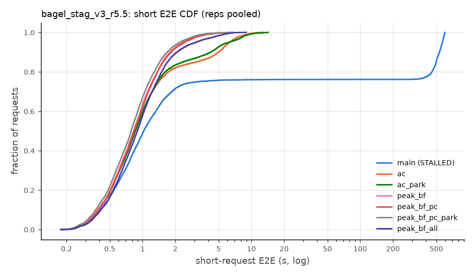
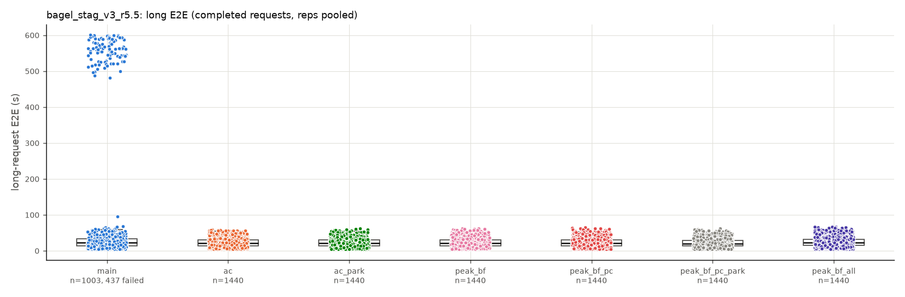

## Data problems

- `13100_ac/bagel_burst_v2_r1` [STALLED]
  - STALLED: 0 request(s) timed out; longest stretch without a completion while requests were outstanding 61.9s, starting at t=35.7s
- `13092_main/bagel_burst_v2_r1` [STALLED]
  - server.log in the run window: 3460 line(s) with Traceback/OOM/fatal; first: Traceback (most recent call last):
  - STALLED: 1730 request(s) timed out; longest stretch without a completion while requests were outstanding 727.1s, starting at t=37.1s
- `13099_main/bagel_burst_v2_r1` [STALLED]
  - server.log in the run window: 3490 line(s) with Traceback/OOM/fatal; first: Traceback (most recent call last):
  - STALLED: 1745 request(s) timed out; longest stretch without a completion while requests were outstanding 744.8s, starting at t=39.0s
- `13106_main/bagel_burst_v2_r1` [STALLED]
  - server.log in the run window: 3514 line(s) with Traceback/OOM/fatal; first: Traceback (most recent call last):
  - STALLED: 1757 request(s) timed out; longest stretch without a completion while requests were outstanding 739.7s, starting at t=37.9s
- `13089_peak_bf_pc/bagel_burst_v3_r1`
  - server.log in the run window: 2 line(s) with Traceback/OOM/fatal; first: Traceback (most recent call last):
- `13104_peak_bf_pc_park/bagel_burst_v3_r1`
  - server.log in the run window: 1 line(s) with Traceback/OOM/fatal; first: Traceback (most recent call last):
- `13092_main/bagel_burst_v3_r1` [STALLED]
  - server.log in the run window: 3005 line(s) with Traceback/OOM/fatal; first: Traceback (most recent call last):
  - STALLED: 1502 request(s) timed out; longest stretch without a completion while requests were outstanding 646.1s, starting at t=37.4s
- `13099_main/bagel_burst_v3_r1` [STALLED]
  - server.log in the run window: 3768 line(s) with Traceback/OOM/fatal; first: Traceback (most recent call last):
  - STALLED: 1884 request(s) timed out; longest stretch without a completion while requests were outstanding 777.1s, starting at t=41.7s
- `13106_main/bagel_burst_v3_r1` [STALLED]
  - server.log in the run window: 3712 line(s) with Traceback/OOM/fatal; first: Traceback (most recent call last):
  - STALLED: 1856 request(s) timed out; longest stretch without a completion while requests were outstanding 774.7s, starting at t=38.0s
- `13092_main/bagel_stag_v2_r3_r1` [STALLED]
  - server.log in the run window: 1046 line(s) with Traceback/OOM/fatal; first: Traceback (most recent call last):
  - STALLED: 522 request(s) timed out; longest stretch without a completion while requests were outstanding 577.3s, starting at t=117.0s
- `13099_main/bagel_stag_v2_r3_r1` [STALLED]
  - server.log in the run window: 1012 line(s) with Traceback/OOM/fatal; first: Traceback (most recent call last):
  - STALLED: 505 request(s) timed out; longest stretch without a completion while requests were outstanding 570.6s, starting at t=127.8s
- `13106_main/bagel_stag_v2_r3_r1` [STALLED]
  - server.log in the run window: 1070 line(s) with Traceback/OOM/fatal; first: Traceback (most recent call last):
  - STALLED: 534 request(s) timed out; longest stretch without a completion while requests were outstanding 607.0s, starting at t=121.5s
- `13092_main/bagel_stag_v3_r5.5_r1` [STALLED]
  - server.log in the run window: 518 line(s) with Traceback/OOM/fatal; first: Traceback (most recent call last):
  - STALLED: 257 request(s) timed out; longest stretch without a completion while requests were outstanding 556.6s, starting at t=427.1s
- `13099_main/bagel_stag_v3_r5.5_r1` [STALLED]
  - server.log in the run window: 2785 line(s) with Traceback/OOM/fatal; first: Traceback (most recent call last):
  - STALLED: 1390 request(s) timed out; longest stretch without a completion while requests were outstanding 621.5s, starting at t=152.3s
- `13106_main/bagel_stag_v3_r5.5_r1`
  - server.log in the run window: 10 line(s) with Traceback/OOM/fatal; first: Traceback (most recent call last):
