# mstar KV-admission A/B (BAGEL text-to-text)

Each config row is the mean over its reps (`n` = reps found; a metric a rep lacks is left out of that mean, `-` = no rep has it). Times in seconds from the client's bench.json; completed-request latencies only (a failed or timed-out request has no latency, so long E2E is optimistic where `timed out` > 0). Short/long = bench `cls`. Percentiles are per rep, then averaged.

- **STALLED**: a request timed out, or no request completed for > 60 s while one was outstanding (`max stall`; a timed-out request counts as outstanding until its timeout).
- **TRUNCATED**: a completed request returned fewer output tokens than the trace asked for (`output_lens` < `intended_output_lens`; BAGEL's decode loop stops at 2,049 tokens), so the run's KV pressure is below the workload's plan; `truncated` in summary.json counts them.
- **OVERRUN**: a completed request returned MORE output tokens than the trace's intended length (`output_lens` > `intended_output_lens`, or the client's `n_overrun_outputs` > 0): the emulated stop of a declared-`max_tokens` trace did not hold, so the run used more KV than the workload plans (`overrun` in summary.json counts them).
- **all E2E / all TTFT**: every completed request, whatever its class (short, mid, long). `mid` (the public-trace workloads) gets its own columns in the `reps` table when a config has any. **declared/generated**: mean over completed requests of declared `max_tokens` / generated tokens, and (prompt + declared) / (prompt + generated) summed over them; the declared length is bench `declared_max_tokens`, else the intended length (the oracle client sent that), so 1.00 = oracle.
- *timed out* = failed with the client's empty-message error (`request failed`) or a timeout message; *failed* = every other error.
- holds / fail: / min free KV pages / GPU busy / decode bs come from step telemetry in the run's window (trace start to last request end + 5 s; the server's telemetry is shared by the runs it serves). GPU busy = sum of step `gpu_ms` / (trace start to last request end). decode bs = mean `bs` of ok `decode` steps. fail: columns count `admit_fail` events by `reason`.
- grant_deferred (adm log), planner_us: admission log, bench-peak configs only (`-` for main/ac).
- KV free lag: per request, ms from its decode `loop_stop` to its pages being back (its first `kv_release`, sent under MSTAR_KV_RELEASE_AT_COMPLETION=1, or `remove_done`); p50/p99 per rep, then averaged. kv_release = how many `kv_release` events the run has (0 when S8 is off).
- Ratio rows `X / ref` = X's mean divided by the reference's mean (E2E < 1 and tok/s > 1 favour X). **≈ (within noise)**: X's and the reference's [min–max] rep ranges of that metric overlap, so the spread between reps alone could give the difference (a min–max overlap, not a significance test; no mark means the ranges are apart, which with few reps is weak evidence). **(1 rep)**: either side has one rep, so the ranges are points.
- `reps` tables: per config, `mean [min–max]` over the reps (`n` = reps found; `(n=k)` = only k reps have that metric; one rep shows the mean alone). **host ms/step** = median over decode steps in the run window of (next step's tm - this step's tm) x 1000 - this step's gpu_ms, 0 < host < 500, split by the waiting depth at the step: requests with a `new_request` event whose handle has not yet appeared in a step's rids (`all` = every depth). A depth bin with fewer than 30 steps shows `-`.
- Cases dropped by `--exclude` and `warmup_*` dirs (the sbatch's warmup replay) are not in any table.

Excluded by `--exclude`: `13218056_main/pub_azure_conv_r1.25_mt2048_r1`, `13218056_main/pub_azure_conv_r1.25_mtx2_r1`, `13218060_ac/pub_azure_conv_r1.25_mt2048_r1`, `13218060_ac/pub_azure_conv_r1.25_mtx2_r1`, `13218061_ac_park/pub_azure_conv_r1.25_mt2048_r1`, `13218061_ac_park/pub_azure_conv_r1.25_mtx2_r1`, `13218062_peak_bf_pc_park/pub_azure_conv_r1.25_mt2048_r1`, `13218062_peak_bf_pc_park/pub_azure_conv_r1.25_mtx2_r1`, `13218072_main/pub_azure_conv_r1.25_r1`, `13218072_main/pub_azure_conv_r1.25_mt2048_r1`, `13218072_main/pub_azure_conv_r1.25_mtx2_r1`, `13218073_main/pub_mooncake_conv_r0.5_r1`, `13218073_main/pub_mooncake_conv_r0.5_mt2048_r1`, `13218074_ac/pub_azure_conv_r1.25_r1`, `13218074_ac/pub_azure_conv_r1.25_mt2048_r1`, `13218074_ac/pub_azure_conv_r1.25_mtx2_r1`, `13218075_ac_park/pub_azure_conv_r1.25_r1`, `13218075_ac_park/pub_azure_conv_r1.25_mt2048_r1`, `13218075_ac_park/pub_azure_conv_r1.25_mtx2_r1`, `13218076_peak_bf_pc_park/pub_azure_conv_r1.25_r1`, `13218076_peak_bf_pc_park/pub_azure_conv_r1.25_mt2048_r1`, `13218076_peak_bf_pc_park/pub_azure_conv_r1.25_mtx2_r1`, `13218077_ac/pub_mooncake_conv_r0.5_r1`, `13218077_ac/pub_mooncake_conv_r0.5_mt2048_r1`, `13218077_ac/pub_mooncake_conv_r0.5_mtx2_r1`, `13218078_ac_park/pub_mooncake_conv_r0.5_mt2048_r1`, `13218079_peak_bf_pc_park/pub_mooncake_conv_r0.5_r1`, `13218079_peak_bf_pc_park/pub_mooncake_conv_r0.5_mt2048_r1`, `13218080_ac/bagel_burst_v2_mt2048_r1`, `13218080_ac/bagel_burst_v2_mtx2_r1`, `13218081_ac_park/bagel_burst_v2_r1`, `13218081_ac_park/bagel_burst_v2_mtx2_r1`, `13218082_peak_bf_pc_park/bagel_burst_v2_r1`, `13218082_peak_bf_pc_park/bagel_burst_v2_mt2048_r1`, `13218082_peak_bf_pc_park/bagel_burst_v2_mtx2_r1`, `13218083_ac/bagel_stag_v3_r5.5_r1`, `13218083_ac/bagel_stag_v3_r5.5_mt2048_r1`, `13218083_ac/bagel_stag_v3_r5.5_mtx2_r1`, `13218084_ac_park/bagel_stag_v3_r5.5_r1`, `13218084_ac_park/bagel_stag_v3_r5.5_mt2048_r1`, `13218084_ac_park/bagel_stag_v3_r5.5_mtx2_r1`, `13218085_peak_bf_pc_park/bagel_stag_v3_r5.5_r1`, `13218085_peak_bf_pc_park/bagel_stag_v3_r5.5_mt2048_r1`, `13218085_peak_bf_pc_park/bagel_stag_v3_r5.5_mtx2_r1`, `13218086_main/pub_azure_conv_r1.25_r1`, `13218086_main/pub_azure_conv_r1.25_mt2048_r1`, `13218086_main/pub_azure_conv_r1.25_mtx2_r1`, `13218087_ac/pub_azure_conv_r1.25_r1`, `13218087_ac/pub_azure_conv_r1.25_mt2048_r1`, `13218087_ac/pub_azure_conv_r1.25_mtx2_r1`, `13218088_ac_park/pub_azure_conv_r1.25_r1`, `13218088_ac_park/pub_azure_conv_r1.25_mt2048_r1`, `13218088_ac_park/pub_azure_conv_r1.25_mtx2_r1`, `13218089_peak_bf_pc_park/pub_azure_conv_r1.25_r1`, `13218089_peak_bf_pc_park/pub_azure_conv_r1.25_mt2048_r1`, `13218089_peak_bf_pc_park/pub_azure_conv_r1.25_mtx2_r1`, `13218090_ac/pub_mooncake_conv_r0.5_r1`, `13218090_ac/pub_mooncake_conv_r0.5_mt2048_r1`, `13218090_ac/pub_mooncake_conv_r0.5_mtx2_r1`, `13218098_peak_bf_pc_park/bagel_stag_v3_r5.5_mtx2_r1`, `13218099_main/pub_azure_conv_r1.25_r1`, `13218099_main/pub_azure_conv_r1.25_mt2048_r1`, `13218099_main/pub_azure_conv_r1.25_mtx2_r1`, `13218100_ac/pub_azure_conv_r1.25_mt2048_r1`, `13218100_ac/pub_azure_conv_r1.25_mtx2_r1`, `13218101_ac_park/pub_azure_conv_r1.25_mt2048_r1`, `13218101_ac_park/pub_azure_conv_r1.25_mtx2_r1`, `13218102_peak_bf_pc_park/pub_azure_conv_r1.25_mt2048_r1`, `13218102_peak_bf_pc_park/pub_azure_conv_r1.25_mtx2_r1`, `13218120_ac/pub_azure_conv_r1.25_mt2048_r1`, `13218120_ac/pub_azure_conv_r1.25_mtx2_r1`, `13218121_ac_park/pub_azure_conv_r1.25_mt2048_r1`, `13218121_ac_park/pub_azure_conv_r1.25_mtx2_r1`, `13218122_peak_bf_pc_park/pub_azure_conv_r1.25_mt2048_r1`, `13218122_peak_bf_pc_park/pub_azure_conv_r1.25_mtx2_r1`, `13218127_peak_bf_pc_park/bagel_burst_v2_mtx2_r1`, `13218128_ac/bagel_stag_v3_r5.5_mt2048_r1`, `13218129_ac_park/bagel_stag_v3_r5.5_mt2048_r1`, `13218130_peak_bf_pc_park/bagel_stag_v3_r5.5_mt2048_r1`, `13218131_ac/pub_mooncake_conv_r0.5_mt2048_r1`, `13218137_main/pub_azure_conv_r1.25_r1`, `13218137_main/pub_azure_conv_r1.25_mt2048_r1`, `13218137_main/pub_azure_conv_r1.25_mtx2_r1`.

## bagel_burst_v2

| config | n | flags | completed | failed | timed out | duration (s) | out tok/s | max stall (s) | short E2E mean (s) | short E2E p50 (s) | short E2E p99 (s) | short TTFT mean (s) | short TTFT p99 (s) | all E2E mean (s) | all E2E p50 (s) | all E2E p99 (s) | all TTFT p50 (s) | all TTFT p99 (s) | long E2E mean (s) | long E2E max (s) | long TTFT mean (s) | declared/generated (mean) | declared/generated KV | holds | fail: AllocationFailed | fail: GrantDeferred | grant_deferred (adm log) | min free KV pages | GPU busy | decode bs | planner_us p50 | planner_us p99 | KV free lag p50 (ms) | KV free lag p99 (ms) | kv_release |
|---|---|---|---|---|---|---|---|---|---|---|---|---|---|---|---|---|---|---|---|---|---|---|---|---|---|---|---|---|---|---|---|---|---|---|---|
| main | 1 | STALLED 1/1 | 1157 | 0 | 1543 | 826.3 | 53.8 | 659.0 | 438.58 | 543.22 | 598.96 | 411.016 | 579.943 | 438.58 | 543.22 | 598.96 | 516.237 | 579.943 | - | - | - | 1.00 | 1.000 | 108919 | 108919 | 0 | - | 0 | 10.0% | 13.3 | - | - | 82.2 | 1269.0 | 0 |
| ac | 3 | STALLED 3/3 | 2700 | 0 | 0 | 305.1 | 647.6 | 61.9 | 20.23 | 1.11 | 78.96 | 16.178 | 66.584 | 21.66 | 1.54 | 83.16 | 0.171 | 68.424 | 103.9 | 170.8 | 25.82 | 1.00 | 1.000 | 0 | 0 | 0 | 0 | 0 | 71.4% | 10.0 | 533.6 | 2317.4 | 37.9 | 692.3 | 0 |
| ac_park | 3 |  | 2700 | 0 | 0 | 305.1 | 647.6 | 43.8 | 9.82 | 0.53 | 58.83 | 7.392 | 48.043 | 10.94 | 0.54 | 61.76 | 0.063 | 49.927 | 75.6 | 123.7 | 19.32 | 1.00 | 1.000 | 0 | 0 | 0 | 0 | 0 | 80.2% | 8.0 | 102.0 | 1986.6 | 18.4 | 563.0 | 0 |
| peak_bf_pc_park | 3 |  | 2700 | 0 | 0 | 305.1 | 647.6 | 5.2 | 0.85 | 0.50 | 6.61 | 0.196 | 3.546 | 2.15 | 0.50 | 63.66 | 0.059 | 4.816 | 76.8 | 101.7 | 24.43 | 1.00 | 1.000 | 0.7 | 0 | 0.7 | 2 | 0 | 83.5% | 7.5 | 381.1 | 1740.7 | 16.3 | 376.2 | 0 |
| *main / ac* |  |  |  |  |  |  | 0.08 (1 rep) |  | 21.67 (1 rep) |  |  |  |  | 20.25 (1 rep) |  |  |  |  | - |  |  |  |  |  |  |  |  |  |  |  |  |  |  |  |  |
| *ac_park / ac* |  |  |  |  |  |  | 1.00 ≈ (within noise) |  | 0.49 |  |  |  |  | 0.51 |  |  |  |  | 0.73 |  |  |  |  |  |  |  |  |  |  |  |  |  |  |  |  |
| *peak_bf_pc_park / ac* |  |  |  |  |  |  | 1.00 ≈ (within noise) |  | 0.04 |  |  |  |  | 0.10 |  |  |  |  | 0.74 |  |  |  |  |  |  |  |  |  |  |  |  |  |  |  |  |
| *ac / main* |  |  |  |  |  |  | 12.04 (1 rep) |  | 0.05 (1 rep) |  |  |  |  | 0.05 (1 rep) |  |  |  |  | - |  |  |  |  |  |  |  |  |  |  |  |  |  |  |  |  |
| *ac_park / main* |  |  |  |  |  |  | 12.04 (1 rep) |  | 0.02 (1 rep) |  |  |  |  | 0.02 (1 rep) |  |  |  |  | - |  |  |  |  |  |  |  |  |  |  |  |  |  |  |  |  |
| *peak_bf_pc_park / main* |  |  |  |  |  |  | 12.04 (1 rep) |  | 0.00 (1 rep) |  |  |  |  | 0.00 (1 rep) |  |  |  |  | - |  |  |  |  |  |  |  |  |  |  |  |  |  |  |  |  |

**reps: mean [min–max]**

| config | n | short E2E mean (s) | short E2E p50 (s) | short E2E p99 (s) | short TTFT p99 (s) | all E2E mean (s) | all E2E p50 (s) | all E2E p99 (s) | all TTFT p50 (s) | all TTFT p99 (s) | long E2E mean (s) | out tok/s | host ms/step all | host ms/step [0,50) | host ms/step [50,200) | host ms/step [200,400) | host ms/step [400,inf) |
|---|---|---|---|---|---|---|---|---|---|---|---|---|---|---|---|---|---|
| main | 1 | 438.58 | 543.22 | 598.96 | 579.943 | 438.58 | 543.22 | 598.96 | 516.237 | 579.943 | - | 53.8 | 0.57 | 0.57 | - | - | - |
| ac | 3 | 20.23 [18.91–22.21] | 1.11 [0.85–1.56] | 78.96 [76.93–82.00] | 66.584 [65.379–68.545] | 21.66 [20.32–23.67] | 1.54 [0.93–2.69] | 83.16 [80.97–86.28] | 0.171 [0.109–0.293] | 68.424 [67.267–70.279] | 103.9 [101.5–107.7] | 647.6 [647.6–647.6] | 0.97 [0.97–0.97] | 0.52 [0.50–0.53] | 10.91 [9.74–11.74] | 18.98 [17.89–19.66] | 29.14 [26.72–32.44] |
| ac_park | 3 | 9.82 [8.72–11.38] | 0.53 [0.51–0.55] | 58.83 [57.03–61.36] | 48.043 [46.210–49.859] | 10.94 [9.79–12.55] | 0.54 [0.52–0.56] | 61.76 [59.99–64.95] | 0.063 [0.059–0.069] | 49.927 [48.095–51.759] | 75.6 [71.5–80.3] | 647.6 [647.6–647.6] | 0.66 [0.58–0.73] | 0.46 [0.42–0.48] | 8.63 [8.25–9.16] | 11.27 [10.29–12.11] | 11.05 [8.76–13.34] |
| peak_bf_pc_park | 3 | 0.85 [0.76–1.02] | 0.50 [0.48–0.53] | 6.61 [5.98–7.73] | 3.546 [2.774–4.617] | 2.15 [1.97–2.45] | 0.50 [0.49–0.53] | 63.66 [59.55–70.69] | 0.059 [0.055–0.065] | 4.816 [4.452–5.166] | 76.8 [72.0–85.1] | 647.6 [647.5–647.6] | 0.64 [0.56–0.77] | 0.63 [0.56–0.77] | - | - | - |

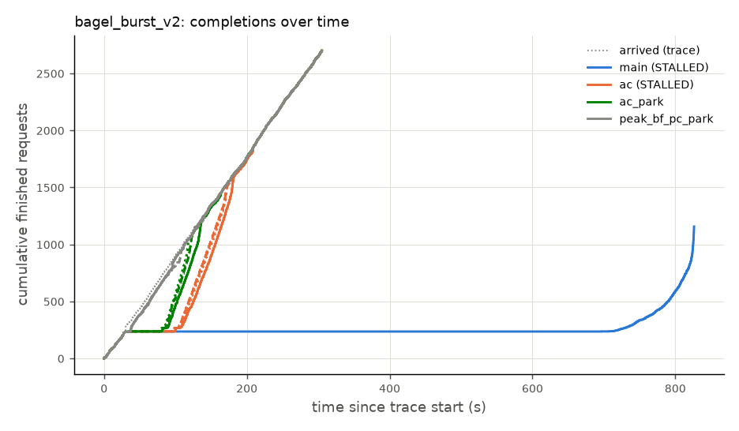
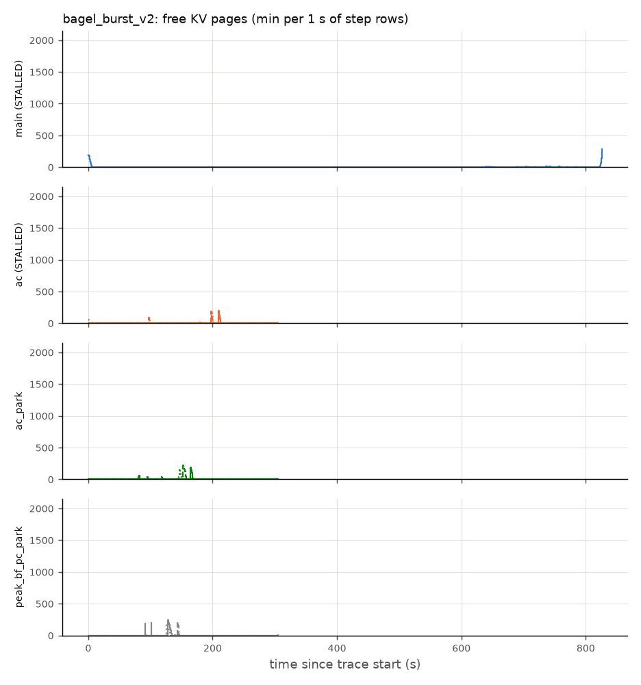
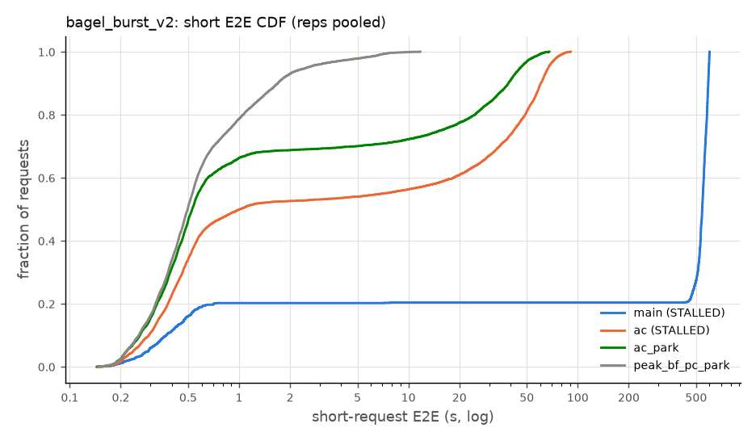
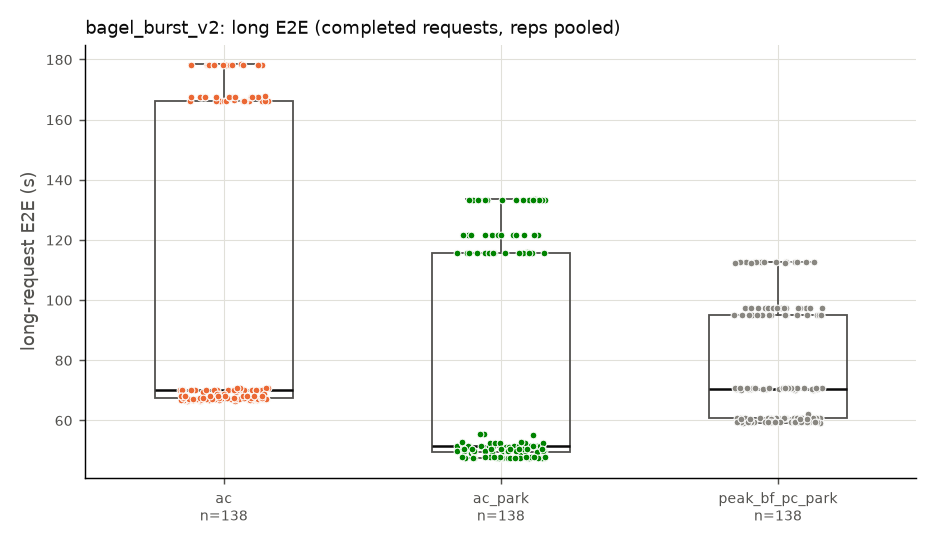

## bagel_stag_v3_r5.5

| config | n | flags | completed | failed | timed out | duration (s) | out tok/s | max stall (s) | short E2E mean (s) | short E2E p50 (s) | short E2E p99 (s) | short TTFT mean (s) | short TTFT p99 (s) | all E2E mean (s) | all E2E p50 (s) | all E2E p99 (s) | all TTFT p50 (s) | all TTFT p99 (s) | long E2E mean (s) | long E2E max (s) | long TTFT mean (s) | declared/generated (mean) | declared/generated KV | holds | fail: AllocationFailed | fail: GrantDeferred | grant_deferred (adm log) | min free KV pages | GPU busy | decode bs | planner_us p50 | planner_us p99 | KV free lag p50 (ms) | KV free lag p99 (ms) | kv_release |
|---|---|---|---|---|---|---|---|---|---|---|---|---|---|---|---|---|---|---|---|---|---|---|---|---|---|---|---|---|---|---|---|---|---|---|---|
| main | 1 |  | 3300 | 0 | 0 | 599.3 | 1102.4 | 4.5 | 0.98 | 0.79 | 3.57 | 0.227 | 2.132 | 4.09 | 0.90 | 45.21 | 0.096 | 4.357 | 22.4 | 85.1 | 1.32 | 1.00 | 1.000 | 3415 | 3415 | 0 | - | 0 | 86.9% | 17.4 | - | - | 22.9 | 428.9 | 0 |
| ac | 3 |  | 3300 | 0 | 0 | 599.4 | 1102.1 | 4.3 | 1.22 | 0.78 | 6.21 | 0.498 | 4.862 | 4.07 | 0.89 | 38.76 | 0.096 | 4.930 | 20.8 | 52.3 | 0.78 | 1.00 | 1.000 | 0 | 0 | 0 | 0 | 0 | 88.2% | 17.0 | 179.0 | 467.1 | 22.3 | 408.3 | 0 |
| ac_park | 3 |  | 3300 | 0 | 0 | 599.8 | 1101.5 | 4.2 | 1.41 | 0.81 | 7.29 | 0.656 | 5.969 | 4.36 | 0.93 | 40.17 | 0.103 | 6.070 | 21.7 | 55.6 | 0.93 | 1.00 | 1.000 | 0 | 0 | 0 | 0 | 0 | 87.6% | 17.5 | 184.4 | 507.0 | 23.4 | 444.5 | 0 |
| peak_bf_pc_park | 3 |  | 3300 | 0 | 0 | 599.8 | 1101.6 | 4.1 | 1.00 | 0.79 | 4.65 | 0.263 | 3.030 | 4.05 | 0.89 | 41.95 | 0.090 | 4.222 | 22.0 | 60.0 | 0.91 | 1.00 | 1.000 | 0 | 0 | 0 | 0 | 0 | 87.7% | 17.5 | 434.5 | 1000.6 | 23.3 | 418.7 | 0 |
| *main / ac* |  |  |  |  |  |  | 1.00 (1 rep) |  | 0.80 ≈ (within noise) |  |  |  |  | 1.00 ≈ (within noise) |  |  |  |  | 1.07 (1 rep) |  |  |  |  |  |  |  |  |  |  |  |  |  |  |  |  |
| *ac_park / ac* |  |  |  |  |  |  | 1.00 ≈ (within noise) |  | 1.16 ≈ (within noise) |  |  |  |  | 1.07 ≈ (within noise) |  |  |  |  | 1.04 ≈ (within noise) |  |  |  |  |  |  |  |  |  |  |  |  |  |  |  |  |
| *peak_bf_pc_park / ac* |  |  |  |  |  |  | 1.00 ≈ (within noise) |  | 0.82 ≈ (within noise) |  |  |  |  | 1.00 ≈ (within noise) |  |  |  |  | 1.05 ≈ (within noise) |  |  |  |  |  |  |  |  |  |  |  |  |  |  |  |  |
| *ac / main* |  |  |  |  |  |  | 1.00 (1 rep) |  | 1.25 ≈ (within noise) |  |  |  |  | 1.00 ≈ (within noise) |  |  |  |  | 0.93 (1 rep) |  |  |  |  |  |  |  |  |  |  |  |  |  |  |  |  |
| *ac_park / main* |  |  |  |  |  |  | 1.00 (1 rep) |  | 1.44 (1 rep) |  |  |  |  | 1.07 ≈ (within noise) |  |  |  |  | 0.97 ≈ (within noise) |  |  |  |  |  |  |  |  |  |  |  |  |  |  |  |  |
| *peak_bf_pc_park / main* |  |  |  |  |  |  | 1.00 (1 rep) |  | 1.03 ≈ (within noise) |  |  |  |  | 0.99 ≈ (within noise) |  |  |  |  | 0.98 ≈ (within noise) |  |  |  |  |  |  |  |  |  |  |  |  |  |  |  |  |

**reps: mean [min–max]**

| config | n | short E2E mean (s) | short E2E p50 (s) | short E2E p99 (s) | short TTFT p99 (s) | all E2E mean (s) | all E2E p50 (s) | all E2E p99 (s) | all TTFT p50 (s) | all TTFT p99 (s) | long E2E mean (s) | out tok/s | host ms/step all | host ms/step [0,50) | host ms/step [50,200) | host ms/step [200,400) | host ms/step [400,inf) |
|---|---|---|---|---|---|---|---|---|---|---|---|---|---|---|---|---|---|
| main | 1 | 0.98 | 0.79 | 3.57 | 2.132 | 4.09 | 0.90 | 45.21 | 0.096 | 4.357 | 22.4 | 1102.4 | 1.63 | 1.63 | - | - | - |
| ac | 3 | 1.22 [0.97–1.45] | 0.78 [0.74–0.81] | 6.21 [4.49–7.54] | 4.862 [3.204–6.122] | 4.07 [3.71–4.39] | 0.89 [0.83–0.94] | 38.76 [36.19–40.51] | 0.096 [0.083–0.109] | 4.930 [3.284–6.243] | 20.8 [19.8–21.6] | 1102.1 [1102.0–1102.2] | 1.84 [1.68–1.98] | 1.84 [1.68–1.98] | - | - | - |
| ac_park | 3 | 1.41 [1.07–1.99] | 0.81 [0.74–0.92] | 7.29 [5.12–11.05] | 5.969 [3.924–9.529] | 4.36 [3.81–5.27] | 0.93 [0.83–1.08] | 40.17 [37.32–45.57] | 0.103 [0.090–0.127] | 6.070 [3.947–9.755] | 21.7 [19.9–24.5] | 1101.5 [1100.5–1102.2] | 1.92 [1.53–2.47] | 1.91 [1.53–2.43] | 7.47 (n=1) | - | - |
| peak_bf_pc_park | 3 | 1.00 [0.88–1.24] | 0.79 [0.74–0.84] | 4.65 [2.76–8.10] | 3.030 [1.379–6.230] | 4.05 [3.74–4.56] | 0.89 [0.84–0.96] | 41.95 [39.27–45.98] | 0.090 [0.084–0.097] | 4.222 [2.191–7.949] | 22.0 [20.6–24.1] | 1101.6 [1101.3–1102.0] | 1.92 [1.70–2.31] | 1.92 [1.70–2.31] | - | - | - |

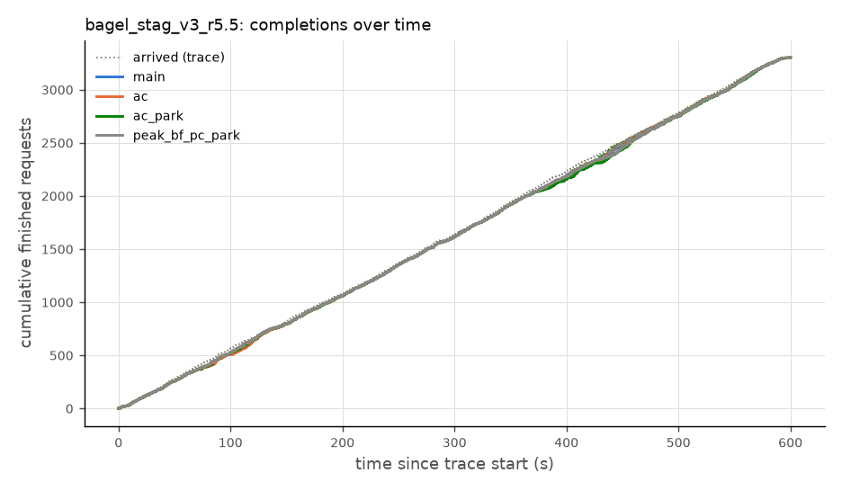
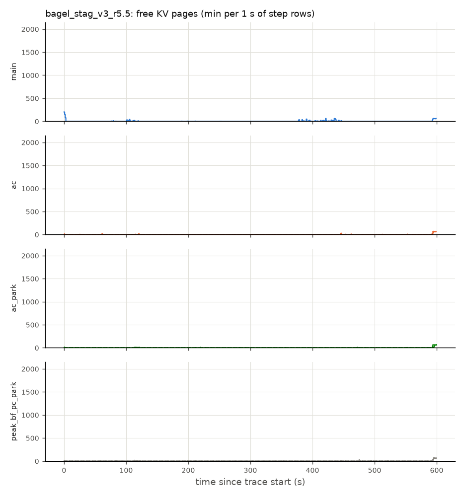
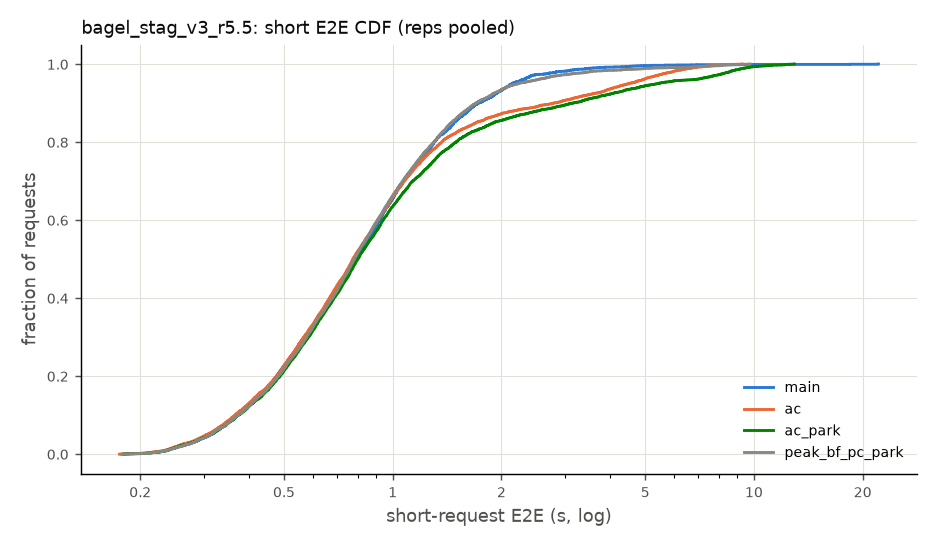
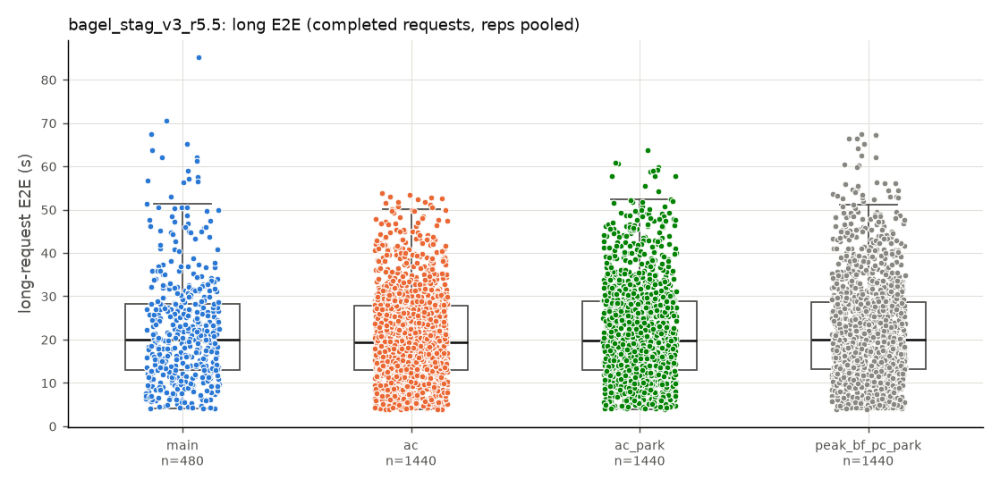

## bagel_burst_v2_mtx2

| config | n | flags | completed | failed | timed out | duration (s) | out tok/s | max stall (s) | short E2E mean (s) | short E2E p50 (s) | short E2E p99 (s) | short TTFT mean (s) | short TTFT p99 (s) | all E2E mean (s) | all E2E p50 (s) | all E2E p99 (s) | all TTFT p50 (s) | all TTFT p99 (s) | long E2E mean (s) | long E2E max (s) | long TTFT mean (s) | declared/generated (mean) | declared/generated KV | holds | fail: AllocationFailed | fail: GrantDeferred | grant_deferred (adm log) | min free KV pages | GPU busy | decode bs | planner_us p50 | planner_us p99 | KV free lag p50 (ms) | KV free lag p99 (ms) | kv_release |
|---|---|---|---|---|---|---|---|---|---|---|---|---|---|---|---|---|---|---|---|---|---|---|---|---|---|---|---|---|---|---|---|---|---|---|---|
| main | 1 | STALLED 1/1 | 1228 | 0 | 1472 | 825.4 | 57.2 | 654.0 | 443.42 | 543.31 | 598.20 | 414.640 | 577.623 | 443.42 | 543.31 | 598.20 | 516.861 | 577.623 | - | - | - | 2.00 | 1.051 | 109051 | 109051 | 0 | - | 0 | 10.3% | 13.6 | - | - | 98.6 | 891.2 | 0 |
| ac | 3 | STALLED 1/3 | 2700 | 0 | 0 | 305.1 | 647.6 | 55.9 | 15.57 | 0.72 | 71.37 | 12.523 | 60.559 | 16.89 | 0.78 | 75.31 | 0.088 | 62.314 | 92.6 | 149.4 | 23.66 | 1.98 | 1.045 | 0 | 0 | 0 | 0 | 0 | 75.4% | 9.0 | 261.2 | 2171.4 | 27.3 | 804.6 | 0 |
| ac_park | 3 |  | 2700 | 0 | 0 | 305.1 | 647.6 | 45.6 | 11.28 | 0.54 | 60.61 | 8.570 | 49.992 | 12.44 | 0.55 | 64.78 | 0.068 | 51.775 | 79.7 | 131.7 | 19.96 | 1.98 | 1.045 | 0 | 0 | 0 | 0 | 0 | 79.0% | 8.2 | 118.9 | 1925.6 | 20.1 | 573.1 | 0 |
| peak_bf_pc_park | 3 |  | 2700 | 0 | 0 | 305.1 | 647.6 | 4.4 | 0.91 | 0.50 | 8.00 | 0.232 | 4.228 | 2.22 | 0.50 | 64.27 | 0.058 | 5.295 | 77.8 | 103.1 | 24.60 | 1.98 | 1.045 | 0 | 0 | 0 | 0 | 0 | 83.3% | 7.5 | 386.8 | 1699.9 | 15.9 | 466.9 | 0 |
| *main / ac* |  |  |  |  |  |  | 0.09 (1 rep) |  | 28.47 (1 rep) |  |  |  |  | 26.26 (1 rep) |  |  |  |  | - |  |  |  |  |  |  |  |  |  |  |  |  |  |  |  |  |
| *ac_park / ac* |  |  |  |  |  |  | 1.00 ≈ (within noise) |  | 0.72 |  |  |  |  | 0.74 |  |  |  |  | 0.86 |  |  |  |  |  |  |  |  |  |  |  |  |  |  |  |  |
| *peak_bf_pc_park / ac* |  |  |  |  |  |  | 1.00 ≈ (within noise) |  | 0.06 |  |  |  |  | 0.13 |  |  |  |  | 0.84 ≈ (within noise) |  |  |  |  |  |  |  |  |  |  |  |  |  |  |  |  |
| *ac / main* |  |  |  |  |  |  | 11.33 (1 rep) |  | 0.04 (1 rep) |  |  |  |  | 0.04 (1 rep) |  |  |  |  | - |  |  |  |  |  |  |  |  |  |  |  |  |  |  |  |  |
| *ac_park / main* |  |  |  |  |  |  | 11.33 (1 rep) |  | 0.03 (1 rep) |  |  |  |  | 0.03 (1 rep) |  |  |  |  | - |  |  |  |  |  |  |  |  |  |  |  |  |  |  |  |  |
| *peak_bf_pc_park / main* |  |  |  |  |  |  | 11.33 (1 rep) |  | 0.00 (1 rep) |  |  |  |  | 0.01 (1 rep) |  |  |  |  | - |  |  |  |  |  |  |  |  |  |  |  |  |  |  |  |  |

**reps: mean [min–max]**

| config | n | short E2E mean (s) | short E2E p50 (s) | short E2E p99 (s) | short TTFT p99 (s) | all E2E mean (s) | all E2E p50 (s) | all E2E p99 (s) | all TTFT p50 (s) | all TTFT p99 (s) | long E2E mean (s) | out tok/s | host ms/step all | host ms/step [0,50) | host ms/step [50,200) | host ms/step [200,400) | host ms/step [400,inf) |
|---|---|---|---|---|---|---|---|---|---|---|---|---|---|---|---|---|---|
| main | 1 | 443.42 | 543.31 | 598.20 | 577.623 | 443.42 | 543.31 | 598.20 | 516.861 | 577.623 | - | 57.2 | 0.58 | 0.58 | - | - | - |
| ac | 3 | 15.57 [12.82–20.30] | 0.72 [0.56–1.05] | 71.37 [66.50–78.95] | 60.559 [57.061–66.140] | 16.89 [14.07–21.73] | 0.78 [0.57–1.18] | 75.31 [69.79–84.06] | 0.088 [0.071–0.121] | 62.314 [58.920–67.769] | 92.6 [85.9–103.7] | 647.6 [647.6–647.6] | 0.80 [0.69–0.98] | 0.48 [0.46–0.51] | 10.59 [10.31–10.85] | 16.40 [15.23–18.26] | 23.35 [19.28–30.21] |
| ac_park | 3 | 11.28 [11.04–11.73] | 0.54 [0.54–0.55] | 60.61 [59.64–62.06] | 49.992 [48.856–50.928] | 12.44 [12.20–12.91] | 0.55 [0.54–0.56] | 64.78 [63.85–66.21] | 0.068 [0.067–0.069] | 51.775 [50.676–52.677] | 79.7 [78.8–81.0] | 647.6 [647.5–647.6] | 0.70 [0.69–0.71] | 0.48 [0.47–0.49] | 8.97 [8.14–10.05] | 11.43 [11.16–11.72] | 13.71 [12.93–15.19] |
| peak_bf_pc_park | 3 | 0.91 [0.81–1.09] | 0.50 [0.48–0.53] | 8.00 [6.89–10.15] | 4.228 [3.440–5.177] | 2.22 [2.04–2.55] | 0.50 [0.49–0.54] | 64.27 [59.73–73.01] | 0.058 [0.055–0.064] | 5.295 [4.563–5.959] | 77.8 [73.1–87.1] | 647.6 [647.5–647.6] | 0.63 [0.56–0.76] | 0.63 [0.56–0.75] | 11.48 (n=1) | - | - |

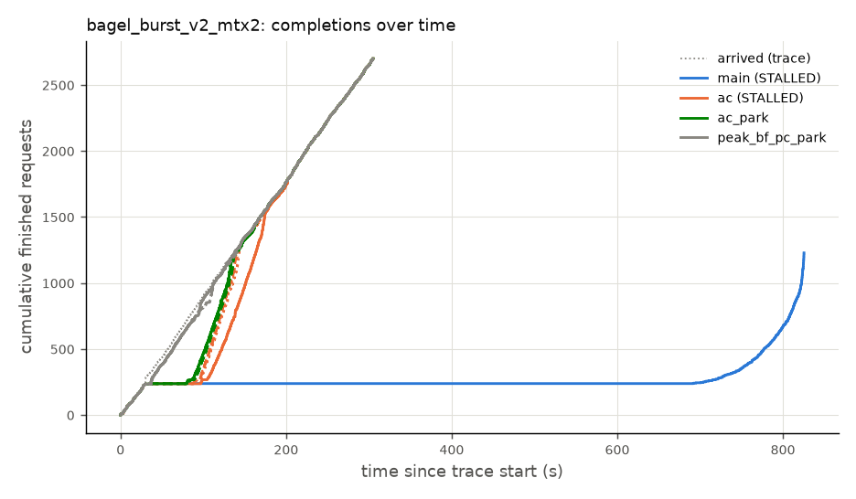
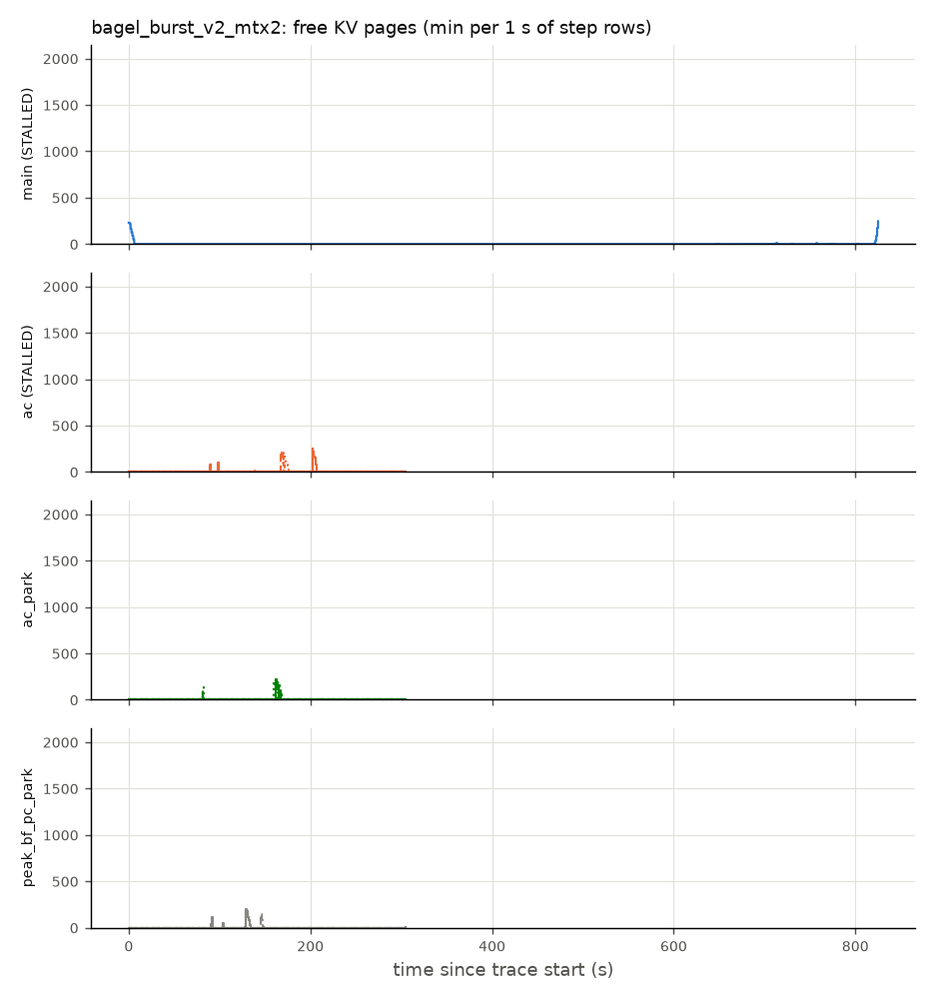
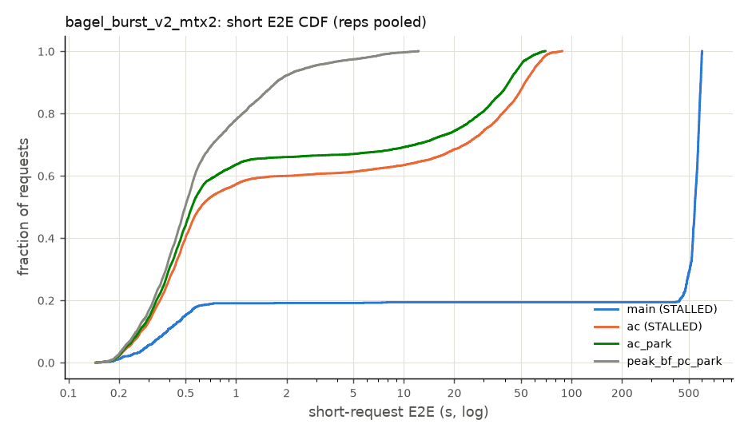
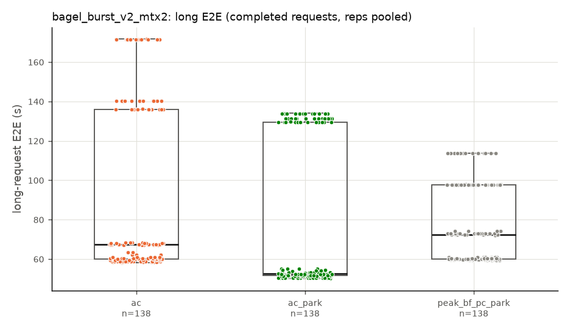

## bagel_burst_v2_mt2048

| config | n | flags | completed | failed | timed out | duration (s) | out tok/s | max stall (s) | short E2E mean (s) | short E2E p50 (s) | short E2E p99 (s) | short TTFT mean (s) | short TTFT p99 (s) | all E2E mean (s) | all E2E p50 (s) | all E2E p99 (s) | all TTFT p50 (s) | all TTFT p99 (s) | long E2E mean (s) | long E2E max (s) | long TTFT mean (s) | declared/generated (mean) | declared/generated KV | holds | fail: AllocationFailed | fail: GrantDeferred | grant_deferred (adm log) | min free KV pages | GPU busy | decode bs | planner_us p50 | planner_us p99 | KV free lag p50 (ms) | KV free lag p99 (ms) | kv_release |
|---|---|---|---|---|---|---|---|---|---|---|---|---|---|---|---|---|---|---|---|---|---|---|---|---|---|---|---|---|---|---|---|---|---|---|---|
| main | 1 | STALLED 1/1 | 1013 | 0 | 1687 | 835.3 | 46.5 | 703.7 | 427.96 | 548.11 | 599.36 | 408.161 | 579.612 | 427.96 | 548.11 | 599.36 | 529.252 | 579.612 | - | - | - | 62.34 | 3.661 | 115830 | 115830 | 0 | - | 0 | 8.8% | 12.3 | - | - | 62.9 | 784.0 | 0 |
| ac | 3 | STALLED 1/3 | 2700 | 0 | 0 | 323.4 | 614.7 | 65.7 | 38.89 | 32.61 | 75.65 | 36.710 | 71.509 | 40.24 | 32.66 | 77.23 | 30.882 | 72.719 | 118.1 | 204.5 | 27.06 | 58.82 | 3.208 | 0 | 0 | 0 | 0 | 0 | 63.7% | 14.6 | 338.2 | 1119.0 | 51.9 | 593.8 | 0 |
| ac_park | 3 |  | 2700 | 0 | 0 | 305.1 | 647.6 | 50.9 | 17.67 | 8.50 | 58.76 | 16.121 | 55.422 | 18.95 | 8.85 | 60.88 | 7.116 | 57.204 | 92.8 | 160.3 | 21.88 | 58.82 | 3.208 | 0 | 0 | 0 | 0 | 0 | 71.9% | 10.1 | 275.1 | 1110.2 | 39.8 | 1095.7 | 0 |
| peak_bf_pc_park | 3 |  | 2700 | 0 | 0 | 305.1 | 647.6 | 4.4 | 24.21 | 17.80 | 59.72 | 21.673 | 55.388 | 25.81 | 19.02 | 72.69 | 14.879 | 56.240 | 118.2 | 202.5 | 27.62 | 58.82 | 3.208 | 0 | 0 | 0 | 0 | 0 | 64.7% | 14.0 | 247.5 | 3335.1 | 59.8 | 1183.5 | 0 |
| *main / ac* |  |  |  |  |  |  | 0.08 (1 rep) |  | 11.00 (1 rep) |  |  |  |  | 10.63 (1 rep) |  |  |  |  | - |  |  |  |  |  |  |  |  |  |  |  |  |  |  |  |  |
| *ac_park / ac* |  |  |  |  |  |  | 1.05 |  | 0.45 ≈ (within noise) |  |  |  |  | 0.47 ≈ (within noise) |  |  |  |  | 0.79 ≈ (within noise) |  |  |  |  |  |  |  |  |  |  |  |  |  |  |  |  |
| *peak_bf_pc_park / ac* |  |  |  |  |  |  | 1.05 ≈ (within noise) |  | 0.62 ≈ (within noise) |  |  |  |  | 0.64 ≈ (within noise) |  |  |  |  | 1.00 ≈ (within noise) |  |  |  |  |  |  |  |  |  |  |  |  |  |  |  |  |
| *ac / main* |  |  |  |  |  |  | 13.21 (1 rep) |  | 0.09 (1 rep) |  |  |  |  | 0.09 (1 rep) |  |  |  |  | - |  |  |  |  |  |  |  |  |  |  |  |  |  |  |  |  |
| *ac_park / main* |  |  |  |  |  |  | 13.91 (1 rep) |  | 0.04 (1 rep) |  |  |  |  | 0.04 (1 rep) |  |  |  |  | - |  |  |  |  |  |  |  |  |  |  |  |  |  |  |  |  |
| *peak_bf_pc_park / main* |  |  |  |  |  |  | 13.91 (1 rep) |  | 0.06 (1 rep) |  |  |  |  | 0.06 (1 rep) |  |  |  |  | - |  |  |  |  |  |  |  |  |  |  |  |  |  |  |  |  |

**reps: mean [min–max]**

| config | n | short E2E mean (s) | short E2E p50 (s) | short E2E p99 (s) | short TTFT p99 (s) | all E2E mean (s) | all E2E p50 (s) | all E2E p99 (s) | all TTFT p50 (s) | all TTFT p99 (s) | long E2E mean (s) | out tok/s | host ms/step all | host ms/step [0,50) | host ms/step [50,200) | host ms/step [200,400) | host ms/step [400,inf) |
|---|---|---|---|---|---|---|---|---|---|---|---|---|---|---|---|---|---|
| main | 1 | 427.96 | 548.11 | 599.36 | 579.612 | 427.96 | 548.11 | 599.36 | 529.252 | 579.612 | - | 46.5 | 0.53 | 0.53 | - | - | - |
| ac | 3 | 38.89 [15.87–84.42] | 32.61 [0.63–96.41] | 75.65 [61.75–102.14] | 71.509 [58.707–95.703] | 40.24 [17.16–85.87] | 32.66 [0.65–96.39] | 77.23 [63.79–102.62] | 30.882 [0.087–92.443] | 72.719 [60.539–95.699] | 118.1 [91.2–169.4] | 614.7 [548.9–647.6] | 7.38 [0.67–20.62] | 0.41 [0.36–0.45] | 12.17 [10.76–14.92] | 19.98 [15.58–27.40] | 30.53 [20.83–47.85] |
| ac_park | 3 | 17.67 [10.17–26.18] | 8.50 [0.57–24.04] | 58.76 [49.82–66.78] | 55.422 [47.282–62.813] | 18.95 [11.28–27.63] | 8.85 [0.58–24.98] | 60.88 [52.31–68.61] | 7.116 [0.073–21.139] | 57.204 [49.214–64.449] | 92.8 [75.5–111.3] | 647.6 [647.6–647.6] | 1.02 [0.74–1.22] | 0.47 [0.40–0.54] | 10.53 [8.76–12.53] | 14.07 [9.89–18.46] | 18.06 [15.04–22.27] |
| peak_bf_pc_park | 3 | 24.21 [14.85–38.10] | 17.80 [1.18–40.53] | 59.72 [49.58–70.61] | 55.388 [45.185–66.065] | 25.81 [16.31–39.91] | 19.02 [2.33–41.72] | 72.69 [65.23–81.28] | 14.879 [0.431–36.052] | 56.240 [45.594–67.707] | 118.2 [100.7–144.2] | 647.6 [647.5–647.6] | 4.57 [0.83–11.85] | 0.46 [0.45–0.48] | 11.15 [9.26–14.62] | 16.09 [13.64–19.41] | 20.20 [15.96–25.44] |

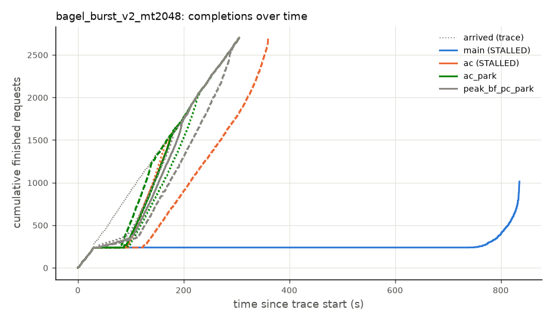
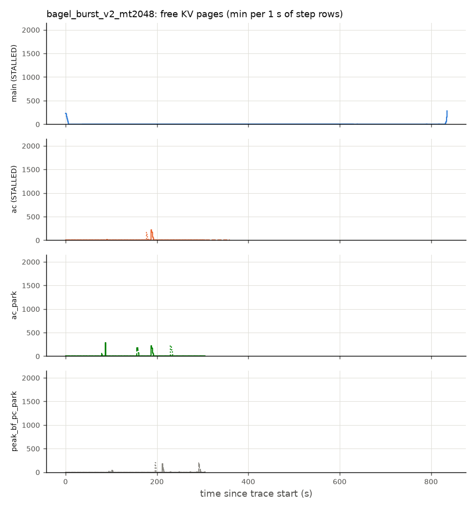
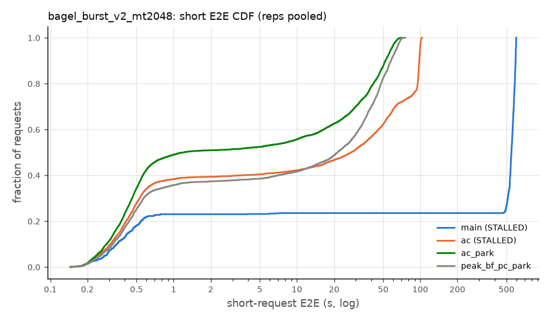
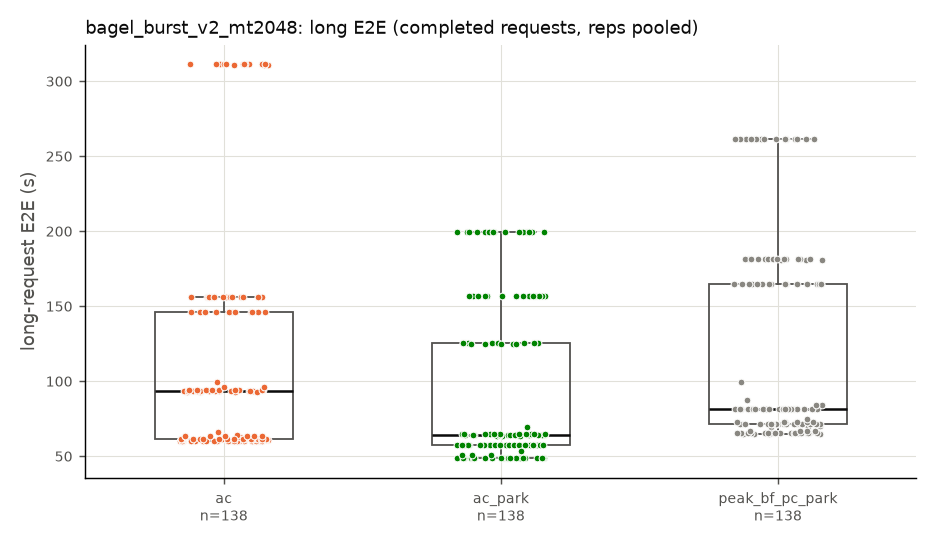

## bagel_stag_v3_r5.5_mtx2

| config | n | flags | completed | failed | timed out | duration (s) | out tok/s | max stall (s) | short E2E mean (s) | short E2E p50 (s) | short E2E p99 (s) | short TTFT mean (s) | short TTFT p99 (s) | all E2E mean (s) | all E2E p50 (s) | all E2E p99 (s) | all TTFT p50 (s) | all TTFT p99 (s) | long E2E mean (s) | long E2E max (s) | long TTFT mean (s) | declared/generated (mean) | declared/generated KV | holds | fail: AllocationFailed | fail: GrantDeferred | grant_deferred (adm log) | min free KV pages | GPU busy | decode bs | planner_us p50 | planner_us p99 | KV free lag p50 (ms) | KV free lag p99 (ms) | kv_release |
|---|---|---|---|---|---|---|---|---|---|---|---|---|---|---|---|---|---|---|---|---|---|---|---|---|---|---|---|---|---|---|---|---|---|---|---|
| main | 1 | STALLED 1/1 | 3036 | 0 | 264 | 1137.1 | 459.2 | 563.7 | 131.54 | 1.01 | 593.50 | 125.573 | 576.420 | 126.02 | 1.20 | 593.26 | 0.207 | 574.710 | 86.1 | 597.2 | 63.36 | 1.96 | 1.060 | 161796 | 161796 | 0 | - | 0 | 37.9% | 18.8 | - | - | 28.4 | 420.8 | 0 |
| ac | 3 |  | 3300 | 0 | 0 | 623.0 | 1063.4 | 4.0 | 6.22 | 0.95 | 28.21 | 5.378 | 26.784 | 9.34 | 1.29 | 58.41 | 0.195 | 26.853 | 27.7 | 80.6 | 5.14 | 1.95 | 1.060 | 0 | 0 | 0 | 0 | 0 | 83.5% | 18.2 | 190.6 | 471.8 | 26.2 | 441.1 | 0 |
| ac_park | 3 |  | 3300 | 0 | 0 | 599.5 | 1102.1 | 4.4 | 1.61 | 0.86 | 7.60 | 0.865 | 6.388 | 4.57 | 1.01 | 40.01 | 0.135 | 6.482 | 21.9 | 51.9 | 1.18 | 1.95 | 1.060 | 0 | 0 | 0 | 0 | 0 | 87.3% | 17.7 | 184.5 | 466.1 | 23.4 | 470.3 | 0 |
| peak_bf_pc_park | 3 |  | 3300 | 0 | 0 | 599.5 | 1102.1 | 4.4 | 0.84 | 0.74 | 2.27 | 0.141 | 0.803 | 3.69 | 0.83 | 37.35 | 0.080 | 1.591 | 20.4 | 51.8 | 0.60 | 1.95 | 1.060 | 0 | 0 | 0 | 0 | 0 | 89.2% | 16.7 | 436.6 | 1091.9 | 22.2 | 433.1 | 0 |
| *main / ac* |  |  |  |  |  |  | 0.43 (1 rep) |  | 21.16 (1 rep) |  |  |  |  | 13.49 (1 rep) |  |  |  |  | 3.11 (1 rep) |  |  |  |  |  |  |  |  |  |  |  |  |  |  |  |  |
| *ac_park / ac* |  |  |  |  |  |  | 1.04 ≈ (within noise) |  | 0.26 ≈ (within noise) |  |  |  |  | 0.49 ≈ (within noise) |  |  |  |  | 0.79 ≈ (within noise) |  |  |  |  |  |  |  |  |  |  |  |  |  |  |  |  |
| *peak_bf_pc_park / ac* |  |  |  |  |  |  | 1.04 ≈ (within noise) |  | 0.13 |  |  |  |  | 0.39 |  |  |  |  | 0.74 ≈ (within noise) |  |  |  |  |  |  |  |  |  |  |  |  |  |  |  |  |
| *ac / main* |  |  |  |  |  |  | 2.32 (1 rep) |  | 0.05 (1 rep) |  |  |  |  | 0.07 (1 rep) |  |  |  |  | 0.32 (1 rep) |  |  |  |  |  |  |  |  |  |  |  |  |  |  |  |  |
| *ac_park / main* |  |  |  |  |  |  | 2.40 (1 rep) |  | 0.01 (1 rep) |  |  |  |  | 0.04 (1 rep) |  |  |  |  | 0.25 (1 rep) |  |  |  |  |  |  |  |  |  |  |  |  |  |  |  |  |
| *peak_bf_pc_park / main* |  |  |  |  |  |  | 2.40 (1 rep) |  | 0.01 (1 rep) |  |  |  |  | 0.03 (1 rep) |  |  |  |  | 0.24 (1 rep) |  |  |  |  |  |  |  |  |  |  |  |  |  |  |  |  |

**reps: mean [min–max]**

| config | n | short E2E mean (s) | short E2E p50 (s) | short E2E p99 (s) | short TTFT p99 (s) | all E2E mean (s) | all E2E p50 (s) | all E2E p99 (s) | all TTFT p50 (s) | all TTFT p99 (s) | long E2E mean (s) | out tok/s | host ms/step all | host ms/step [0,50) | host ms/step [50,200) | host ms/step [200,400) | host ms/step [400,inf) |
|---|---|---|---|---|---|---|---|---|---|---|---|---|---|---|---|---|---|
| main | 1 | 131.54 | 1.01 | 593.50 | 576.420 | 126.02 | 1.20 | 593.26 | 0.207 | 574.710 | 86.1 | 459.2 | 1.72 | 1.72 | - | - | - |
| ac | 3 | 6.22 [1.47–15.62] | 0.95 [0.78–1.25] | 28.21 [7.54–69.00] | 26.784 [6.246–67.199] | 9.34 [4.31–19.28] | 1.29 [0.90–2.05] | 58.41 [38.96–96.36] | 0.195 [0.103–0.379] | 26.853 [6.338–67.249] | 27.7 [21.0–40.8] | 1063.4 [986.1–1102.3] | 2.32 [1.80–3.22] | 1.93 [1.80–2.04] | 14.48 (n=1) | 19.08 (n=1) | - |
| ac_park | 3 | 1.61 [1.27–2.23] | 0.86 [0.77–1.01] | 7.60 [6.43–9.54] | 6.388 [5.216–8.385] | 4.57 [4.06–5.49] | 1.01 [0.88–1.23] | 40.01 [37.11–44.19] | 0.135 [0.095–0.203] | 6.482 [5.261–8.475] | 21.9 [20.5–24.6] | 1102.1 [1102.0–1102.2] | 2.07 [1.74–2.63] | 2.07 [1.74–2.63] | 4.31 (n=1) | - | - |
| peak_bf_pc_park | 3 | 0.84 [0.82–0.87] | 0.74 [0.73–0.77] | 2.27 [2.14–2.37] | 0.803 [0.691–0.872] | 3.69 [3.61–3.84] | 0.83 [0.81–0.87] | 37.35 [36.00–39.90] | 0.080 [0.078–0.082] | 1.591 [0.961–2.554] | 20.4 [20.0–21.2] | 1102.1 [1101.8–1102.3] | 1.73 [1.65–1.88] | 1.73 [1.65–1.88] | - | - | - |

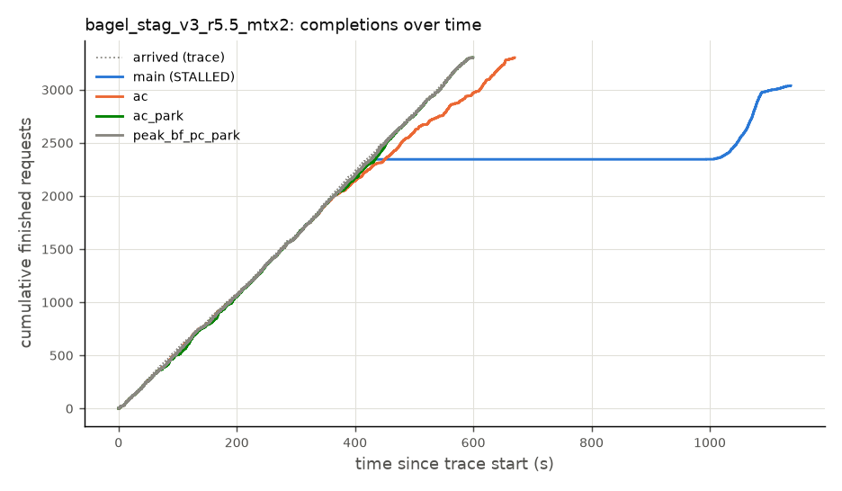
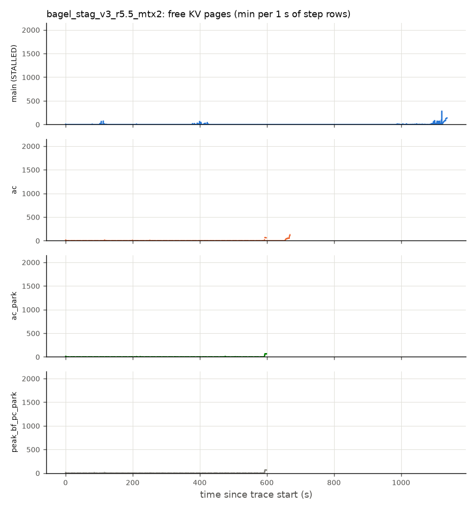
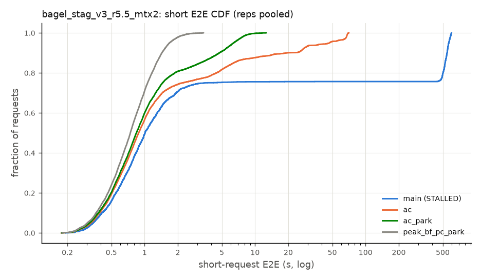
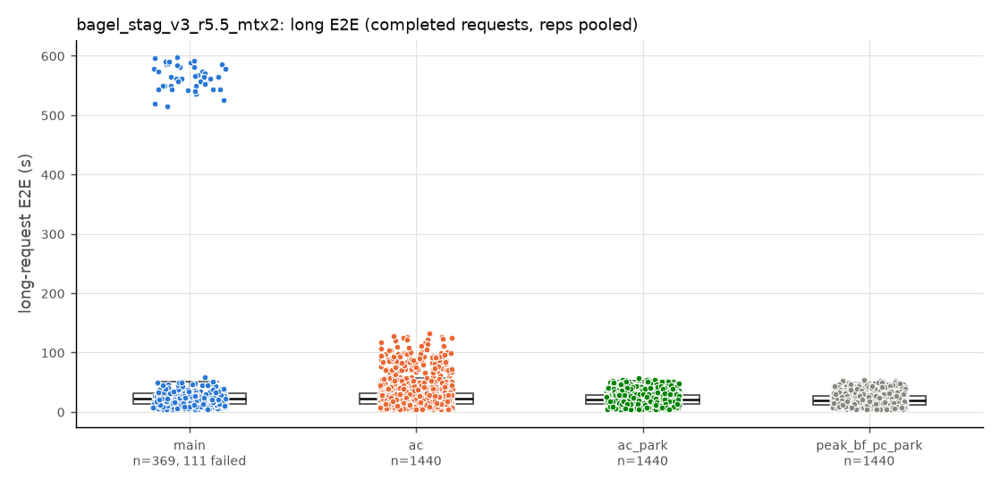

## bagel_stag_v3_r5.5_mt2048

| config | n | flags | completed | failed | timed out | duration (s) | out tok/s | max stall (s) | short E2E mean (s) | short E2E p50 (s) | short E2E p99 (s) | short TTFT mean (s) | short TTFT p99 (s) | all E2E mean (s) | all E2E p50 (s) | all E2E p99 (s) | all TTFT p50 (s) | all TTFT p99 (s) | long E2E mean (s) | long E2E max (s) | long TTFT mean (s) | declared/generated (mean) | declared/generated KV | holds | fail: AllocationFailed | fail: GrantDeferred | grant_deferred (adm log) | min free KV pages | GPU busy | decode bs | planner_us p50 | planner_us p99 | KV free lag p50 (ms) | KV free lag p99 (ms) | kv_release |
|---|---|---|---|---|---|---|---|---|---|---|---|---|---|---|---|---|---|---|---|---|---|---|---|---|---|---|---|---|---|---|---|---|---|---|---|
| main | 1 | STALLED 1/1 | 1641 | 0 | 1659 | 1130.3 | 149.8 | 577.2 | 350.73 | 467.64 | 596.26 | 312.223 | 572.820 | 346.18 | 467.57 | 596.79 | 422.240 | 575.917 | 281.0 | 598.9 | 249.60 | 58.66 | 2.487 | 167236 | 167236 | 0 | - | 0 | 16.2% | 21.6 | - | - | 60.1 | 691.6 | 0 |
| ac | 3 |  | 3300 | 0 | 0 | 599.7 | 1101.7 | 4.0 | 1.93 | 0.88 | 8.86 | 1.178 | 7.760 | 4.89 | 1.01 | 40.15 | 0.145 | 7.785 | 22.3 | 53.0 | 1.41 | 52.19 | 1.929 | 0 | 0 | 0 | 0 | 0 | 86.0% | 18.1 | 187.1 | 524.3 | 23.4 | 417.8 | 0 |
| ac_park | 3 |  | 3300 | 0 | 0 | 602.7 | 1096.2 | 3.9 | 3.17 | 1.27 | 11.50 | 2.365 | 10.409 | 6.30 | 2.47 | 44.41 | 0.380 | 10.438 | 24.7 | 57.3 | 2.46 | 52.19 | 1.929 | 0 | 0 | 0 | 0 | 0 | 84.3% | 19.2 | 194.1 | 541.2 | 25.8 | 470.0 | 0 |
| peak_bf_pc_park | 3 |  | 3300 | 0 | 0 | 599.8 | 1101.5 | 4.2 | 1.45 | 0.94 | 6.91 | 0.631 | 5.523 | 4.77 | 1.09 | 44.67 | 0.160 | 6.235 | 24.3 | 59.9 | 1.49 | 52.19 | 1.929 | 0 | 0 | 0 | 0 | 0 | 84.5% | 19.2 | 385.6 | 946.6 | 27.1 | 495.8 | 0 |
| *main / ac* |  |  |  |  |  |  | 0.14 (1 rep) |  | 181.89 (1 rep) |  |  |  |  | 70.77 (1 rep) |  |  |  |  | 12.60 (1 rep) |  |  |  |  |  |  |  |  |  |  |  |  |  |  |  |  |
| *ac_park / ac* |  |  |  |  |  |  | 1.00 ≈ (within noise) |  | 1.65 ≈ (within noise) |  |  |  |  | 1.29 ≈ (within noise) |  |  |  |  | 1.11 ≈ (within noise) |  |  |  |  |  |  |  |  |  |  |  |  |  |  |  |  |
| *peak_bf_pc_park / ac* |  |  |  |  |  |  | 1.00 ≈ (within noise) |  | 0.75 ≈ (within noise) |  |  |  |  | 0.97 ≈ (within noise) |  |  |  |  | 1.09 ≈ (within noise) |  |  |  |  |  |  |  |  |  |  |  |  |  |  |  |  |
| *ac / main* |  |  |  |  |  |  | 7.35 (1 rep) |  | 0.01 (1 rep) |  |  |  |  | 0.01 (1 rep) |  |  |  |  | 0.08 (1 rep) |  |  |  |  |  |  |  |  |  |  |  |  |  |  |  |  |
| *ac_park / main* |  |  |  |  |  |  | 7.32 (1 rep) |  | 0.01 (1 rep) |  |  |  |  | 0.02 (1 rep) |  |  |  |  | 0.09 (1 rep) |  |  |  |  |  |  |  |  |  |  |  |  |  |  |  |  |
| *peak_bf_pc_park / main* |  |  |  |  |  |  | 7.35 (1 rep) |  | 0.00 (1 rep) |  |  |  |  | 0.01 (1 rep) |  |  |  |  | 0.09 (1 rep) |  |  |  |  |  |  |  |  |  |  |  |  |  |  |  |  |

**reps: mean [min–max]**

| config | n | short E2E mean (s) | short E2E p50 (s) | short E2E p99 (s) | short TTFT p99 (s) | all E2E mean (s) | all E2E p50 (s) | all E2E p99 (s) | all TTFT p50 (s) | all TTFT p99 (s) | long E2E mean (s) | out tok/s | host ms/step all | host ms/step [0,50) | host ms/step [50,200) | host ms/step [200,400) | host ms/step [400,inf) |
|---|---|---|---|---|---|---|---|---|---|---|---|---|---|---|---|---|---|
| main | 1 | 350.73 | 467.64 | 596.26 | 572.820 | 346.18 | 467.57 | 596.79 | 422.240 | 575.917 | 281.0 | 149.8 | 2.26 | 2.26 | - | - | - |
| ac | 3 | 1.93 [1.68–2.06] | 0.88 [0.80–0.92] | 8.86 [8.61–9.21] | 7.760 [7.524–8.198] | 4.89 [4.49–5.10] | 1.01 [0.92–1.06] | 40.15 [38.74–41.05] | 0.145 [0.115–0.166] | 7.785 [7.564–8.216] | 22.3 [21.0–23.0] | 1101.7 [1101.1–1102.2] | 2.29 [1.87–2.51] | 2.29 [1.87–2.51] | - | - | - |
| ac_park | 3 | 3.17 [1.74–5.99] | 1.27 [0.83–2.08] | 11.50 [8.08–18.13] | 10.409 [7.052–16.824] | 6.30 [4.59–9.54] | 2.47 [0.96–5.39] | 44.41 [39.20–54.65] | 0.380 [0.124–0.860] | 10.438 [7.044–16.882] | 24.7 [21.3–30.4] | 1096.2 [1085.0–1102.4] | 2.75 [1.96–3.93] | 2.47 [1.96–3.07] | 7.40 (n=1) | - | - |
| peak_bf_pc_park | 3 | 1.45 [0.88–1.98] | 0.94 [0.74–1.14] | 6.91 [3.07–9.77] | 5.523 [1.891–8.158] | 4.77 [3.67–5.76] | 1.09 [0.83–1.37] | 44.67 [36.97–50.25] | 0.160 [0.084–0.265] | 6.235 [2.372–9.231] | 24.3 [20.1–28.0] | 1101.5 [1100.9–1102.2] | 2.64 [1.69–3.56] | 2.64 [1.69–3.56] | - | - | - |

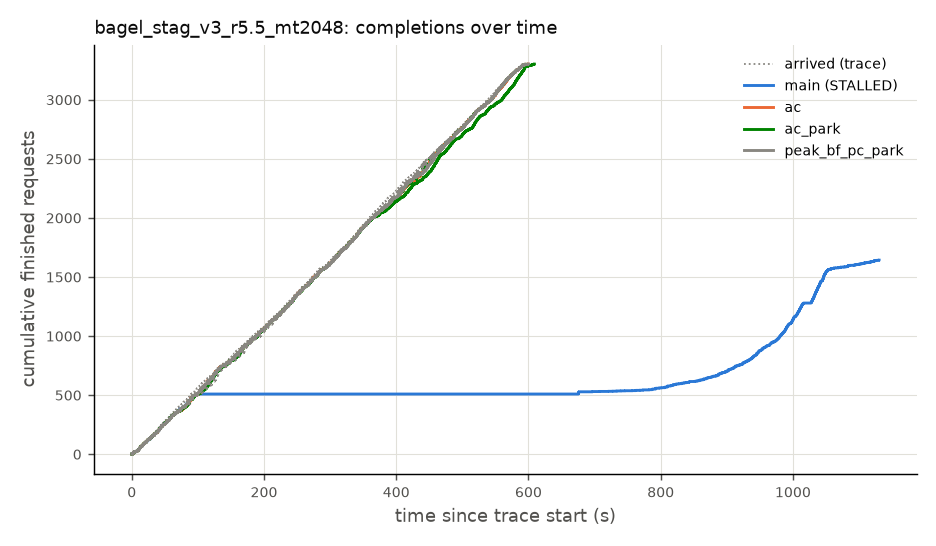
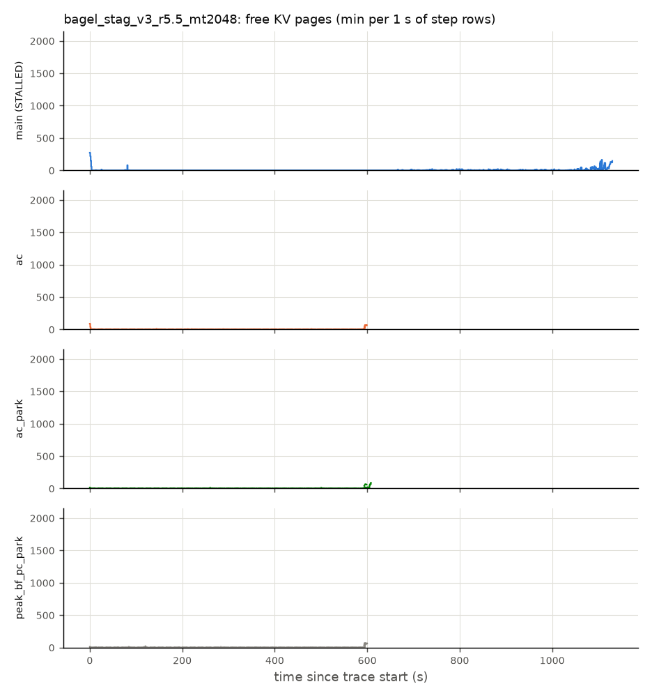
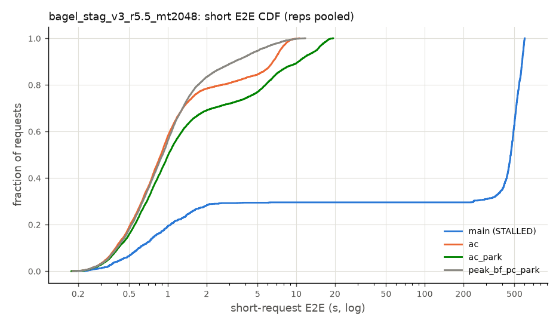
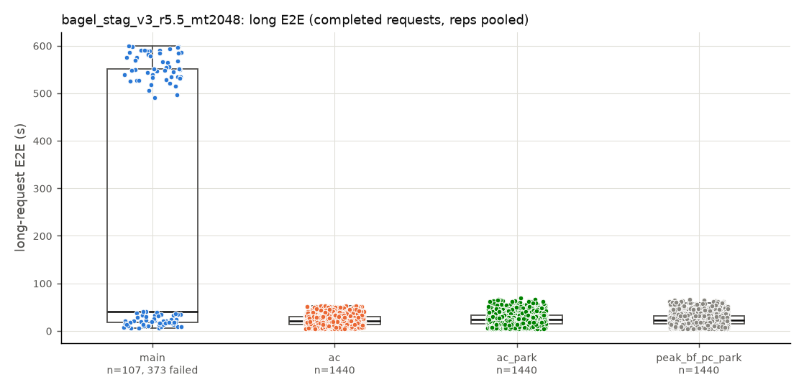

## pub_mooncake_conv_r0.5

| config | n | flags | completed | failed | timed out | duration (s) | out tok/s | max stall (s) | short E2E mean (s) | short E2E p50 (s) | short E2E p99 (s) | short TTFT mean (s) | short TTFT p99 (s) | all E2E mean (s) | all E2E p50 (s) | all E2E p99 (s) | all TTFT p50 (s) | all TTFT p99 (s) | long E2E mean (s) | long E2E max (s) | long TTFT mean (s) | declared/generated (mean) | declared/generated KV | holds | fail: AllocationFailed | fail: GrantDeferred | grant_deferred (adm log) | min free KV pages | GPU busy | decode bs | planner_us p50 | planner_us p99 | KV free lag p50 (ms) | KV free lag p99 (ms) | kv_release |
|---|---|---|---|---|---|---|---|---|---|---|---|---|---|---|---|---|---|---|---|---|---|---|---|---|---|---|---|---|---|---|---|---|---|---|---|
| main | 2 | OVERRUN 2/2 | 1036 | 0 | 0 | 616.1 | 579.0 | 6.9 | 12.55 | 10.96 | 40.97 | 2.860 | 23.818 | 15.92 | 12.29 | 117.77 | 2.209 | 106.346 | 30.3 | 182.7 | 18.96 | 1.00 | 1.000 | 15841 | 15841 | 0 | - | 0 | 85.9% | 14.4 | - | - | 20.4 | 1117.3 | 0 |
| ac | 3 | OVERRUN 3/3 | 1036 | 0 | 0 | 612.9 | 582.1 | 6.9 | 10.20 | 8.85 | 30.51 | 2.906 | 14.540 | 11.22 | 9.70 | 33.15 | 2.382 | 15.275 | 14.6 | 58.2 | 5.56 | 1.00 | 1.000 | 0 | 0 | 0 | 0 | 0 | 94.5% | 10.9 | 131.1 | 350.5 | 18.3 | 1201.2 | 0 |
| ac_park | 3 | OVERRUN 3/3 | 1036 | 0 | 0 | 613.5 | 581.5 | 7.2 | 10.55 | 9.29 | 32.58 | 3.059 | 15.047 | 11.58 | 10.00 | 34.09 | 2.450 | 15.873 | 15.0 | 59.0 | 5.74 | 1.00 | 1.000 | 0 | 0 | 0 | 0 | 0 | 94.8% | 11.2 | 132.6 | 353.6 | 18.4 | 1287.7 | 0 |
| peak_bf_pc_park | 3 | OVERRUN 3/3 | 1036 | 0 | 0 | 613.0 | 582.0 | 7.3 | 9.25 | 8.03 | 29.03 | 1.796 | 7.762 | 10.78 | 9.43 | 34.72 | 1.880 | 17.722 | 15.1 | 60.6 | 5.91 | 1.00 | 1.000 | 2.3 | 0 | 2.3 | 6.7 | 0 | 94.9% | 11.0 | 251.2 | 1151.2 | 18.1 | 1219.3 | 0 |
| *main / ac* |  |  |  |  |  |  | 0.99 |  | 1.23 |  |  |  |  | 1.42 |  |  |  |  | 2.08 |  |  |  |  |  |  |  |  |  |  |  |  |  |  |  |  |
| *ac_park / ac* |  |  |  |  |  |  | 1.00 ≈ (within noise) |  | 1.03 ≈ (within noise) |  |  |  |  | 1.03 ≈ (within noise) |  |  |  |  | 1.03 ≈ (within noise) |  |  |  |  |  |  |  |  |  |  |  |  |  |  |  |  |
| *peak_bf_pc_park / ac* |  |  |  |  |  |  | 1.00 ≈ (within noise) |  | 0.91 |  |  |  |  | 0.96 |  |  |  |  | 1.03 ≈ (within noise) |  |  |  |  |  |  |  |  |  |  |  |  |  |  |  |  |
| *ac / main* |  |  |  |  |  |  | 1.01 |  | 0.81 |  |  |  |  | 0.71 |  |  |  |  | 0.48 |  |  |  |  |  |  |  |  |  |  |  |  |  |  |  |  |
| *ac_park / main* |  |  |  |  |  |  | 1.00 |  | 0.84 |  |  |  |  | 0.73 |  |  |  |  | 0.49 |  |  |  |  |  |  |  |  |  |  |  |  |  |  |  |  |
| *peak_bf_pc_park / main* |  |  |  |  |  |  | 1.01 |  | 0.74 |  |  |  |  | 0.68 |  |  |  |  | 0.50 |  |  |  |  |  |  |  |  |  |  |  |  |  |  |  |  |

**reps: mean [min–max]**

| config | n | short E2E mean (s) | short E2E p50 (s) | short E2E p99 (s) | short TTFT p99 (s) | all E2E mean (s) | all E2E p50 (s) | all E2E p99 (s) | all TTFT p50 (s) | all TTFT p99 (s) | long E2E mean (s) | out tok/s | host ms/step all | host ms/step [0,50) | host ms/step [50,200) | host ms/step [200,400) | host ms/step [400,inf) | mid E2E mean (s) | mid E2E p99 (s) |
|---|---|---|---|---|---|---|---|---|---|---|---|---|---|---|---|---|---|---|---|
| main | 2 | 12.55 [11.29–13.82] | 10.96 [9.62–12.30] | 40.97 [39.89–42.04] | 23.818 [17.799–29.838] | 15.92 [13.53–18.31] | 12.29 [10.57–14.02] | 117.77 [76.67–158.87] | 2.209 [2.111–2.307] | 106.346 [63.787–148.904] | 30.3 [23.3–37.4] | 579.0 [578.8–579.2] | 0.96 [0.55–1.37] | 0.96 [0.55–1.37] | - | - | - | 16.50 [13.87–19.13] | 115.03 [70.28–159.78] |
| ac | 3 | 10.20 [9.90–10.70] | 8.85 [8.43–9.42] | 30.51 [29.38–32.69] | 14.540 [13.765–14.962] | 11.22 [10.90–11.74] | 9.70 [9.47–10.12] | 33.15 [31.76–34.71] | 2.382 [2.306–2.455] | 15.275 [14.588–15.658] | 14.6 [14.2–15.3] | 582.1 [581.6–582.6] | 0.57 [0.47–0.76] | 0.57 [0.47–0.76] | - | - | - | 11.66 [11.32–12.15] | 31.74 [30.55–33.35] |
| ac_park | 3 | 10.55 [10.32–10.79] | 9.29 [9.05–9.73] | 32.58 [31.92–32.96] | 15.047 [14.307–15.490] | 11.58 [11.36–11.82] | 10.00 [9.83–10.29] | 34.09 [33.30–34.60] | 2.450 [2.426–2.477] | 15.873 [15.234–16.419] | 15.0 [14.8–15.3] | 581.5 [580.6–582.1] | 0.56 [0.51–0.66] | 0.56 [0.51–0.66] | - | - | - | 12.02 [11.78–12.24] | 32.22 [31.97–32.36] |
| peak_bf_pc_park | 3 | 9.25 [9.02–9.38] | 8.03 [7.21–8.51] | 29.03 [28.50–29.48] | 7.762 [7.212–8.142] | 10.78 [10.58–10.90] | 9.43 [9.19–9.56] | 34.72 [33.71–35.54] | 1.880 [1.814–1.932] | 17.722 [17.069–18.252] | 15.1 [14.7–15.3] | 582.0 [581.5–582.3] | 0.49 [0.47–0.51] | 0.49 [0.47–0.51] | - | - | - | 11.62 [11.50–11.74] | 33.12 [31.93–33.97] |

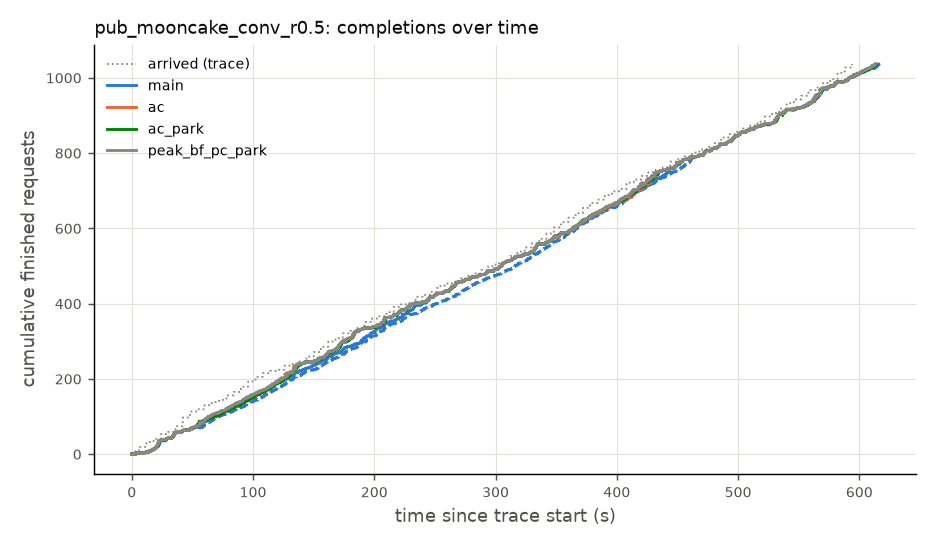
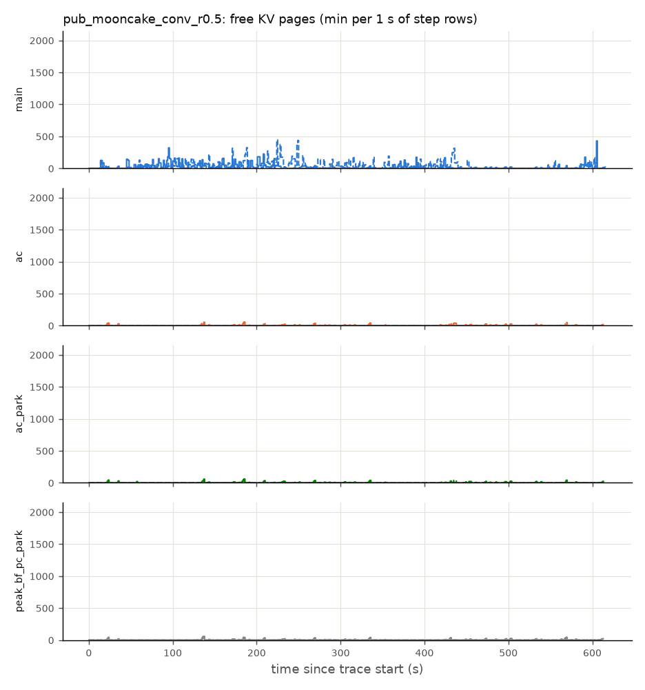
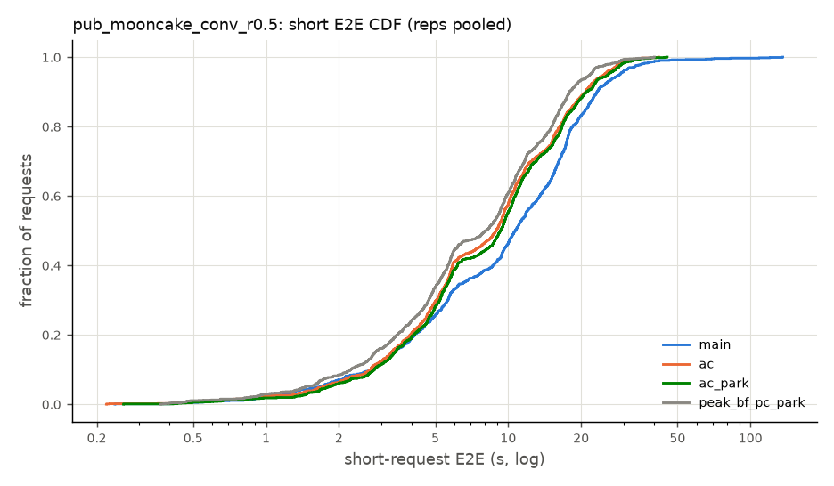
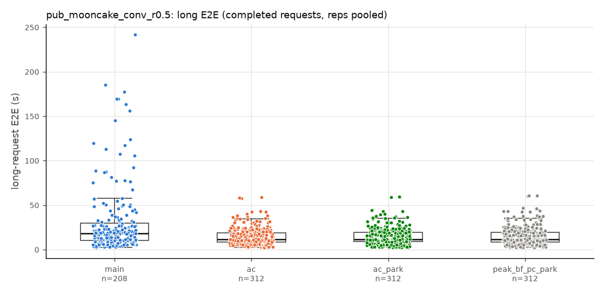

## pub_mooncake_conv_r0.5_mtx2

| config | n | flags | completed | failed | timed out | duration (s) | out tok/s | max stall (s) | short E2E mean (s) | short E2E p50 (s) | short E2E p99 (s) | short TTFT mean (s) | short TTFT p99 (s) | all E2E mean (s) | all E2E p50 (s) | all E2E p99 (s) | all TTFT p50 (s) | all TTFT p99 (s) | long E2E mean (s) | long E2E max (s) | long TTFT mean (s) | declared/generated (mean) | declared/generated KV | holds | fail: AllocationFailed | fail: GrantDeferred | grant_deferred (adm log) | min free KV pages | GPU busy | decode bs | planner_us p50 | planner_us p99 | KV free lag p50 (ms) | KV free lag p99 (ms) | kv_release |
|---|---|---|---|---|---|---|---|---|---|---|---|---|---|---|---|---|---|---|---|---|---|---|---|---|---|---|---|---|---|---|---|---|---|---|---|
| main | 2 | OVERRUN 2/2 | 1036 | 0 | 0 | 615.6 | 579.5 | 6.6 | 12.08 | 10.58 | 38.88 | 2.733 | 18.630 | 14.91 | 11.82 | 78.87 | 2.309 | 64.983 | 28.0 | 212.8 | 16.77 | 1.99 | 1.031 | 13169 | 13169 | 0 | - | 0 | 86.5% | 14.0 | - | - | 19.7 | 1057.4 | 0 |
| ac | 3 | OVERRUN 3/3 | 1036 | 0 | 0 | 612.9 | 582.0 | 6.9 | 10.29 | 9.02 | 31.50 | 3.039 | 14.610 | 11.28 | 9.78 | 33.28 | 2.412 | 15.737 | 14.6 | 56.2 | 5.73 | 1.99 | 1.031 | 0 | 0 | 0 | 0 | 0 | 94.6% | 10.8 | 133.7 | 348.1 | 18.4 | 1300.1 | 0 |
| ac_park | 3 | OVERRUN 3/3 | 1036 | 0 | 0 | 613.3 | 581.7 | 6.9 | 10.77 | 9.47 | 32.31 | 3.185 | 14.711 | 11.75 | 10.23 | 33.86 | 2.492 | 16.135 | 15.0 | 56.5 | 5.90 | 1.99 | 1.031 | 0 | 0 | 0 | 0 | 0 | 94.4% | 11.3 | 135.6 | 342.2 | 18.7 | 1210.9 | 0 |
| peak_bf_pc_park | 3 | OVERRUN 3/3 | 1036 | 0 | 0 | 613.0 | 582.0 | 7.4 | 9.37 | 8.32 | 29.01 | 1.826 | 7.582 | 10.86 | 9.55 | 34.99 | 1.918 | 17.994 | 15.1 | 60.2 | 5.91 | 1.99 | 1.031 | 0 | 0 | 0 | 0 | 0 | 94.5% | 11.0 | 251.3 | 1320.2 | 18.3 | 1218.7 | 0 |
| *main / ac* |  |  |  |  |  |  | 1.00 |  | 1.17 |  |  |  |  | 1.32 |  |  |  |  | 1.92 |  |  |  |  |  |  |  |  |  |  |  |  |  |  |  |  |
| *ac_park / ac* |  |  |  |  |  |  | 1.00 ≈ (within noise) |  | 1.05 ≈ (within noise) |  |  |  |  | 1.04 ≈ (within noise) |  |  |  |  | 1.03 ≈ (within noise) |  |  |  |  |  |  |  |  |  |  |  |  |  |  |  |  |
| *peak_bf_pc_park / ac* |  |  |  |  |  |  | 1.00 ≈ (within noise) |  | 0.91 |  |  |  |  | 0.96 ≈ (within noise) |  |  |  |  | 1.03 ≈ (within noise) |  |  |  |  |  |  |  |  |  |  |  |  |  |  |  |  |
| *ac / main* |  |  |  |  |  |  | 1.00 |  | 0.85 |  |  |  |  | 0.76 |  |  |  |  | 0.52 |  |  |  |  |  |  |  |  |  |  |  |  |  |  |  |  |
| *ac_park / main* |  |  |  |  |  |  | 1.00 |  | 0.89 ≈ (within noise) |  |  |  |  | 0.79 |  |  |  |  | 0.54 |  |  |  |  |  |  |  |  |  |  |  |  |  |  |  |  |
| *peak_bf_pc_park / main* |  |  |  |  |  |  | 1.00 |  | 0.78 |  |  |  |  | 0.73 |  |  |  |  | 0.54 |  |  |  |  |  |  |  |  |  |  |  |  |  |  |  |  |

**reps: mean [min–max]**

| config | n | short E2E mean (s) | short E2E p50 (s) | short E2E p99 (s) | short TTFT p99 (s) | all E2E mean (s) | all E2E p50 (s) | all E2E p99 (s) | all TTFT p50 (s) | all TTFT p99 (s) | long E2E mean (s) | out tok/s | host ms/step all | host ms/step [0,50) | host ms/step [50,200) | host ms/step [200,400) | host ms/step [400,inf) | mid E2E mean (s) | mid E2E p99 (s) |
|---|---|---|---|---|---|---|---|---|---|---|---|---|---|---|---|---|---|---|---|
| main | 2 | 12.08 [11.44–12.71] | 10.58 [10.11–11.05] | 38.88 [38.42–39.33] | 18.630 [16.262–20.998] | 14.91 [13.76–16.06] | 11.82 [10.86–12.79] | 78.87 [72.81–84.93] | 2.309 [2.232–2.386] | 64.983 [63.220–66.747] | 28.0 [23.5–32.5] | 579.5 [579.4–579.5] | 0.87 [0.58–1.16] | 0.87 [0.58–1.16] | - | - | - | 15.17 [14.20–16.13] | 66.54 [63.52–69.57] |
| ac | 3 | 10.29 [9.90–10.65] | 9.02 [8.65–9.52] | 31.50 [30.81–32.58] | 14.610 [14.265–14.947] | 11.28 [10.90–11.66] | 9.78 [9.56–10.06] | 33.28 [32.25–34.62] | 2.412 [2.320–2.478] | 15.737 [15.485–15.961] | 14.6 [14.2–15.1] | 582.0 [581.8–582.4] | 0.55 [0.46–0.69] | 0.55 [0.46–0.69] | - | - | - | 11.69 [11.33–12.09] | 31.82 [30.52–33.10] |
| ac_park | 3 | 10.77 [10.33–11.57] | 9.47 [9.20–9.98] | 32.31 [30.91–34.54] | 14.711 [14.354–15.094] | 11.75 [11.33–12.53] | 10.23 [9.97–10.70] | 33.86 [32.78–35.77] | 2.492 [2.423–2.604] | 16.135 [15.285–16.904] | 15.0 [14.6–15.8] | 581.7 [581.4–582.0] | 0.60 [0.50–0.74] | 0.60 [0.50–0.74] | - | - | - | 12.15 [11.75–12.91] | 32.46 [30.74–34.85] |
| peak_bf_pc_park | 3 | 9.37 [9.24–9.54] | 8.32 [8.10–8.59] | 29.01 [28.22–29.62] | 7.582 [6.272–8.577] | 10.86 [10.64–11.10] | 9.55 [9.38–9.64] | 34.99 [33.65–37.43] | 1.918 [1.893–1.936] | 17.994 [17.707–18.256] | 15.1 [14.8–15.3] | 582.0 [581.7–582.1] | 0.52 [0.48–0.56] | 0.52 [0.48–0.56] | - | - | - | 11.65 [11.36–12.01] | 34.34 [32.95–36.88] |

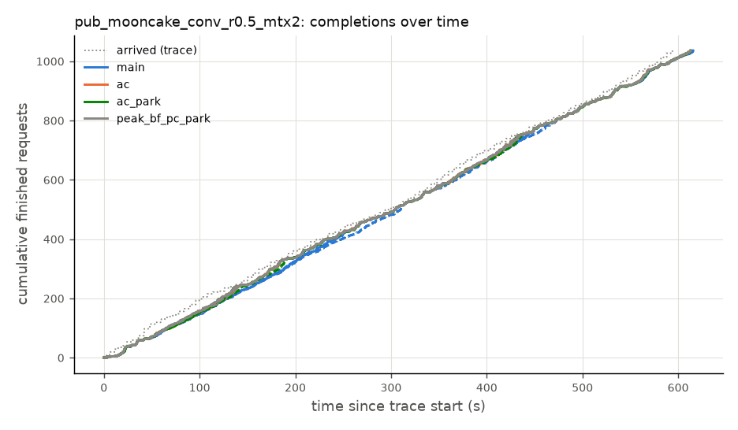
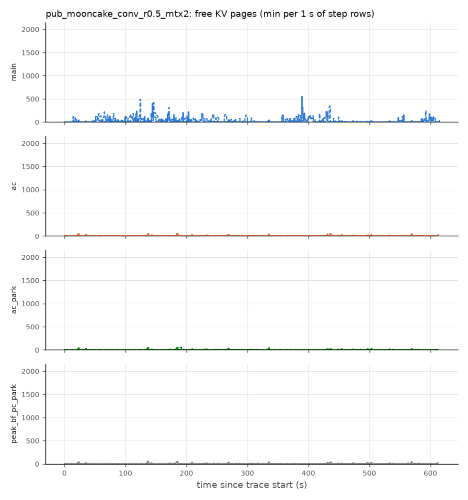
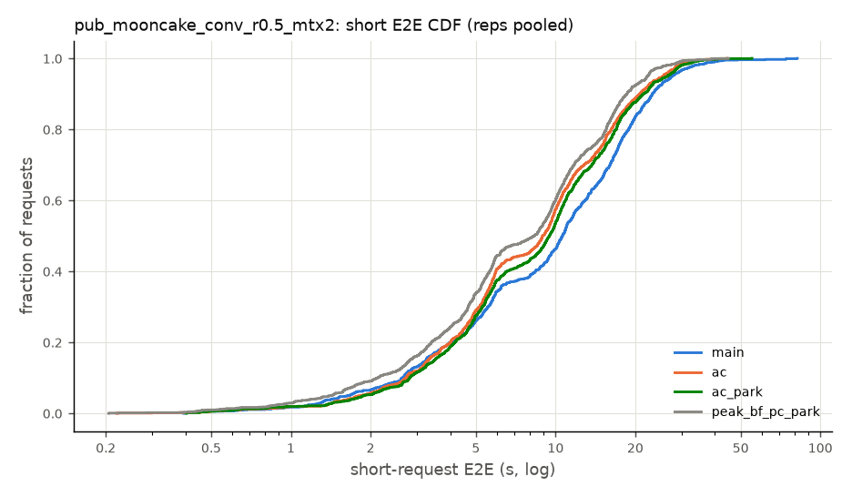
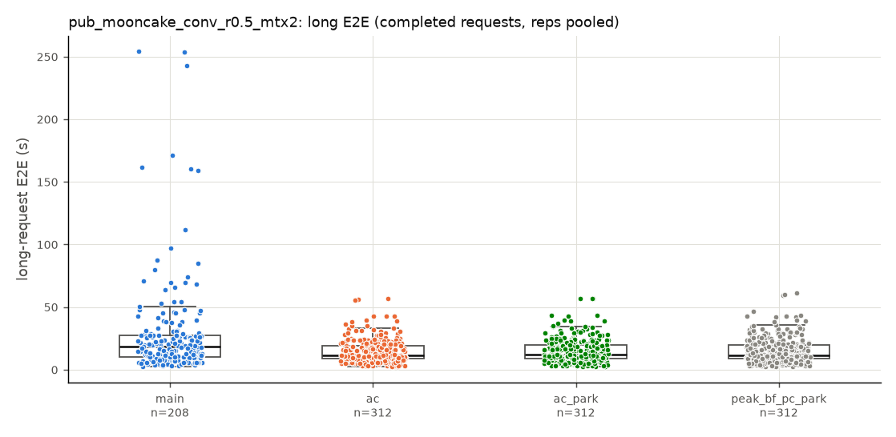

## pub_mooncake_conv_r0.5_mt2048

| config | n | flags | completed | failed | timed out | duration (s) | out tok/s | max stall (s) | short E2E mean (s) | short E2E p50 (s) | short E2E p99 (s) | short TTFT mean (s) | short TTFT p99 (s) | all E2E mean (s) | all E2E p50 (s) | all E2E p99 (s) | all TTFT p50 (s) | all TTFT p99 (s) | long E2E mean (s) | long E2E max (s) | long TTFT mean (s) | declared/generated (mean) | declared/generated KV | holds | fail: AllocationFailed | fail: GrantDeferred | grant_deferred (adm log) | min free KV pages | GPU busy | decode bs | planner_us p50 | planner_us p99 | KV free lag p50 (ms) | KV free lag p99 (ms) | kv_release |
|---|---|---|---|---|---|---|---|---|---|---|---|---|---|---|---|---|---|---|---|---|---|---|---|---|---|---|---|---|---|---|---|---|---|---|---|
| main | 2 | OVERRUN 2/2, STALLED 1/2 | 775 | 0 | 261 | 889.9 | 359.2 | 299.7 | 161.99 | 215.82 | 315.86 | 136.562 | 299.121 | 145.26 | 188.99 | 340.61 | 110.882 | 330.542 | 125.3 | 400.0 | 110.00 | 50.74 | 1.173 | 171605 | 171605 | 0 | - | 0 | 53.6% | 15.6 | - | - | 24.0 | 910.7 | 0 |
| ac | 3 | OVERRUN 3/3 | 1036 | 0 | 0 | 613.4 | 581.6 | 6.7 | 10.83 | 9.55 | 32.71 | 3.599 | 16.244 | 11.79 | 10.19 | 34.68 | 2.619 | 17.170 | 14.9 | 53.5 | 6.26 | 47.06 | 1.159 | 0 | 0 | 0 | 0 | 0 | 94.3% | 11.0 | 128.9 | 462.9 | 18.6 | 1157.3 | 0 |
| ac_park | 3 | OVERRUN 3/3 | 1036 | 0 | 0 | 613.8 | 581.2 | 7.0 | 10.32 | 9.28 | 30.37 | 3.266 | 15.624 | 11.29 | 9.89 | 32.19 | 2.525 | 16.335 | 14.3 | 52.5 | 5.85 | 47.06 | 1.159 | 0 | 0 | 0 | 0 | 0 | 95.3% | 10.8 | 130.4 | 297.9 | 17.5 | 1213.0 | 0 |
| peak_bf_pc_park | 3 | OVERRUN 3/3 | 1036 | 0 | 0 | 614.2 | 580.8 | 7.2 | 9.35 | 8.76 | 27.35 | 1.978 | 8.446 | 11.04 | 9.84 | 35.14 | 2.129 | 20.365 | 15.9 | 58.0 | 6.99 | 47.06 | 1.159 | 0 | 0 | 0 | 0 | 0 | 94.4% | 11.1 | 216.1 | 1200.6 | 18.5 | 1214.8 | 0 |
| *main / ac* |  |  |  |  |  |  | 0.62 |  | 14.96 |  |  |  |  | 12.32 |  |  |  |  | 8.40 |  |  |  |  |  |  |  |  |  |  |  |  |  |  |  |  |
| *ac_park / ac* |  |  |  |  |  |  | 1.00 |  | 0.95 ≈ (within noise) |  |  |  |  | 0.96 ≈ (within noise) |  |  |  |  | 0.96 ≈ (within noise) |  |  |  |  |  |  |  |  |  |  |  |  |  |  |  |  |
| *peak_bf_pc_park / ac* |  |  |  |  |  |  | 1.00 |  | 0.86 |  |  |  |  | 0.94 ≈ (within noise) |  |  |  |  | 1.07 ≈ (within noise) |  |  |  |  |  |  |  |  |  |  |  |  |  |  |  |  |
| *ac / main* |  |  |  |  |  |  | 1.62 |  | 0.07 |  |  |  |  | 0.08 |  |  |  |  | 0.12 |  |  |  |  |  |  |  |  |  |  |  |  |  |  |  |  |
| *ac_park / main* |  |  |  |  |  |  | 1.62 |  | 0.06 |  |  |  |  | 0.08 |  |  |  |  | 0.11 |  |  |  |  |  |  |  |  |  |  |  |  |  |  |  |  |
| *peak_bf_pc_park / main* |  |  |  |  |  |  | 1.62 |  | 0.06 |  |  |  |  | 0.08 |  |  |  |  | 0.13 |  |  |  |  |  |  |  |  |  |  |  |  |  |  |  |  |

**reps: mean [min–max]**

| config | n | short E2E mean (s) | short E2E p50 (s) | short E2E p99 (s) | short TTFT p99 (s) | all E2E mean (s) | all E2E p50 (s) | all E2E p99 (s) | all TTFT p50 (s) | all TTFT p99 (s) | long E2E mean (s) | out tok/s | host ms/step all | host ms/step [0,50) | host ms/step [50,200) | host ms/step [200,400) | host ms/step [400,inf) | mid E2E mean (s) | mid E2E p99 (s) |
|---|---|---|---|---|---|---|---|---|---|---|---|---|---|---|---|---|---|---|---|
| main | 2 | 161.99 [12.28–311.69] | 215.82 [10.64–420.99] | 315.86 [38.46–593.26] | 299.121 [18.144–580.098] | 145.26 [15.04–275.48] | 188.99 [11.78–366.19] | 340.61 [84.63–596.59] | 110.882 [2.274–219.490] | 330.542 [72.535–588.550] | 125.3 [28.7–221.9] | 359.2 [139.4–579.0] | 1.20 [0.93–1.46] | 1.20 [0.93–1.46] | - | - | - | 122.25 [15.07–229.44] | 330.85 [62.67–599.03] |
| ac | 3 | 10.83 [10.26–11.70] | 9.55 [9.01–10.22] | 32.71 [31.19–34.80] | 16.244 [15.053–17.316] | 11.79 [11.23–12.68] | 10.19 [9.79–10.77] | 34.68 [33.12–37.05] | 2.619 [2.521–2.762] | 17.170 [15.790–18.831] | 14.9 [14.3–15.9] | 581.6 [581.4–581.8] | 0.67 [0.49–1.00] | 0.67 [0.49–1.00] | - | - | - | 12.21 [11.65–13.09] | 32.44 [30.54–35.68] |
| ac_park | 3 | 10.32 [10.06–10.81] | 9.28 [9.01–9.66] | 30.37 [30.04–30.73] | 15.624 [15.300–16.052] | 11.29 [10.99–11.82] | 9.89 [9.58–10.34] | 32.19 [31.25–33.62] | 2.525 [2.375–2.719] | 16.335 [15.897–17.174] | 14.3 [14.0–15.0] | 581.2 [580.9–581.3] | 0.52 [0.46–0.61] | 0.52 [0.46–0.61] | - | - | - | 11.73 [11.41–12.29] | 31.05 [30.11–32.74] |
| peak_bf_pc_park | 3 | 9.35 [9.17–9.62] | 8.76 [8.46–9.10] | 27.35 [26.06–29.18] | 8.446 [6.820–10.293] | 11.04 [10.85–11.32] | 9.84 [9.67–10.09] | 35.14 [34.82–35.34] | 2.129 [2.047–2.214] | 20.365 [19.326–21.833] | 15.9 [15.6–16.4] | 580.8 [580.3–581.1] | 0.60 [0.51–0.70] | 0.60 [0.51–0.70] | - | - | - | 11.92 [11.73–12.19] | 34.01 [32.78–34.65] |

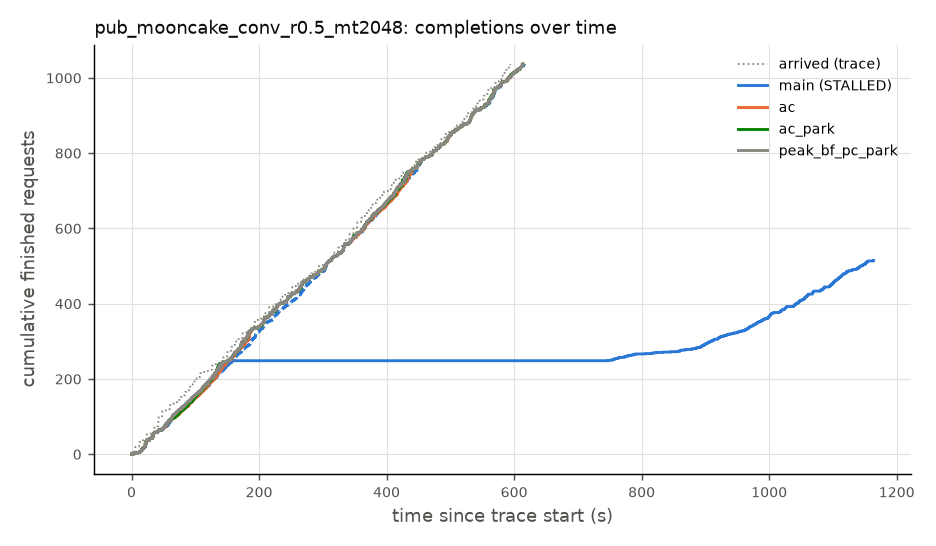
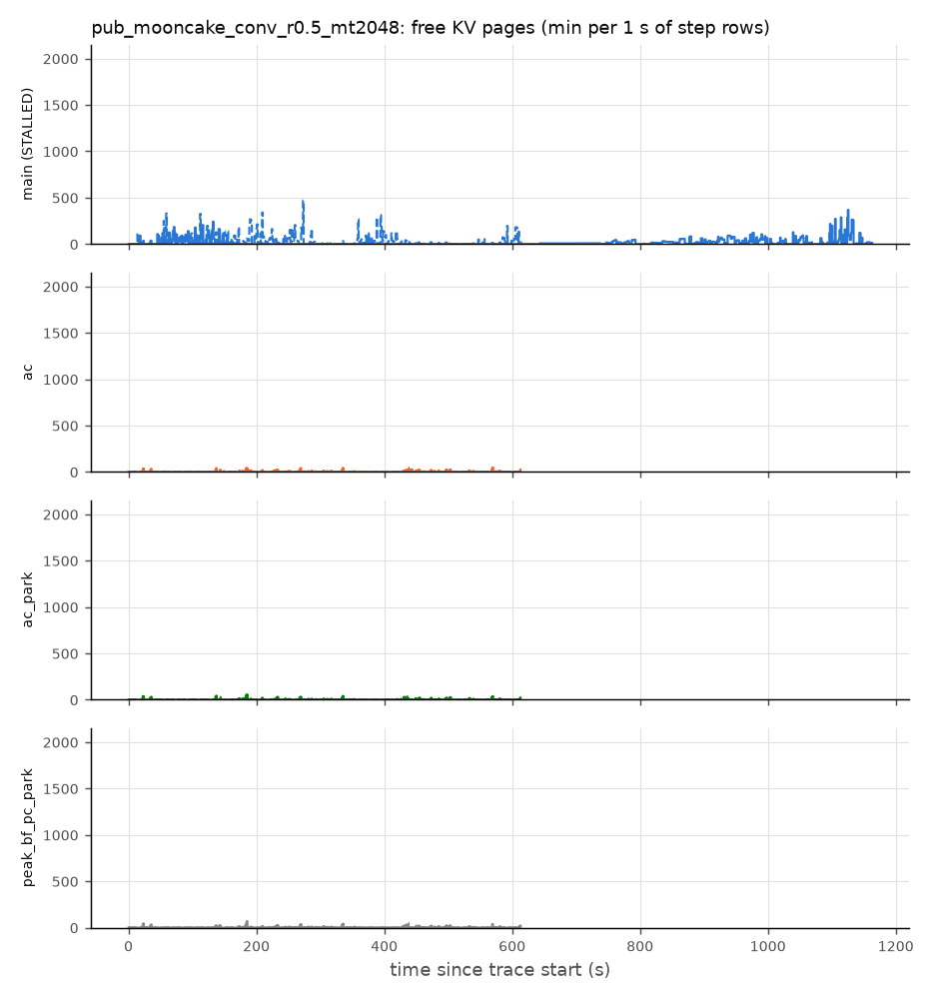
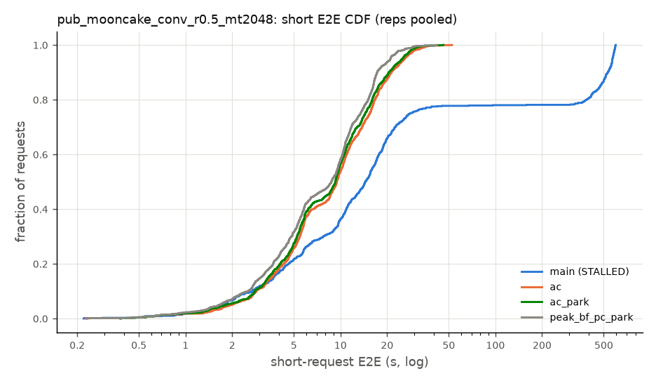
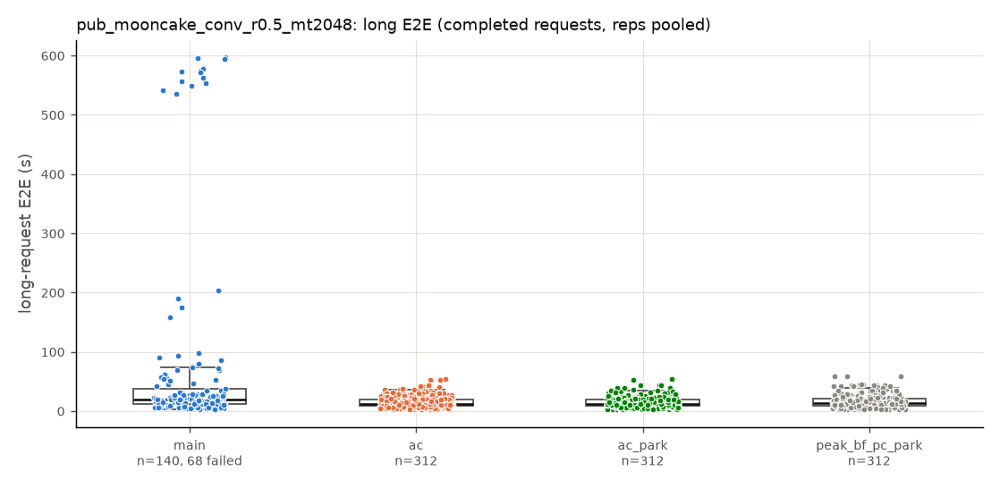

## pub_azure_conv_r1.25

| config | n | flags | completed | failed | timed out | duration (s) | out tok/s | max stall (s) | short E2E mean (s) | short E2E p50 (s) | short E2E p99 (s) | short TTFT mean (s) | short TTFT p99 (s) | all E2E mean (s) | all E2E p50 (s) | all E2E p99 (s) | all TTFT p50 (s) | all TTFT p99 (s) | long E2E mean (s) | long E2E max (s) | long TTFT mean (s) | declared/generated (mean) | declared/generated KV | holds | fail: AllocationFailed | fail: GrantDeferred | grant_deferred (adm log) | min free KV pages | GPU busy | decode bs | planner_us p50 | planner_us p99 | KV free lag p50 (ms) | KV free lag p99 (ms) | kv_release |
|---|---|---|---|---|---|---|---|---|---|---|---|---|---|---|---|---|---|---|---|---|---|---|---|---|---|---|---|---|---|---|---|---|---|---|---|
| main | 1 |  | 4105 | 0 | 0 | 602.0 | 1406.5 | 1.9 | 3.83 | 2.43 | 23.91 | 0.244 | 3.875 | 6.70 | 3.76 | 38.14 | 0.105 | 4.520 | 4.0 | 18.2 | 0.48 | 1.00 | 1.000 | 0 | 0 | 0 | - | 0 | 63.9% | 28.2 | - | - | 37.6 | 489.2 | 0 |
| ac | 3 |  | 4105 | 0 | 0 | 626.7 | 1351.2 | 2.9 | 6.45 | 3.27 | 46.88 | 0.846 | 13.408 | 11.61 | 5.55 | 71.68 | 0.137 | 14.152 | 6.7 | 39.8 | 1.28 | 1.00 | 1.000 | 0 | 0 | 0 | 0 | 0 | 56.4% | 36.0 | 343.4 | 1764.5 | 50.8 | 1105.6 | 0 |
| ac_park | 3 |  | 4105 | 0 | 0 | 620.3 | 1365.7 | 2.4 | 5.57 | 3.12 | 39.86 | 0.540 | 9.117 | 10.12 | 5.02 | 61.36 | 0.125 | 9.666 | 5.7 | 32.1 | 0.85 | 1.00 | 1.000 | 0 | 0 | 0 | 0 | 0 | 57.8% | 34.5 | 346.0 | 1630.7 | 44.6 | 493.3 | 0 |
| peak_bf_pc_park | 3 |  | 4105 | 0 | 0 | 606.5 | 1396.2 | 2.0 | 4.39 | 2.75 | 27.12 | 0.292 | 4.334 | 7.69 | 4.34 | 41.09 | 0.114 | 4.542 | 4.5 | 21.7 | 0.44 | 1.00 | 1.000 | 0 | 0 | 0 | 0 | 0 | 61.8% | 30.6 | 466.5 | 1902.6 | 40.6 | 472.5 | 0 |
| *main / ac* |  |  |  |  |  |  | 1.04 (1 rep) |  | 0.59 (1 rep) |  |  |  |  | 0.58 (1 rep) |  |  |  |  | 0.61 (1 rep) |  |  |  |  |  |  |  |  |  |  |  |  |  |  |  |  |
| *ac_park / ac* |  |  |  |  |  |  | 1.01 ≈ (within noise) |  | 0.86 ≈ (within noise) |  |  |  |  | 0.87 ≈ (within noise) |  |  |  |  | 0.85 ≈ (within noise) |  |  |  |  |  |  |  |  |  |  |  |  |  |  |  |  |
| *peak_bf_pc_park / ac* |  |  |  |  |  |  | 1.03 |  | 0.68 |  |  |  |  | 0.66 |  |  |  |  | 0.67 |  |  |  |  |  |  |  |  |  |  |  |  |  |  |  |  |
| *ac / main* |  |  |  |  |  |  | 0.96 (1 rep) |  | 1.68 (1 rep) |  |  |  |  | 1.73 (1 rep) |  |  |  |  | 1.65 (1 rep) |  |  |  |  |  |  |  |  |  |  |  |  |  |  |  |  |
| *ac_park / main* |  |  |  |  |  |  | 0.97 ≈ (within noise) |  | 1.45 (1 rep) |  |  |  |  | 1.51 (1 rep) |  |  |  |  | 1.41 (1 rep) |  |  |  |  |  |  |  |  |  |  |  |  |  |  |  |  |
| *peak_bf_pc_park / main* |  |  |  |  |  |  | 0.99 ≈ (within noise) |  | 1.15 ≈ (within noise) |  |  |  |  | 1.15 ≈ (within noise) |  |  |  |  | 1.11 ≈ (within noise) |  |  |  |  |  |  |  |  |  |  |  |  |  |  |  |  |

**reps: mean [min–max]**

| config | n | short E2E mean (s) | short E2E p50 (s) | short E2E p99 (s) | short TTFT p99 (s) | all E2E mean (s) | all E2E p50 (s) | all E2E p99 (s) | all TTFT p50 (s) | all TTFT p99 (s) | long E2E mean (s) | out tok/s | host ms/step all | host ms/step [0,50) | host ms/step [50,200) | host ms/step [200,400) | host ms/step [400,inf) | mid E2E mean (s) | mid E2E p99 (s) |
|---|---|---|---|---|---|---|---|---|---|---|---|---|---|---|---|---|---|---|---|
| main | 1 | 3.83 | 2.43 | 23.91 | 3.875 | 6.70 | 3.76 | 38.14 | 0.105 | 4.520 | 4.0 | 1406.5 | 6.11 | 6.11 | - | - | - | 10.96 | 43.14 |
| ac | 3 | 6.45 [5.29–7.07] | 3.27 [2.65–3.61] | 46.88 [38.65–51.73] | 13.408 [7.551–19.009] | 11.61 [9.43–12.88] | 5.55 [4.58–6.41] | 71.68 [61.30–78.69] | 0.137 [0.116–0.152] | 14.152 [8.722–19.292] | 6.7 [5.4–7.4] | 1351.2 [1336.0–1371.6] | 10.05 [6.65–12.24] | 9.81 [6.61–11.91] | 27.40 [20.50–31.25] | - | - | 19.30 [15.63–21.52] | 76.86 [66.80–82.83] |
| ac_park | 3 | 5.57 [4.17–6.30] | 3.12 [2.87–3.24] | 39.86 [21.05–52.23] | 9.117 [3.273–14.089] | 10.12 [7.19–11.65] | 5.02 [4.38–5.40] | 61.36 [37.84–74.62] | 0.125 [0.114–0.131] | 9.666 [3.332–14.728] | 5.7 [4.3–6.5] | 1365.7 [1343.4–1407.6] | 9.25 [8.01–10.15] | 9.16 [8.01–9.87] | 30.02 [27.47–32.57] (n=2) | - | - | 16.93 [11.70–19.63] | 65.83 [41.58–78.68] |
| peak_bf_pc_park | 3 | 4.39 [3.60–5.03] | 2.75 [2.58–3.08] | 27.12 [18.62–37.27] | 4.334 [2.462–6.887] | 7.69 [6.07–9.25] | 4.34 [3.87–4.59] | 41.09 [27.60–59.86] | 0.114 [0.105–0.120] | 4.542 [3.021–7.020] | 4.5 [3.8–5.1] | 1396.2 [1381.7–1407.6] | 7.11 [5.98–8.84] | 7.11 [5.98–8.84] | 25.05 (n=1) | - | - | 12.62 [9.74–15.58] | 44.32 [31.74–62.88] |

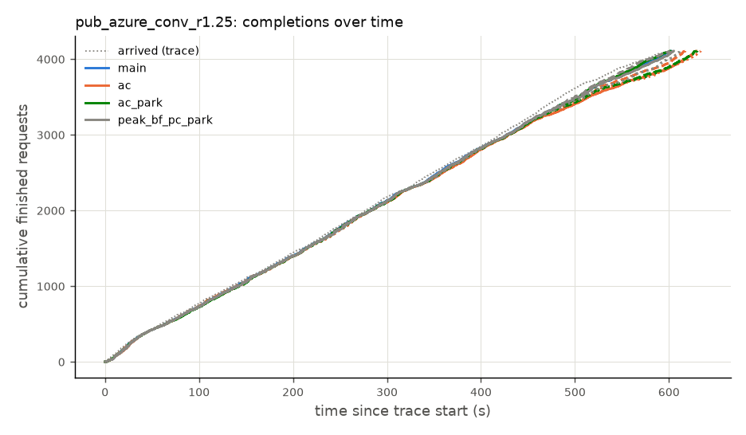
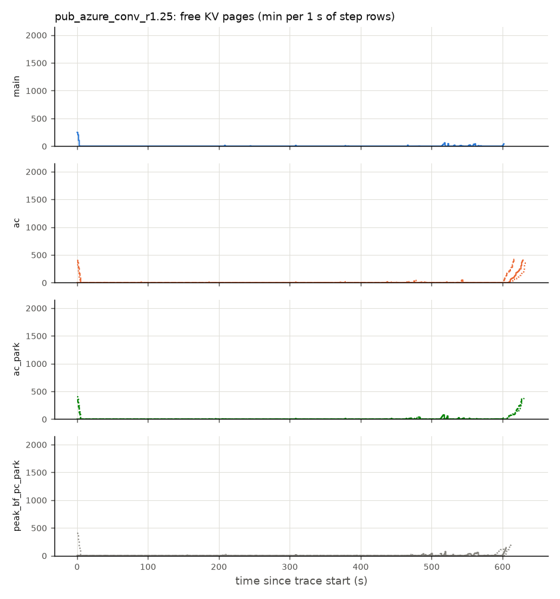
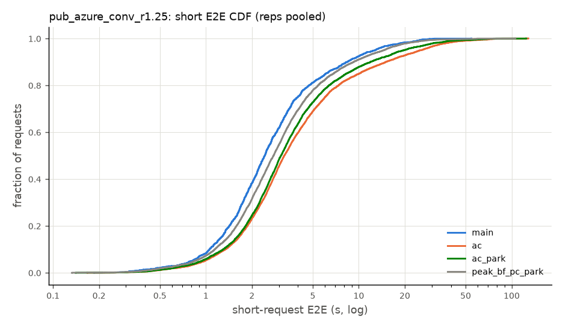
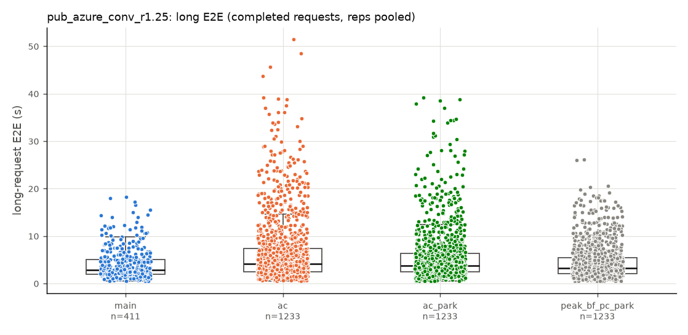

## Data problems

- `13218057_main/pub_mooncake_conv_r0.5_r1` [OVERRUN]
  - server.log in the run window: 2 line(s) with Traceback/OOM/fatal; first: Traceback (most recent call last):
  - OVERRUN: 9 completed request(s) returned more output tokens than the trace's intended length (the emulated stop did not hold) (generated 2-2 vs intended 1-1), so this run's KV use is above what the workload plans
- `13218132_main/pub_mooncake_conv_r0.5_r1` [OVERRUN]
  - server.log in the run window: 6 line(s) with Traceback/OOM/fatal; first: Traceback (most recent call last):
  - OVERRUN: 9 completed request(s) returned more output tokens than the trace's intended length (the emulated stop did not hold) (generated 2-2 vs intended 1-1), so this run's KV use is above what the workload plans
- `13218063_ac/pub_mooncake_conv_r0.5_r1` [OVERRUN]
  - OVERRUN: 9 completed request(s) returned more output tokens than the trace's intended length (the emulated stop did not hold) (generated 2-2 vs intended 1-1), so this run's KV use is above what the workload plans
- `13218131_ac/pub_mooncake_conv_r0.5_r1` [OVERRUN]
  - OVERRUN: 9 completed request(s) returned more output tokens than the trace's intended length (the emulated stop did not hold) (generated 2-2 vs intended 1-1), so this run's KV use is above what the workload plans
- `13218133_ac/pub_mooncake_conv_r0.5_r1` [OVERRUN]
  - OVERRUN: 9 completed request(s) returned more output tokens than the trace's intended length (the emulated stop did not hold) (generated 2-2 vs intended 1-1), so this run's KV use is above what the workload plans
- `13218064_ac_park/pub_mooncake_conv_r0.5_r1` [OVERRUN]
  - OVERRUN: 9 completed request(s) returned more output tokens than the trace's intended length (the emulated stop did not hold) (generated 2-2 vs intended 1-1), so this run's KV use is above what the workload plans
- `13218078_ac_park/pub_mooncake_conv_r0.5_r1` [OVERRUN]
  - OVERRUN: 9 completed request(s) returned more output tokens than the trace's intended length (the emulated stop did not hold) (generated 2-2 vs intended 1-1), so this run's KV use is above what the workload plans
- `13218091_ac_park/pub_mooncake_conv_r0.5_r1` [OVERRUN]
  - OVERRUN: 9 completed request(s) returned more output tokens than the trace's intended length (the emulated stop did not hold) (generated 2-2 vs intended 1-1), so this run's KV use is above what the workload plans
- `13218065_peak_bf_pc_park/pub_mooncake_conv_r0.5_r1` [OVERRUN]
  - OVERRUN: 9 completed request(s) returned more output tokens than the trace's intended length (the emulated stop did not hold) (generated 2-2 vs intended 1-1), so this run's KV use is above what the workload plans
- `13218092_peak_bf_pc_park/pub_mooncake_conv_r0.5_r1` [OVERRUN]
  - OVERRUN: 9 completed request(s) returned more output tokens than the trace's intended length (the emulated stop did not hold) (generated 2-2 vs intended 1-1), so this run's KV use is above what the workload plans
- `13218134_peak_bf_pc_park/pub_mooncake_conv_r0.5_r1` [OVERRUN]
  - server.log: 1 line(s) with Traceback/OOM/fatal; first: Traceback (most recent call last):
  - OVERRUN: 9 completed request(s) returned more output tokens than the trace's intended length (the emulated stop did not hold) (generated 2-2 vs intended 1-1), so this run's KV use is above what the workload plans
- `13218057_main/pub_mooncake_conv_r0.5_mt2048_r1` [OVERRUN, STALLED]
  - server.log in the run window: 1046 line(s) with Traceback/OOM/fatal; first: Traceback (most recent call last):
  - STALLED: 522 request(s) timed out; longest stretch without a completion while requests were outstanding 591.9s, starting at t=155.1s
  - OVERRUN: 6 completed request(s) returned more output tokens than the trace's intended length (the emulated stop did not hold) (generated 2-2 vs intended 1-1), so this run's KV use is above what the workload plans
- `13218132_main/pub_mooncake_conv_r0.5_mt2048_r1` [OVERRUN]
  - server.log in the run window: 3 line(s) with Traceback/OOM/fatal; first: Traceback (most recent call last):
  - OVERRUN: 9 completed request(s) returned more output tokens than the trace's intended length (the emulated stop did not hold) (generated 2-2 vs intended 1-1), so this run's KV use is above what the workload plans
- `13218063_ac/pub_mooncake_conv_r0.5_mt2048_r1` [OVERRUN]
  - OVERRUN: 9 completed request(s) returned more output tokens than the trace's intended length (the emulated stop did not hold) (generated 2-2 vs intended 1-1), so this run's KV use is above what the workload plans
- `13218133_ac/pub_mooncake_conv_r0.5_mt2048_r1` [OVERRUN]
  - OVERRUN: 9 completed request(s) returned more output tokens than the trace's intended length (the emulated stop did not hold) (generated 2-2 vs intended 1-1), so this run's KV use is above what the workload plans
- `13218143_ac/pub_mooncake_conv_r0.5_mt2048_r1` [OVERRUN]
  - server.log: 1 line(s) with Traceback/OOM/fatal; first: Traceback (most recent call last):
  - OVERRUN: 9 completed request(s) returned more output tokens than the trace's intended length (the emulated stop did not hold) (generated 2-2 vs intended 1-1), so this run's KV use is above what the workload plans
- `13218064_ac_park/pub_mooncake_conv_r0.5_mt2048_r1` [OVERRUN]
  - OVERRUN: 9 completed request(s) returned more output tokens than the trace's intended length (the emulated stop did not hold) (generated 2-2 vs intended 1-1), so this run's KV use is above what the workload plans
- `13218091_ac_park/pub_mooncake_conv_r0.5_mt2048_r1` [OVERRUN]
  - OVERRUN: 9 completed request(s) returned more output tokens than the trace's intended length (the emulated stop did not hold) (generated 2-2 vs intended 1-1), so this run's KV use is above what the workload plans
- `13218123_ac_park/pub_mooncake_conv_r0.5_mt2048_r1` [OVERRUN]
  - OVERRUN: 9 completed request(s) returned more output tokens than the trace's intended length (the emulated stop did not hold) (generated 2-2 vs intended 1-1), so this run's KV use is above what the workload plans
- `13218065_peak_bf_pc_park/pub_mooncake_conv_r0.5_mt2048_r1` [OVERRUN]
  - OVERRUN: 9 completed request(s) returned more output tokens than the trace's intended length (the emulated stop did not hold) (generated 2-2 vs intended 1-1), so this run's KV use is above what the workload plans
- `13218092_peak_bf_pc_park/pub_mooncake_conv_r0.5_mt2048_r1` [OVERRUN]
  - OVERRUN: 9 completed request(s) returned more output tokens than the trace's intended length (the emulated stop did not hold) (generated 2-2 vs intended 1-1), so this run's KV use is above what the workload plans
- `13218124_peak_bf_pc_park/pub_mooncake_conv_r0.5_mt2048_r1` [OVERRUN]
  - server.log: 1 line(s) with Traceback/OOM/fatal; first: Traceback (most recent call last):
  - OVERRUN: 9 completed request(s) returned more output tokens than the trace's intended length (the emulated stop did not hold) (generated 2-2 vs intended 1-1), so this run's KV use is above what the workload plans
- `13218057_main/pub_mooncake_conv_r0.5_mtx2_r1` [OVERRUN]
  - server.log in the run window: 8 line(s) with Traceback/OOM/fatal; first: Traceback (most recent call last):
  - OVERRUN: 9 completed request(s) returned more output tokens than the trace's intended length (the emulated stop did not hold) (generated 2-2 vs intended 1-1), so this run's KV use is above what the workload plans
- `13218073_main/pub_mooncake_conv_r0.5_mtx2_r1` [OVERRUN]
  - server.log in the run window: 6 line(s) with Traceback/OOM/fatal; first: Traceback (most recent call last):
  - OVERRUN: 9 completed request(s) returned more output tokens than the trace's intended length (the emulated stop did not hold) (generated 2-2 vs intended 1-1), so this run's KV use is above what the workload plans
- `13218063_ac/pub_mooncake_conv_r0.5_mtx2_r1` [OVERRUN]
  - OVERRUN: 9 completed request(s) returned more output tokens than the trace's intended length (the emulated stop did not hold) (generated 2-2 vs intended 1-1), so this run's KV use is above what the workload plans
- `13218131_ac/pub_mooncake_conv_r0.5_mtx2_r1` [OVERRUN]
  - OVERRUN: 9 completed request(s) returned more output tokens than the trace's intended length (the emulated stop did not hold) (generated 2-2 vs intended 1-1), so this run's KV use is above what the workload plans
- `13218133_ac/pub_mooncake_conv_r0.5_mtx2_r1` [OVERRUN]
  - OVERRUN: 9 completed request(s) returned more output tokens than the trace's intended length (the emulated stop did not hold) (generated 2-2 vs intended 1-1), so this run's KV use is above what the workload plans
- `13218064_ac_park/pub_mooncake_conv_r0.5_mtx2_r1` [OVERRUN]
  - OVERRUN: 9 completed request(s) returned more output tokens than the trace's intended length (the emulated stop did not hold) (generated 2-2 vs intended 1-1), so this run's KV use is above what the workload plans
- `13218078_ac_park/pub_mooncake_conv_r0.5_mtx2_r1` [OVERRUN]
  - OVERRUN: 9 completed request(s) returned more output tokens than the trace's intended length (the emulated stop did not hold) (generated 2-2 vs intended 1-1), so this run's KV use is above what the workload plans
- `13218091_ac_park/pub_mooncake_conv_r0.5_mtx2_r1` [OVERRUN]
  - OVERRUN: 9 completed request(s) returned more output tokens than the trace's intended length (the emulated stop did not hold) (generated 2-2 vs intended 1-1), so this run's KV use is above what the workload plans
- `13218065_peak_bf_pc_park/pub_mooncake_conv_r0.5_mtx2_r1` [OVERRUN]
  - OVERRUN: 9 completed request(s) returned more output tokens than the trace's intended length (the emulated stop did not hold) (generated 2-2 vs intended 1-1), so this run's KV use is above what the workload plans
- `13218079_peak_bf_pc_park/pub_mooncake_conv_r0.5_mtx2_r1` [OVERRUN]
  - OVERRUN: 9 completed request(s) returned more output tokens than the trace's intended length (the emulated stop did not hold) (generated 2-2 vs intended 1-1), so this run's KV use is above what the workload plans
- `13218092_peak_bf_pc_park/pub_mooncake_conv_r0.5_mtx2_r1` [OVERRUN]
  - OVERRUN: 9 completed request(s) returned more output tokens than the trace's intended length (the emulated stop did not hold) (generated 2-2 vs intended 1-1), so this run's KV use is above what the workload plans
- `13218058_main/bagel_burst_v2_r1` [STALLED]
  - server.log: 6296 line(s) with Traceback/OOM/fatal; first: Traceback (most recent call last):
  - STALLED: 1543 request(s) timed out; longest stretch without a completion while requests were outstanding 659.0s, starting at t=37.7s
- `13218066_ac/bagel_burst_v2_r1` [STALLED]
  - STALLED: 0 request(s) timed out; longest stretch without a completion while requests were outstanding 63.6s, starting at t=35.9s
- `13218080_ac/bagel_burst_v2_r1` [STALLED]
  - STALLED: 0 request(s) timed out; longest stretch without a completion while requests were outstanding 60.8s, starting at t=35.5s
- `13218093_ac/bagel_burst_v2_r1` [STALLED]
  - STALLED: 0 request(s) timed out; longest stretch without a completion while requests were outstanding 61.4s, starting at t=35.5s
- `13218058_main/bagel_burst_v2_mt2048_r1` [STALLED]
  - server.log: 6539 line(s) with Traceback/OOM/fatal; first: Traceback (most recent call last):
  - STALLED: 1687 request(s) timed out; longest stretch without a completion while requests were outstanding 703.7s, starting at t=37.7s
- `13218093_ac/bagel_burst_v2_mt2048_r1` [STALLED]
  - STALLED: 0 request(s) timed out; longest stretch without a completion while requests were outstanding 87.1s, starting at t=35.5s
- `13218058_main/bagel_burst_v2_mtx2_r1` [STALLED]
  - server.log: 5943 line(s) with Traceback/OOM/fatal; first: Traceback (most recent call last):
  - STALLED: 1472 request(s) timed out; longest stretch without a completion while requests were outstanding 654.0s, starting at t=37.8s
- `13218066_ac/bagel_burst_v2_mtx2_r1` [STALLED]
  - STALLED: 0 request(s) timed out; longest stretch without a completion while requests were outstanding 61.4s, starting at t=35.6s
- `13218139_peak_bf_pc_park/bagel_burst_v2_mtx2_r1`
  - server.log: 1 line(s) with Traceback/OOM/fatal; first: Traceback (most recent call last):
- `13218059_main/bagel_stag_v3_r5.5_r1`
  - server.log in the run window: 13 line(s) with Traceback/OOM/fatal; first: Traceback (most recent call last):
- `13218059_main/bagel_stag_v3_r5.5_mt2048_r1` [STALLED]
  - server.log: 6588 line(s) with Traceback/OOM/fatal; first: Traceback (most recent call last):
  - STALLED: 1659 request(s) timed out; longest stretch without a completion while requests were outstanding 577.2s, starting at t=97.7s
- `13218141_ac_park/bagel_stag_v3_r5.5_mt2048_r1`
  - server.log: 1 line(s) with Traceback/OOM/fatal; first: Traceback (most recent call last):
- `13218059_main/bagel_stag_v3_r5.5_mtx2_r1` [STALLED]
  - server.log in the run window: 537 line(s) with Traceback/OOM/fatal; first: Traceback (most recent call last):
  - STALLED: 264 request(s) timed out; longest stretch without a completion while requests were outstanding 563.7s, starting at t=429.6s
- `13218138_peak_bf_pc_park/bagel_stag_v3_r5.5_mtx2_r1`
  - server.log: 1 line(s) with Traceback/OOM/fatal; first: Traceback (most recent call last):
