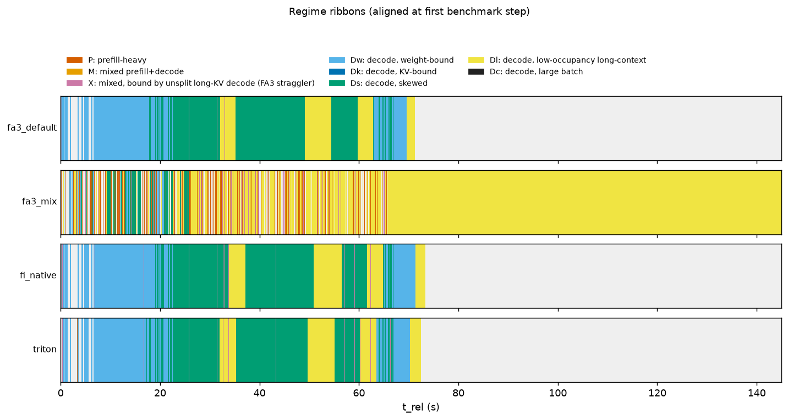

# Telemetry summary: s1_smoke_1011

Regimes: **P** prefill-heavy; **M** mixed prefill+decode; **X** mixed, bound by unsplit long-KV decode (FA3 straggler); **Dw** decode, weight-bound; **Dk** decode, KV-bound; **Ds** decode, skewed; **Dl** decode, low-occupancy long-context; **Dc** decode, large batch.

## fa3_default

- steps: 9365 (warmup steps dropped: 4), GPU busy 67.69 s, wall 71.25 s, utilization 0.950; bench.json completed=240 (distinct request ids in telemetry: 240)
- cudagraph_mode=FULL_AND_PIECEWISE, capture_max=512, cg null steps: 0

| regime | n_steps | step_share | gpu_time_share | gpu_ms_mean | gpu_ms_p50 | gpu_ms_p99 | B_mean | T_mean | maxL_mean | cg_FULL | cg_NONE | cg_PIECEWISE | fa3_dyn32 | fa3_nosplit |
|---|---|---|---|---|---|---|---|---|---|---|---|---|---|---|
| P | 10 | 0.001 | 0.002 | 16.34 | 14.47 | 24.44 | 1.1 | 563.2 | 0 | 0.00 | 0.10 | 0.90 | 0.90 | 0.10 |
| X | 226 | 0.024 | 0.049 | 14.60 | 14.40 | 23.64 | 4.0 | 521.8 | 2982 | 0.00 | 1.00 | 0.00 | 0.00 | 1.00 |
| Dw | 3036 | 0.324 | 0.306 | 6.82 | 6.77 | 8.13 | 1.5 | 1.5 | 1890 | 1.00 | 0.00 | 0.00 | 1.00 | 0.00 |
| Ds | 4382 | 0.468 | 0.460 | 7.11 | 7.06 | 8.43 | 3.5 | 3.5 | 3293 | 1.00 | 0.00 | 0.00 | 1.00 | 0.00 |
| Dl | 1711 | 0.183 | 0.183 | 7.23 | 7.20 | 8.48 | 3.8 | 3.8 | 4302 | 1.00 | 0.00 | 0.00 | 1.00 | 0.00 |

Figures: `fa3_default/a_regime_timeline.png`, `b_kv_fan.png`, `c_regime_breakdown.png`, `d_request_gantt.png`, `e_feature_scatter.png`, `trace.json.gz` (65557 events)

## fa3_mix

- steps: 15475 (warmup steps dropped: 4), GPU busy 143.60 s, wall 144.96 s, utilization 0.991; bench.json completed=480 (distinct request ids in telemetry: 480)
- cudagraph_mode=FULL_AND_PIECEWISE, capture_max=512, cg null steps: 0

| regime | n_steps | step_share | gpu_time_share | gpu_ms_mean | gpu_ms_p50 | gpu_ms_p99 | B_mean | T_mean | maxL_mean | cg_FULL | cg_NONE | cg_PIECEWISE | fa3_dyn32 | fa3_nosplit |
|---|---|---|---|---|---|---|---|---|---|---|---|---|---|---|
| P | 281 | 0.018 | 0.189 | 96.47 | 82.57 | 212.97 | 6.0 | 3867.4 | 4848 | 0.00 | 0.81 | 0.19 | 0.19 | 0.81 |
| X | 140 | 0.009 | 0.035 | 35.88 | 34.66 | 73.03 | 6.2 | 1446.1 | 5567 | 0.00 | 1.00 | 0.00 | 0.00 | 1.00 |
| Dw | 487 | 0.031 | 0.023 | 6.84 | 6.78 | 7.82 | 1.9 | 1.9 | 1859 | 1.00 | 0.00 | 0.00 | 1.00 | 0.00 |
| Ds | 830 | 0.054 | 0.041 | 7.15 | 7.05 | 8.30 | 3.5 | 3.5 | 2885 | 1.00 | 0.00 | 0.00 | 1.00 | 0.00 |
| Dl | 13737 | 0.888 | 0.712 | 7.44 | 7.37 | 8.83 | 2.4 | 2.4 | 8683 | 1.00 | 0.00 | 0.00 | 1.00 | 0.00 |

Figures: `fa3_mix/a_regime_timeline.png`, `b_kv_fan.png`, `c_regime_breakdown.png`, `d_request_gantt.png`, `e_feature_scatter.png`, `trace.json.gz` (108327 events)

## fa3_piecewise

No telemetry produced (RuntimeError: Engine core initialization failed. See root cause above. Failed core proc(s): {}).

## fi_native

- steps: 9077 (warmup steps dropped: 4), GPU busy 69.84 s, wall 73.32 s, utilization 0.952; bench.json completed=240 (distinct request ids in telemetry: 240)
- cudagraph_mode=FULL_AND_PIECEWISE, capture_max=512, cg null steps: 0

| regime | n_steps | step_share | gpu_time_share | gpu_ms_mean | gpu_ms_p50 | gpu_ms_p99 | B_mean | T_mean | maxL_mean | cg_FULL | cg_NONE | cg_PIECEWISE | fa3_dyn32 | fa3_nosplit |
|---|---|---|---|---|---|---|---|---|---|---|---|---|---|---|
| P | 10 | 0.001 | 0.003 | 18.28 | 15.01 | 36.46 | 1.3 | 665.6 | 0 | 0.00 | 0.20 | 0.80 | 0.80 | 0.20 |
| X | 222 | 0.024 | 0.064 | 20.07 | 19.20 | 28.27 | 4.2 | 526.7 | 2972 | 0.00 | 1.00 | 0.00 | 0.00 | 1.00 |
| Dw | 2934 | 0.323 | 0.300 | 7.14 | 7.10 | 7.90 | 1.6 | 1.6 | 1888 | 1.00 | 0.00 | 0.00 | 1.00 | 0.00 |
| Ds | 4161 | 0.458 | 0.444 | 7.45 | 7.40 | 8.33 | 3.7 | 3.7 | 3302 | 1.00 | 0.00 | 0.00 | 1.00 | 0.00 |
| Dl | 1750 | 0.193 | 0.190 | 7.57 | 7.53 | 8.50 | 3.6 | 3.6 | 4303 | 1.00 | 0.00 | 0.00 | 1.00 | 0.00 |

Figures: `fi_native/a_regime_timeline.png`, `b_kv_fan.png`, `c_regime_breakdown.png`, `d_request_gantt.png`, `e_feature_scatter.png`, `trace.json.gz` (63541 events)

## fi_xqa

No telemetry produced (RuntimeError: Engine core initialization failed. See root cause above. Failed core proc(s): {}).

## triton

- steps: 9381 (warmup steps dropped: 4), GPU busy 68.81 s, wall 72.38 s, utilization 0.951; bench.json completed=240 (distinct request ids in telemetry: 240)
- cudagraph_mode=FULL_AND_PIECEWISE, capture_max=512, cg null steps: 0

| regime | n_steps | step_share | gpu_time_share | gpu_ms_mean | gpu_ms_p50 | gpu_ms_p99 | B_mean | T_mean | maxL_mean | cg_FULL | cg_NONE | cg_PIECEWISE | fa3_dyn32 | fa3_nosplit |
|---|---|---|---|---|---|---|---|---|---|---|---|---|---|---|
| P | 11 | 0.001 | 0.008 | 49.40 | 15.29 | 323.88 | 1.4 | 651.7 | 47 | 0.00 | 0.18 | 0.82 | 0.82 | 0.18 |
| X | 223 | 0.024 | 0.061 | 18.69 | 19.03 | 27.68 | 4.0 | 521.9 | 3006 | 0.00 | 1.00 | 0.00 | 0.00 | 1.00 |
| Dw | 3036 | 0.324 | 0.294 | 6.66 | 6.62 | 7.73 | 1.5 | 1.5 | 1922 | 1.00 | 0.00 | 0.00 | 1.00 | 0.00 |
| Ds | 4333 | 0.462 | 0.448 | 7.11 | 7.09 | 7.98 | 3.5 | 3.5 | 3283 | 1.00 | 0.00 | 0.00 | 1.00 | 0.00 |
| Dl | 1778 | 0.190 | 0.190 | 7.35 | 7.37 | 7.87 | 3.8 | 3.8 | 4305 | 1.00 | 0.00 | 0.00 | 1.00 | 0.00 |

Figures: `triton/a_regime_timeline.png`, `b_kv_fan.png`, `c_regime_breakdown.png`, `d_request_gantt.png`, `e_feature_scatter.png`, `trace.json.gz` (65669 events)

## Comparison

| case | reqs | req/s | out tok/s | TTFT p50 | TTFT p99 | TPOT p50 | TPOT p99 | E2E p50 | E2E p99 | GPU busy s | util | P %GPU | X %GPU | Dw %GPU | Ds %GPU | Dl %GPU |
|---|---|---|---|---|---|---|---|---|---|---|---|---|---|---|---|---|
| fa3_default | 240 | 3.31 | 378.5 | 34.5 | 52.9 | 7.2 | 8.2 | 253.4 | 29442.3 | 67.7 | 0.95 | 0.2 | 4.9 | 30.6 | 46.0 | 18.3 |
| fa3_mix | 480 | 3.28 | 273.4 | 116.5 | 559.3 | 12.0 | 123.9 | 276.7 | 17643.5 | 143.6 | 0.99 | 18.9 | 3.5 | 2.3 | 4.1 | 71.2 |
| fi_native | 240 | 3.23 | 369.2 | 41.9 | 69.2 | 7.7 | 8.9 | 277.6 | 31346.9 | 69.8 | 0.95 | 0.3 | 6.4 | 30.0 | 44.4 | 19.0 |
| triton | 240 | 3.28 | 375.1 | 38.3 | 152.8 | 7.3 | 8.7 | 262.4 | 30064.1 | 68.8 | 0.95 | 0.8 | 6.1 | 29.4 | 44.8 | 19.0 |

Latencies in ms. TPOT = (E2E - TTFT)/(output_len - 1) per request; percentiles over per-request values.

