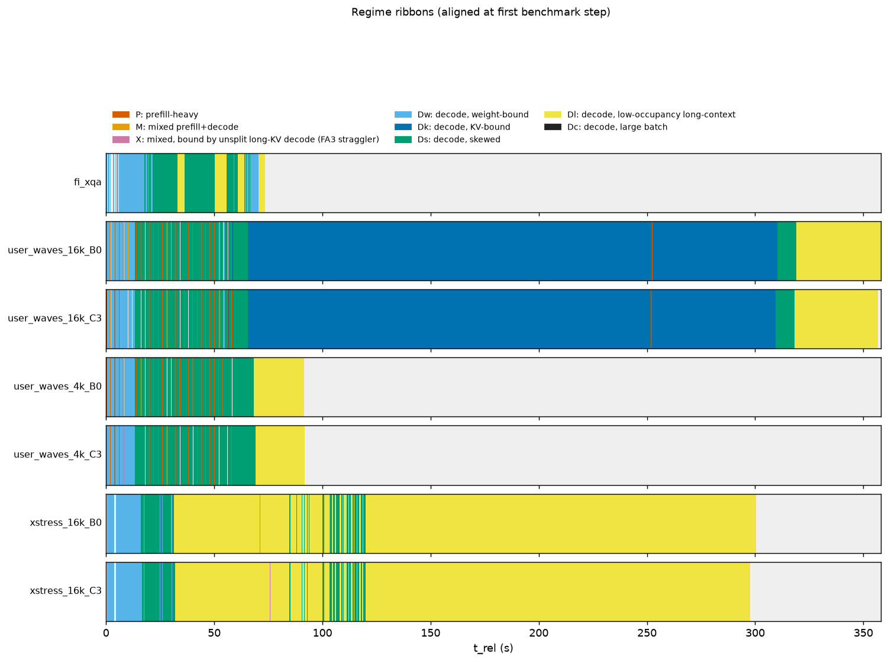

# Telemetry summary: s1b_1013

Regimes: **P** prefill-heavy; **M** mixed prefill+decode; **X** mixed, bound by unsplit long-KV decode (FA3 straggler); **Dw** decode, weight-bound; **Dk** decode, KV-bound; **Ds** decode, skewed; **Dl** decode, low-occupancy long-context; **Dc** decode, large batch.

## fi_xqa

- steps: 9357 (warmup steps dropped: 4), GPU busy 69.69 s, wall 73.35 s, utilization 0.950; bench.json completed=240 (distinct request ids in telemetry: 240)
- cudagraph_mode=FULL_AND_PIECEWISE, capture_max=512, cg null steps: 0

| regime | n_steps | step_share | gpu_time_share | gpu_ms_mean | gpu_ms_p50 | gpu_ms_p99 | B_mean | T_mean | maxL_mean | cg_FULL | cg_NONE | cg_PIECEWISE | fa3_dyn32 | fa3_nosplit |
|---|---|---|---|---|---|---|---|---|---|---|---|---|---|---|
| P | 10 | 0.001 | 0.002 | 15.92 | 14.63 | 24.38 | 1.1 | 563.2 | 0 | 0.00 | 0.10 | 0.90 | 0.90 | 0.10 |
| X | 224 | 0.024 | 0.060 | 18.52 | 17.62 | 28.36 | 4.1 | 526.5 | 2976 | 0.00 | 1.00 | 0.00 | 0.00 | 1.00 |
| Dw | 2937 | 0.314 | 0.291 | 6.90 | 6.83 | 7.98 | 1.5 | 1.5 | 1877 | 1.00 | 0.00 | 0.00 | 1.00 | 0.00 |
| Ds | 4309 | 0.461 | 0.448 | 7.25 | 7.16 | 8.48 | 3.5 | 3.5 | 3290 | 1.00 | 0.00 | 0.00 | 1.00 | 0.00 |
| Dl | 1877 | 0.201 | 0.199 | 7.40 | 7.33 | 8.64 | 3.6 | 3.6 | 4312 | 1.00 | 0.00 | 0.00 | 1.00 | 0.00 |

Figures: `fi_xqa/a_regime_timeline.png`, `b_kv_fan.png`, `c_regime_breakdown.png`, `d_request_gantt.png`, `e_feature_scatter.png`, `trace.json.gz` (65501 events)

## user_waves_16k_B0

- steps: 21729 (warmup steps dropped: 4), GPU busy 357.98 s, wall 358.10 s, utilization 1.000; bench.json completed=960 (distinct request ids in telemetry: 960)
- cudagraph_mode=FULL_AND_PIECEWISE, capture_max=512, cg null steps: 0

| regime | n_steps | step_share | gpu_time_share | gpu_ms_mean | gpu_ms_p50 | gpu_ms_p99 | B_mean | T_mean | maxL_mean | cg_FULL | cg_NONE | cg_PIECEWISE | fa3_dyn32 | fa3_nosplit |
|---|---|---|---|---|---|---|---|---|---|---|---|---|---|---|
| P | 74 | 0.003 | 0.031 | 149.05 | 178.37 | 189.64 | 38.3 | 6523.3 | 3806 | 0.00 | 0.96 | 0.04 | 0.04 | 0.96 |
| M | 6 | 0.000 | 0.000 | 10.02 | 9.45 | 13.20 | 40.8 | 72.5 | 2490 | 0.00 | 0.00 | 1.00 | 1.00 | 0.00 |
| X | 14 | 0.001 | 0.001 | 28.24 | 25.88 | 63.87 | 18.5 | 1078.8 | 3510 | 0.00 | 1.00 | 0.00 | 0.00 | 1.00 |
| Dw | 1571 | 0.072 | 0.032 | 7.25 | 6.91 | 11.77 | 9.5 | 9.5 | 1432 | 1.00 | 0.00 | 0.00 | 1.00 | 0.00 |
| Dk | 12312 | 0.567 | 0.685 | 19.91 | 20.76 | 25.70 | 29.0 | 29.0 | 12542 | 1.00 | 0.00 | 0.00 | 1.00 | 0.00 |
| Ds | 4883 | 0.225 | 0.142 | 10.43 | 9.43 | 21.89 | 22.3 | 22.3 | 5334 | 1.00 | 0.00 | 0.00 | 1.00 | 0.00 |
| Dl | 2869 | 0.132 | 0.109 | 13.62 | 15.10 | 19.87 | 8.5 | 8.5 | 16419 | 1.00 | 0.00 | 0.00 | 1.00 | 0.00 |

Figures: `user_waves_16k_B0/a_regime_timeline.png`, `b_kv_fan.png`, `c_regime_breakdown.png`, `d_request_gantt.png`, `e_feature_scatter.png`, `trace.json.gz` (152105 events)

## user_waves_16k_C3

- steps: 21646 (warmup steps dropped: 4), GPU busy 356.54 s, wall 356.64 s, utilization 1.000; bench.json completed=960 (distinct request ids in telemetry: 960)
- cudagraph_mode=FULL_AND_PIECEWISE, capture_max=512, cg null steps: 0

| regime | n_steps | step_share | gpu_time_share | gpu_ms_mean | gpu_ms_p50 | gpu_ms_p99 | B_mean | T_mean | maxL_mean | cg_FULL | cg_NONE | cg_PIECEWISE | fa3_dyn32 | fa3_nosplit |
|---|---|---|---|---|---|---|---|---|---|---|---|---|---|---|
| P | 78 | 0.004 | 0.031 | 141.95 | 175.54 | 189.60 | 38.5 | 6182.9 | 3694 | 0.00 | 0.94 | 0.06 | 0.06 | 0.94 |
| M | 3 | 0.000 | 0.000 | 10.57 | 10.04 | 11.97 | 43.7 | 81.0 | 3089 | 0.00 | 0.00 | 1.00 | 1.00 | 0.00 |
| X | 13 | 0.001 | 0.001 | 32.61 | 27.19 | 67.31 | 17.2 | 1237.5 | 3027 | 0.00 | 1.00 | 0.00 | 0.00 | 1.00 |
| Dw | 1584 | 0.073 | 0.032 | 7.28 | 6.92 | 11.79 | 9.7 | 9.7 | 1444 | 1.00 | 0.00 | 0.00 | 1.00 | 0.00 |
| Dk | 12322 | 0.569 | 0.685 | 19.83 | 20.69 | 25.53 | 29.0 | 29.0 | 12527 | 1.00 | 0.00 | 0.00 | 1.00 | 0.00 |
| Ds | 4856 | 0.224 | 0.142 | 10.42 | 9.43 | 21.97 | 22.2 | 22.2 | 5327 | 1.00 | 0.00 | 0.00 | 1.00 | 0.00 |
| Dl | 2790 | 0.129 | 0.108 | 13.80 | 15.11 | 19.84 | 8.7 | 8.7 | 16416 | 1.00 | 0.00 | 0.00 | 1.00 | 0.00 |

Figures: `user_waves_16k_C3/a_regime_timeline.png`, `b_kv_fan.png`, `c_regime_breakdown.png`, `d_request_gantt.png`, `e_feature_scatter.png`, `trace.json.gz` (151524 events)

## user_waves_4k_B0

- steps: 9652 (warmup steps dropped: 4), GPU busy 91.41 s, wall 91.48 s, utilization 0.999; bench.json completed=960 (distinct request ids in telemetry: 960)
- cudagraph_mode=FULL_AND_PIECEWISE, capture_max=512, cg null steps: 0

| regime | n_steps | step_share | gpu_time_share | gpu_ms_mean | gpu_ms_p50 | gpu_ms_p99 | B_mean | T_mean | maxL_mean | cg_FULL | cg_NONE | cg_PIECEWISE | fa3_dyn32 | fa3_nosplit |
|---|---|---|---|---|---|---|---|---|---|---|---|---|---|---|
| P | 73 | 0.008 | 0.118 | 148.04 | 175.19 | 209.86 | 37.2 | 6489.6 | 3209 | 0.00 | 0.96 | 0.04 | 0.04 | 0.96 |
| M | 2 | 0.000 | 0.000 | 10.14 | 10.14 | 11.49 | 38.0 | 64.0 | 1898 | 0.00 | 0.00 | 1.00 | 1.00 | 0.00 |
| X | 18 | 0.002 | 0.006 | 28.49 | 27.97 | 46.73 | 16.3 | 1096.6 | 3110 | 0.00 | 1.00 | 0.00 | 0.00 | 1.00 |
| Dw | 1518 | 0.157 | 0.118 | 7.11 | 6.91 | 8.49 | 7.8 | 7.8 | 1278 | 1.00 | 0.00 | 0.00 | 1.00 | 0.00 |
| Ds | 5253 | 0.544 | 0.503 | 8.76 | 8.98 | 10.21 | 20.5 | 20.5 | 3883 | 1.00 | 0.00 | 0.00 | 1.00 | 0.00 |
| Dl | 2788 | 0.289 | 0.255 | 8.35 | 8.48 | 9.38 | 9.0 | 9.0 | 4419 | 1.00 | 0.00 | 0.00 | 1.00 | 0.00 |

Figures: `user_waves_4k_B0/a_regime_timeline.png`, `b_kv_fan.png`, `c_regime_breakdown.png`, `d_request_gantt.png`, `e_feature_scatter.png`, `trace.json.gz` (67566 events)

## user_waves_4k_C3

- steps: 9503 (warmup steps dropped: 4), GPU busy 91.70 s, wall 91.78 s, utilization 0.999; bench.json completed=960 (distinct request ids in telemetry: 960)
- cudagraph_mode=FULL_AND_PIECEWISE, capture_max=512, cg null steps: 0

| regime | n_steps | step_share | gpu_time_share | gpu_ms_mean | gpu_ms_p50 | gpu_ms_p99 | B_mean | T_mean | maxL_mean | cg_FULL | cg_NONE | cg_PIECEWISE | fa3_dyn32 | fa3_nosplit |
|---|---|---|---|---|---|---|---|---|---|---|---|---|---|---|
| P | 73 | 0.008 | 0.118 | 148.32 | 176.07 | 189.12 | 36.5 | 6524.1 | 3202 | 0.00 | 0.96 | 0.04 | 0.04 | 0.96 |
| M | 1 | 0.000 | 0.000 | 10.09 | 10.09 | 10.09 | 46.0 | 88.0 | 3560 | 0.00 | 0.00 | 1.00 | 1.00 | 0.00 |
| X | 18 | 0.002 | 0.006 | 29.58 | 22.21 | 104.17 | 15.7 | 954.1 | 3047 | 0.00 | 1.00 | 0.00 | 0.00 | 1.00 |
| Dw | 1520 | 0.160 | 0.118 | 7.10 | 6.91 | 8.39 | 7.8 | 7.8 | 1278 | 1.00 | 0.00 | 0.00 | 1.00 | 0.00 |
| Ds | 5247 | 0.552 | 0.511 | 8.93 | 9.17 | 10.38 | 20.6 | 20.6 | 3882 | 1.00 | 0.00 | 0.00 | 1.00 | 0.00 |
| Dl | 2644 | 0.278 | 0.247 | 8.58 | 8.70 | 9.41 | 9.3 | 9.3 | 4420 | 1.00 | 0.00 | 0.00 | 1.00 | 0.00 |

Figures: `user_waves_4k_C3/a_regime_timeline.png`, `b_kv_fan.png`, `c_regime_breakdown.png`, `d_request_gantt.png`, `e_feature_scatter.png`, `trace.json.gz` (66523 events)

## xstress_16k_B0

- steps: 27889 (warmup steps dropped: 4), GPU busy 298.67 s, wall 300.51 s, utilization 0.994; bench.json completed=960 (distinct request ids in telemetry: 960)
- cudagraph_mode=FULL_AND_PIECEWISE, capture_max=512, cg null steps: 0

| regime | n_steps | step_share | gpu_time_share | gpu_ms_mean | gpu_ms_p50 | gpu_ms_p99 | B_mean | T_mean | maxL_mean | cg_FULL | cg_NONE | cg_PIECEWISE | fa3_dyn32 | fa3_nosplit |
|---|---|---|---|---|---|---|---|---|---|---|---|---|---|---|
| P | 8 | 0.000 | 0.000 | 15.01 | 14.63 | 17.82 | 1.0 | 512.0 | 0 | 0.00 | 0.00 | 1.00 | 1.00 | 0.00 |
| X | 902 | 0.032 | 0.052 | 17.28 | 16.77 | 30.05 | 10.1 | 549.5 | 7341 | 0.00 | 1.00 | 0.00 | 0.00 | 1.00 |
| Dw | 2092 | 0.075 | 0.048 | 6.82 | 6.76 | 7.97 | 2.5 | 2.5 | 1291 | 1.00 | 0.00 | 0.00 | 1.00 | 0.00 |
| Ds | 2784 | 0.100 | 0.079 | 8.49 | 6.99 | 11.77 | 9.0 | 9.0 | 6645 | 1.00 | 0.00 | 0.00 | 1.00 | 0.00 |
| Dl | 22103 | 0.793 | 0.820 | 11.09 | 11.57 | 16.09 | 9.7 | 9.7 | 12766 | 1.00 | 0.00 | 0.00 | 1.00 | 0.00 |

Figures: `xstress_16k_B0/a_regime_timeline.png`, `b_kv_fan.png`, `c_regime_breakdown.png`, `d_request_gantt.png`, `e_feature_scatter.png`, `trace.json.gz` (195225 events)

## xstress_16k_C3

- steps: 27812 (warmup steps dropped: 4), GPU busy 296.05 s, wall 297.82 s, utilization 0.994; bench.json completed=960 (distinct request ids in telemetry: 960)
- cudagraph_mode=FULL_AND_PIECEWISE, capture_max=512, cg null steps: 0

| regime | n_steps | step_share | gpu_time_share | gpu_ms_mean | gpu_ms_p50 | gpu_ms_p99 | B_mean | T_mean | maxL_mean | cg_FULL | cg_NONE | cg_PIECEWISE | fa3_dyn32 | fa3_nosplit |
|---|---|---|---|---|---|---|---|---|---|---|---|---|---|---|
| P | 9 | 0.000 | 0.000 | 15.10 | 14.81 | 19.03 | 1.0 | 512.0 | 0 | 0.00 | 0.00 | 1.00 | 1.00 | 0.00 |
| X | 901 | 0.032 | 0.050 | 16.52 | 15.27 | 30.27 | 10.2 | 549.5 | 7366 | 0.00 | 1.00 | 0.00 | 0.00 | 1.00 |
| Dw | 2110 | 0.076 | 0.049 | 6.88 | 6.78 | 9.27 | 2.5 | 2.5 | 1315 | 1.00 | 0.00 | 0.00 | 1.00 | 0.00 |
| Ds | 2751 | 0.099 | 0.079 | 8.49 | 7.01 | 11.75 | 9.0 | 9.0 | 6697 | 1.00 | 0.00 | 0.00 | 1.00 | 0.00 |
| Dl | 22041 | 0.792 | 0.821 | 11.03 | 11.53 | 15.97 | 9.7 | 9.7 | 12756 | 1.00 | 0.00 | 0.00 | 1.00 | 0.00 |

Figures: `xstress_16k_C3/a_regime_timeline.png`, `b_kv_fan.png`, `c_regime_breakdown.png`, `d_request_gantt.png`, `e_feature_scatter.png`, `trace.json.gz` (194686 events)

## Comparison

| case | reqs | req/s | out tok/s | TTFT p50 | TTFT p99 | TPOT p50 | TPOT p99 | E2E p50 | E2E p99 | GPU busy s | util | P %GPU | M %GPU | X %GPU | Dw %GPU | Dk %GPU | Ds %GPU | Dl %GPU |
|---|---|---|---|---|---|---|---|---|---|---|---|---|---|---|---|---|---|---|
| fi_xqa | 240 | 3.26 | 373.5 | 40.5 | 63.3 | 7.4 | 8.8 | 265.7 | 30509.2 | 69.7 | 0.95 | 0.2 | 0.0 | 6.0 | 29.1 | 0.0 | 44.8 | 19.9 |
| user_waves_16k_B0 | 960 | 2.68 | 1418.2 | 399.9 | 462.7 | 11.5 | 21.6 | 682.8 | 299989.2 | 358.0 | 1.00 | 3.1 | 0.0 | 0.1 | 3.2 | 68.5 | 14.2 | 10.9 |
| user_waves_16k_C3 | 960 | 2.69 | 1421.2 | 385.6 | 447.8 | 11.6 | 21.2 | 685.2 | 299163.4 | 356.5 | 1.00 | 3.1 | 0.0 | 0.1 | 3.2 | 68.5 | 14.2 | 10.8 |
| user_waves_4k_B0 | 960 | 10.38 | 1598.6 | 374.9 | 489.2 | 11.2 | 20.5 | 687.2 | 41616.9 | 91.4 | 1.00 | 11.8 | 0.0 | 0.6 | 11.8 | 0.0 | 50.3 | 25.5 |
| user_waves_4k_C3 | 960 | 10.28 | 1584.0 | 386.7 | 472.9 | 10.8 | 20.7 | 690.6 | 42496.2 | 91.7 | 1.00 | 11.8 | 0.0 | 0.6 | 11.8 | 0.0 | 51.1 | 24.7 |
| xstress_16k_B0 | 960 | 3.19 | 843.7 | 41.6 | 69.3 | 8.6 | 13.4 | 313.6 | 191868.5 | 298.7 | 0.99 | 0.0 | 0.0 | 5.2 | 4.8 | 0.0 | 7.9 | 82.0 |
| xstress_16k_C3 | 960 | 3.21 | 848.5 | 39.4 | 89.1 | 8.5 | 12.9 | 312.8 | 188966.5 | 296.0 | 0.99 | 0.0 | 0.0 | 5.0 | 4.9 | 0.0 | 7.9 | 82.1 |

Latencies in ms. TPOT = (E2E - TTFT)/(output_len - 1) per request; percentiles over per-request values.

