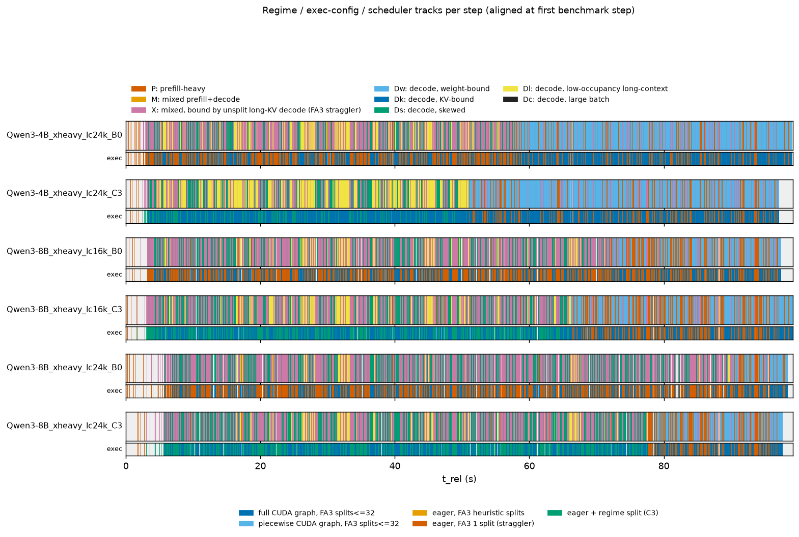

# Telemetry summary: s1c_1015

Regimes: **P** prefill-heavy; **M** mixed prefill+decode; **X** mixed, bound by unsplit long-KV decode (FA3 straggler); **Dw** decode, weight-bound; **Dk** decode, KV-bound; **Ds** decode, skewed; **Dl** decode, low-occupancy long-context; **Dc** decode, large batch.

## Qwen3-4B_xheavy_lc24k_B0

- steps: 10333 (warmup steps dropped: 4), GPU busy 97.93 s, wall 99.02 s, utilization 0.989; bench.json completed=2400 (distinct request ids in telemetry: 2400)
- cudagraph_mode=FULL_AND_PIECEWISE, capture_max=512, cg null steps: 0

| regime | n_steps | step_share | gpu_time_share | gpu_ms_mean | gpu_ms_p50 | gpu_ms_p99 | B_mean | T_mean | maxL_mean | cg_FULL | cg_NONE | cg_PIECEWISE | fa3_dyn32 | fa3_nosplit |
|---|---|---|---|---|---|---|---|---|---|---|---|---|---|---|
| P | 525 | 0.051 | 0.109 | 20.32 | 14.65 | 214.21 | 10.6 | 1085.4 | 5214 | 0.00 | 0.70 | 0.30 | 0.30 | 0.70 |
| X | 1454 | 0.141 | 0.331 | 22.26 | 22.01 | 43.42 | 15.4 | 894.2 | 18203 | 0.00 | 1.00 | 0.00 | 0.00 | 1.00 |
| Dw | 5438 | 0.526 | 0.267 | 4.80 | 4.64 | 7.27 | 6.3 | 6.3 | 936 | 1.00 | 0.00 | 0.00 | 1.00 | 0.00 |
| Ds | 1449 | 0.140 | 0.149 | 10.07 | 10.05 | 11.64 | 21.4 | 21.4 | 26006 | 1.00 | 0.00 | 0.00 | 1.00 | 0.00 |
| Dl | 1467 | 0.142 | 0.145 | 9.68 | 9.65 | 10.11 | 13.1 | 13.1 | 26018 | 1.00 | 0.00 | 0.00 | 1.00 | 0.00 |

Figures: `Qwen3-4B_xheavy_lc24k_B0/a_regime_timeline.png`, `b_kv_fan.png`, `c_regime_breakdown.png`, `d_request_gantt.png`, `e_feature_scatter.png`, `trace.json.gz` (82667 events)

## Qwen3-4B_xheavy_lc24k_C3

- steps: 11070 (warmup steps dropped: 4), GPU busy 95.86 s, wall 97.11 s, utilization 0.987; bench.json completed=2400 (distinct request ids in telemetry: 2365)
- cudagraph_mode=FULL_AND_PIECEWISE, capture_max=512, cg null steps: 0

| regime | n_steps | step_share | gpu_time_share | gpu_ms_mean | gpu_ms_p50 | gpu_ms_p99 | B_mean | T_mean | maxL_mean | cg_FULL | cg_NONE | cg_PIECEWISE | fa3_dyn32 | fa3_nosplit |
|---|---|---|---|---|---|---|---|---|---|---|---|---|---|---|
| P | 586 | 0.053 | 0.121 | 19.85 | 14.66 | 205.81 | 9.9 | 1087.6 | 4328 | 0.00 | 0.72 | 0.28 | 0.28 | 0.72 |
| X | 1377 | 0.124 | 0.261 | 18.16 | 16.82 | 37.74 | 13.6 | 873.9 | 16855 | 0.00 | 1.00 | 0.00 | 0.00 | 1.00 |
| Dw | 6056 | 0.547 | 0.304 | 4.81 | 4.66 | 7.12 | 6.4 | 6.4 | 941 | 1.00 | 0.00 | 0.00 | 1.00 | 0.00 |
| Ds | 1039 | 0.094 | 0.109 | 10.07 | 10.02 | 11.80 | 20.9 | 20.9 | 25861 | 1.00 | 0.00 | 0.00 | 1.00 | 0.00 |
| Dl | 2012 | 0.182 | 0.204 | 9.74 | 9.71 | 10.40 | 12.9 | 12.9 | 26107 | 1.00 | 0.00 | 0.00 | 1.00 | 0.00 |

Figures: `Qwen3-4B_xheavy_lc24k_C3/a_regime_timeline.png`, `b_kv_fan.png`, `c_regime_breakdown.png`, `d_request_gantt.png`, `e_feature_scatter.png`, `trace.json.gz` (88563 events)

## Qwen3-8B_xheavy_lc16k_B0

- steps: 6355 (warmup steps dropped: 4), GPU busy 97.37 s, wall 97.46 s, utilization 0.999; bench.json completed=2400 (distinct request ids in telemetry: 2370)
- cudagraph_mode=FULL_AND_PIECEWISE, capture_max=512, cg null steps: 0

| regime | n_steps | step_share | gpu_time_share | gpu_ms_mean | gpu_ms_p50 | gpu_ms_p99 | B_mean | T_mean | maxL_mean | cg_FULL | cg_NONE | cg_PIECEWISE | fa3_dyn32 | fa3_nosplit |
|---|---|---|---|---|---|---|---|---|---|---|---|---|---|---|
| P | 446 | 0.070 | 0.126 | 27.41 | 21.28 | 224.55 | 15.2 | 1049.9 | 3877 | 0.00 | 0.76 | 0.24 | 0.24 | 0.76 |
| X | 1390 | 0.219 | 0.434 | 30.42 | 27.70 | 76.41 | 21.5 | 975.5 | 16009 | 0.00 | 1.00 | 0.00 | 0.00 | 1.00 |
| Dw | 1818 | 0.286 | 0.138 | 7.37 | 7.39 | 8.42 | 10.6 | 10.6 | 964 | 1.00 | 0.00 | 0.00 | 1.00 | 0.00 |
| Ds | 1845 | 0.290 | 0.209 | 11.01 | 10.94 | 12.83 | 23.6 | 23.6 | 17955 | 1.00 | 0.00 | 0.00 | 1.00 | 0.00 |
| Dl | 856 | 0.135 | 0.094 | 10.70 | 10.65 | 11.61 | 13.3 | 13.3 | 18096 | 1.00 | 0.00 | 0.00 | 1.00 | 0.00 |

Figures: `Qwen3-8B_xheavy_lc16k_B0/a_regime_timeline.png`, `b_kv_fan.png`, `c_regime_breakdown.png`, `d_request_gantt.png`, `e_feature_scatter.png`, `trace.json.gz` (50843 events)

## Qwen3-8B_xheavy_lc16k_C3

- steps: 6982 (warmup steps dropped: 4), GPU busy 98.72 s, wall 99.19 s, utilization 0.995; bench.json completed=2400 (distinct request ids in telemetry: 2400)
- cudagraph_mode=FULL_AND_PIECEWISE, capture_max=512, cg null steps: 0

| regime | n_steps | step_share | gpu_time_share | gpu_ms_mean | gpu_ms_p50 | gpu_ms_p99 | B_mean | T_mean | maxL_mean | cg_FULL | cg_NONE | cg_PIECEWISE | fa3_dyn32 | fa3_nosplit |
|---|---|---|---|---|---|---|---|---|---|---|---|---|---|---|
| P | 536 | 0.077 | 0.154 | 28.40 | 22.16 | 217.67 | 15.0 | 1075.4 | 3390 | 0.00 | 0.78 | 0.22 | 0.22 | 0.78 |
| X | 1299 | 0.186 | 0.365 | 27.72 | 24.32 | 71.61 | 19.9 | 975.8 | 15559 | 0.00 | 1.00 | 0.00 | 0.00 | 1.00 |
| Dw | 2332 | 0.334 | 0.174 | 7.36 | 7.22 | 13.27 | 10.5 | 10.5 | 963 | 1.00 | 0.00 | 0.00 | 1.00 | 0.00 |
| Ds | 1748 | 0.250 | 0.193 | 10.90 | 10.78 | 13.62 | 22.8 | 22.8 | 18002 | 1.00 | 0.00 | 0.00 | 1.00 | 0.00 |
| Dl | 1067 | 0.153 | 0.114 | 10.57 | 10.45 | 13.83 | 13.4 | 13.4 | 18024 | 1.00 | 0.00 | 0.00 | 1.00 | 0.00 |

Figures: `Qwen3-8B_xheavy_lc16k_C3/a_regime_timeline.png`, `b_kv_fan.png`, `c_regime_breakdown.png`, `d_request_gantt.png`, `e_feature_scatter.png`, `trace.json.gz` (55859 events)

## Qwen3-8B_xheavy_lc24k_B0

- steps: 4728 (warmup steps dropped: 4), GPU busy 98.24 s, wall 98.41 s, utilization 0.998; bench.json completed=2400 (distinct request ids in telemetry: 2389)
- cudagraph_mode=FULL_AND_PIECEWISE, capture_max=512, cg null steps: 0

| regime | n_steps | step_share | gpu_time_share | gpu_ms_mean | gpu_ms_p50 | gpu_ms_p99 | B_mean | T_mean | maxL_mean | cg_FULL | cg_NONE | cg_PIECEWISE | fa3_dyn32 | fa3_nosplit |
|---|---|---|---|---|---|---|---|---|---|---|---|---|---|---|
| P | 195 | 0.041 | 0.078 | 39.35 | 20.91 | 324.71 | 17.4 | 1272.1 | 11121 | 0.00 | 0.56 | 0.44 | 0.44 | 0.56 |
| X | 1496 | 0.316 | 0.566 | 37.19 | 32.78 | 93.92 | 27.5 | 1089.3 | 25286 | 0.00 | 1.00 | 0.00 | 0.00 | 1.00 |
| Dw | 560 | 0.118 | 0.042 | 7.43 | 7.20 | 13.48 | 10.9 | 10.9 | 949 | 1.00 | 0.00 | 0.00 | 1.00 | 0.00 |
| Ds | 2089 | 0.442 | 0.266 | 12.51 | 12.35 | 16.26 | 26.8 | 26.8 | 26007 | 1.00 | 0.00 | 0.00 | 1.00 | 0.00 |
| Dl | 388 | 0.082 | 0.047 | 11.90 | 11.84 | 14.20 | 13.2 | 13.2 | 25908 | 1.00 | 0.00 | 0.00 | 1.00 | 0.00 |

Figures: `Qwen3-8B_xheavy_lc24k_B0/a_regime_timeline.png`, `b_kv_fan.png`, `c_regime_breakdown.png`, `d_request_gantt.png`, `e_feature_scatter.png`, `trace.json.gz` (37827 events)

## Qwen3-8B_xheavy_lc24k_C3

- steps: 5846 (warmup steps dropped: 4), GPU busy 97.59 s, wall 97.67 s, utilization 0.999; bench.json completed=2400 (distinct request ids in telemetry: 2373)
- cudagraph_mode=FULL_AND_PIECEWISE, capture_max=512, cg null steps: 0

| regime | n_steps | step_share | gpu_time_share | gpu_ms_mean | gpu_ms_p50 | gpu_ms_p99 | B_mean | T_mean | maxL_mean | cg_FULL | cg_NONE | cg_PIECEWISE | fa3_dyn32 | fa3_nosplit |
|---|---|---|---|---|---|---|---|---|---|---|---|---|---|---|
| P | 381 | 0.065 | 0.124 | 31.78 | 21.29 | 304.19 | 15.8 | 1133.7 | 6316 | 0.00 | 0.73 | 0.27 | 0.27 | 0.73 |
| X | 1388 | 0.237 | 0.429 | 30.19 | 26.40 | 88.28 | 23.2 | 1028.5 | 23846 | 0.00 | 1.00 | 0.00 | 0.00 | 1.00 |
| Dw | 1419 | 0.243 | 0.107 | 7.39 | 7.39 | 8.97 | 10.8 | 10.8 | 959 | 1.00 | 0.00 | 0.00 | 1.00 | 0.00 |
| Ds | 2000 | 0.342 | 0.257 | 12.56 | 12.48 | 15.05 | 24.4 | 24.4 | 25997 | 1.00 | 0.00 | 0.00 | 1.00 | 0.00 |
| Dl | 658 | 0.113 | 0.082 | 12.13 | 12.12 | 12.65 | 13.5 | 13.5 | 26036 | 1.00 | 0.00 | 0.00 | 1.00 | 0.00 |

Figures: `Qwen3-8B_xheavy_lc24k_C3/a_regime_timeline.png`, `b_kv_fan.png`, `c_regime_breakdown.png`, `d_request_gantt.png`, `e_feature_scatter.png`, `trace.json.gz` (46771 events)

## Comparison

| case | reqs | req/s | out tok/s | TTFT p50 | TTFT p99 | TPOT p50 | TPOT p99 | E2E p50 | E2E p99 | GPU busy s | util | P %GPU | X %GPU | Dw %GPU | Ds %GPU | Dl %GPU |
|---|---|---|---|---|---|---|---|---|---|---|---|---|---|---|---|---|
| Qwen3-4B_xheavy_lc24k_B0 | 2400 | 24.22 | 1133.5 | 52.6 | 1867.4 | 12.0 | 23.5 | 421.7 | 2798.1 | 97.9 | 0.99 | 10.9 | 33.1 | 26.7 | 14.9 | 14.5 |
| Qwen3-4B_xheavy_lc24k_C3 | 2400 | 24.23 | 1133.5 | 45.3 | 1842.1 | 9.6 | 22.0 | 379.0 | 2698.2 | 95.9 | 0.99 | 12.1 | 26.1 | 30.4 | 10.9 | 20.4 |
| Qwen3-8B_xheavy_lc16k_B0 | 2400 | 24.18 | 1131.5 | 65.6 | 1752.7 | 16.1 | 36.6 | 662.7 | 2944.9 | 97.4 | 1.00 | 12.6 | 43.4 | 13.8 | 20.9 | 9.4 |
| Qwen3-8B_xheavy_lc16k_C3 | 2400 | 24.18 | 1131.6 | 67.1 | 1712.3 | 14.7 | 34.3 | 620.8 | 2901.8 | 98.7 | 1.00 | 15.4 | 36.5 | 17.4 | 19.3 | 11.4 |
| Qwen3-8B_xheavy_lc24k_B0 | 2400 | 24.18 | 1131.5 | 89.3 | 3111.6 | 21.3 | 67.5 | 900.4 | 5281.9 | 98.2 | 1.00 | 7.8 | 56.6 | 4.2 | 26.6 | 4.7 |
| Qwen3-8B_xheavy_lc24k_C3 | 2400 | 24.18 | 1131.6 | 67.3 | 3056.4 | 17.4 | 64.1 | 708.8 | 5253.9 | 97.6 | 1.00 | 12.4 | 42.9 | 10.7 | 25.7 | 8.2 |

**GPU time by exec config, scheduler decisions**

| case | full CUDA graph, FA3 splits<=32 %GPU | piecewise CUDA graph, FA3 splits<=32 %GPU | eager, FA3 1 split (straggler) %GPU | eager + regime split (C3) %GPU | shape-cap steps | gated calls | gated reqs (unique) | preemptions |
|---|---|---|---|---|---|---|---|---|
| Qwen3-4B_xheavy_lc24k_B0 | 56.1 | 1.8 | 42.1 | 0.0 | n/a | n/a | n/a | n/a |
| Qwen3-4B_xheavy_lc24k_C3 | 61.8 | 1.9 | 18.1 | 18.2 | n/a | n/a | n/a | n/a |
| Qwen3-8B_xheavy_lc16k_B0 | 44.0 | 1.7 | 54.3 | 0.0 | n/a | n/a | n/a | n/a |
| Qwen3-8B_xheavy_lc16k_C3 | 48.1 | 1.9 | 17.1 | 32.9 | n/a | n/a | n/a | n/a |
| Qwen3-8B_xheavy_lc24k_B0 | 35.5 | 1.5 | 62.9 | 0.0 | n/a | n/a | n/a | n/a |
| Qwen3-8B_xheavy_lc24k_C3 | 44.7 | 1.8 | 12.7 | 40.8 | n/a | n/a | n/a | n/a |

shape-cap steps = steps joined to a sched record with shape=true; gated calls = schedule() calls with n_gated>0; preemptions = sum of n_preempt over sched records (n/a = no sched file).

Latencies in ms. TPOT = (E2E - TTFT)/(output_len - 1) per request; percentiles over per-request values.

