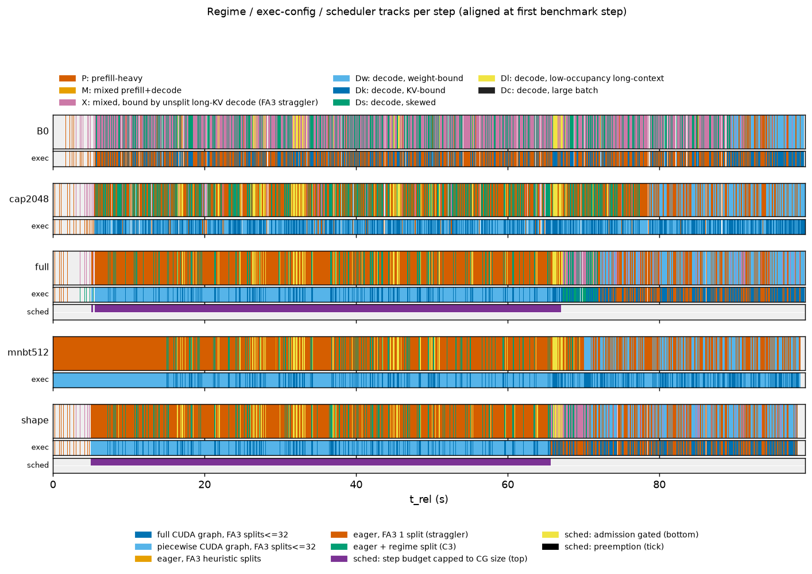

# Telemetry summary: s3a_1017

Regimes: **P** prefill-heavy; **M** mixed prefill+decode; **X** mixed, bound by unsplit long-KV decode (FA3 straggler); **Dw** decode, weight-bound; **Dk** decode, KV-bound; **Ds** decode, skewed; **Dl** decode, low-occupancy long-context; **Dc** decode, large batch.

## B0

- steps: 4946 (warmup steps dropped: 4), GPU busy 99.00 s, wall 99.06 s, utilization 0.999; bench.json completed=2400 (distinct request ids in telemetry: 2400)
- cudagraph_mode=FULL_AND_PIECEWISE, capture_max=512, cg null steps: 0

| regime | n_steps | step_share | gpu_time_share | gpu_ms_mean | gpu_ms_p50 | gpu_ms_p99 | B_mean | T_mean | maxL_mean | cg_FULL | cg_NONE | cg_PIECEWISE | fa3_dyn32 | fa3_nosplit |
|---|---|---|---|---|---|---|---|---|---|---|---|---|---|---|
| P | 205 | 0.041 | 0.076 | 36.77 | 19.21 | 321.27 | 16.8 | 1223.3 | 11213 | 0.00 | 0.56 | 0.44 | 0.44 | 0.56 |
| X | 1522 | 0.308 | 0.556 | 36.17 | 32.18 | 88.88 | 27.0 | 1074.9 | 24894 | 0.00 | 1.00 | 0.00 | 0.00 | 1.00 |
| Dw | 748 | 0.151 | 0.055 | 7.29 | 7.17 | 8.53 | 9.4 | 9.4 | 946 | 1.00 | 0.00 | 0.00 | 1.00 | 0.00 |
| Ds | 2096 | 0.424 | 0.267 | 12.61 | 12.49 | 14.17 | 26.5 | 26.5 | 26029 | 1.00 | 0.00 | 0.00 | 1.00 | 0.00 |
| Dl | 375 | 0.076 | 0.046 | 12.06 | 12.03 | 12.47 | 13.4 | 13.4 | 25763 | 1.00 | 0.00 | 0.00 | 1.00 | 0.00 |

Figures: `B0/a_regime_timeline.png`, `b_kv_fan.png`, `c_regime_breakdown.png`, `d_request_gantt.png`, `e_feature_scatter.png`, `trace.json.gz` (34624 events)

## cap2048

- steps: 5863 (warmup steps dropped: 4), GPU busy 99.02 s, wall 99.22 s, utilization 0.998; bench.json completed=2400 (distinct request ids in telemetry: 2400)
- cudagraph_mode=FULL_AND_PIECEWISE, capture_max=2048, cg null steps: 0

| regime | n_steps | step_share | gpu_time_share | gpu_ms_mean | gpu_ms_p50 | gpu_ms_p99 | B_mean | T_mean | maxL_mean | cg_FULL | cg_NONE | cg_PIECEWISE | fa3_dyn32 | fa3_nosplit |
|---|---|---|---|---|---|---|---|---|---|---|---|---|---|---|
| P | 1688 | 0.288 | 0.489 | 28.67 | 24.83 | 64.59 | 21.6 | 964.4 | 19981 | 0.00 | 0.02 | 0.98 | 0.98 | 0.02 |
| X | 75 | 0.013 | 0.066 | 87.65 | 70.58 | 201.44 | 35.1 | 3376.2 | 25649 | 0.00 | 1.00 | 0.00 | 0.00 | 1.00 |
| Dw | 1449 | 0.247 | 0.110 | 7.53 | 7.40 | 11.90 | 10.9 | 10.9 | 961 | 1.00 | 0.00 | 0.00 | 1.00 | 0.00 |
| Ds | 2010 | 0.343 | 0.256 | 12.61 | 12.48 | 16.22 | 24.3 | 24.3 | 26007 | 1.00 | 0.00 | 0.00 | 1.00 | 0.00 |
| Dl | 641 | 0.109 | 0.079 | 12.17 | 12.12 | 12.66 | 13.5 | 13.5 | 26002 | 1.00 | 0.00 | 0.00 | 1.00 | 0.00 |

Figures: `cap2048/a_regime_timeline.png`, `b_kv_fan.png`, `c_regime_breakdown.png`, `d_request_gantt.png`, `e_feature_scatter.png`, `trace.json.gz` (41043 events)

## full

- steps: 6518 (warmup steps dropped: 4), GPU busy 98.73 s, wall 99.12 s, utilization 0.996; bench.json completed=2400 (distinct request ids in telemetry: 2400)
- cudagraph_mode=FULL_AND_PIECEWISE, capture_max=512, cg null steps: 0

| regime | n_steps | step_share | gpu_time_share | gpu_ms_mean | gpu_ms_p50 | gpu_ms_p99 | B_mean | T_mean | maxL_mean | cg_FULL | cg_NONE | cg_PIECEWISE | fa3_dyn32 | fa3_nosplit |
|---|---|---|---|---|---|---|---|---|---|---|---|---|---|---|
| P | 2841 | 0.436 | 0.595 | 20.66 | 19.05 | 47.85 | 21.9 | 573.6 | 22454 | 0.00 | 0.13 | 0.87 | 0.87 | 0.13 |
| M | 21 | 0.003 | 0.003 | 13.75 | 12.67 | 23.73 | 22.1 | 32.5 | 25801 | 0.00 | 0.00 | 1.00 | 1.00 | 0.00 |
| X | 261 | 0.040 | 0.076 | 28.77 | 20.22 | 200.21 | 15.7 | 1060.2 | 10725 | 0.00 | 1.00 | 0.00 | 0.00 | 1.00 |
| Dw | 1957 | 0.300 | 0.144 | 7.28 | 7.21 | 11.13 | 10.5 | 10.5 | 964 | 1.00 | 0.00 | 0.00 | 1.00 | 0.00 |
| Ds | 914 | 0.140 | 0.117 | 12.61 | 12.41 | 19.06 | 21.6 | 21.6 | 26138 | 1.00 | 0.00 | 0.00 | 1.00 | 0.00 |
| Dl | 524 | 0.080 | 0.065 | 12.32 | 12.16 | 17.85 | 13.4 | 13.4 | 26218 | 1.00 | 0.00 | 0.00 | 1.00 | 0.00 |

Figures: `full/a_regime_timeline.png`, `b_kv_fan.png`, `c_regime_breakdown.png`, `d_request_gantt.png`, `e_feature_scatter.png`, `trace.json.gz` (45628 events)

## mnbt512

- steps: 7227 (warmup steps dropped: 4), GPU busy 98.63 s, wall 98.66 s, utilization 1.000; bench.json completed=2400 (distinct request ids in telemetry: 2399)
- cudagraph_mode=FULL_AND_PIECEWISE, capture_max=512, cg null steps: 0

| regime | n_steps | step_share | gpu_time_share | gpu_ms_mean | gpu_ms_p50 | gpu_ms_p99 | B_mean | T_mean | maxL_mean | cg_FULL | cg_PIECEWISE | fa3_dyn32 |
|---|---|---|---|---|---|---|---|---|---|---|---|---|
| P | 4123 | 0.570 | 0.705 | 16.86 | 18.35 | 27.02 | 18.5 | 464.2 | 18238 | 0.00 | 1.00 | 1.00 |
| M | 29 | 0.004 | 0.003 | 11.26 | 12.35 | 13.54 | 19.5 | 27.1 | 20331 | 0.00 | 1.00 | 1.00 |
| Dw | 1808 | 0.250 | 0.134 | 7.31 | 7.28 | 8.36 | 8.9 | 8.9 | 956 | 1.00 | 0.00 | 1.00 |
| Ds | 700 | 0.097 | 0.088 | 12.38 | 12.43 | 13.20 | 20.8 | 20.8 | 26361 | 1.00 | 0.00 | 1.00 |
| Dl | 567 | 0.078 | 0.070 | 12.18 | 12.20 | 12.74 | 13.4 | 13.4 | 26378 | 1.00 | 0.00 | 1.00 |

Figures: `mnbt512/a_regime_timeline.png`, `b_kv_fan.png`, `c_regime_breakdown.png`, `d_request_gantt.png`, `e_feature_scatter.png`, `trace.json.gz` (50591 events)

## shape

- steps: 6569 (warmup steps dropped: 4), GPU busy 98.17 s, wall 98.26 s, utilization 0.999; bench.json completed=2400 (distinct request ids in telemetry: 2388)
- cudagraph_mode=FULL_AND_PIECEWISE, capture_max=512, cg null steps: 0

| regime | n_steps | step_share | gpu_time_share | gpu_ms_mean | gpu_ms_p50 | gpu_ms_p99 | B_mean | T_mean | maxL_mean | cg_FULL | cg_NONE | cg_PIECEWISE | fa3_dyn32 | fa3_nosplit |
|---|---|---|---|---|---|---|---|---|---|---|---|---|---|---|
| P | 2868 | 0.437 | 0.593 | 20.30 | 18.98 | 44.77 | 21.5 | 572.7 | 22257 | 0.00 | 0.13 | 0.87 | 0.87 | 0.13 |
| M | 20 | 0.003 | 0.003 | 12.57 | 12.58 | 13.25 | 21.2 | 29.7 | 26011 | 0.00 | 0.00 | 1.00 | 1.00 | 0.00 |
| X | 251 | 0.038 | 0.073 | 28.71 | 18.92 | 198.10 | 15.1 | 1010.2 | 10279 | 0.00 | 1.00 | 0.00 | 0.00 | 1.00 |
| Dw | 1981 | 0.302 | 0.149 | 7.39 | 7.40 | 8.66 | 10.5 | 10.5 | 963 | 1.00 | 0.00 | 0.00 | 1.00 | 0.00 |
| Ds | 903 | 0.137 | 0.114 | 12.41 | 12.38 | 13.35 | 21.4 | 21.4 | 26067 | 1.00 | 0.00 | 0.00 | 1.00 | 0.00 |
| Dl | 546 | 0.083 | 0.068 | 12.18 | 12.17 | 12.62 | 13.4 | 13.4 | 26221 | 1.00 | 0.00 | 0.00 | 1.00 | 0.00 |

Figures: `shape/a_regime_timeline.png`, `b_kv_fan.png`, `c_regime_breakdown.png`, `d_request_gantt.png`, `e_feature_scatter.png`, `trace.json.gz` (45985 events)

## Comparison

| case | reqs | req/s | out tok/s | TTFT p50 | TTFT p99 | TPOT p50 | TPOT p99 | E2E p50 | E2E p99 | GPU busy s | util | P %GPU | M %GPU | X %GPU | Dw %GPU | Ds %GPU | Dl %GPU |
|---|---|---|---|---|---|---|---|---|---|---|---|---|---|---|---|---|---|
| B0 | 2400 | 24.18 | 1131.4 | 78.7 | 3034.5 | 21.0 | 62.2 | 883.7 | 5183.6 | 99.0 | 1.00 | 7.6 | 0.0 | 55.6 | 5.5 | 26.7 | 4.6 |
| cap2048 | 2400 | 24.17 | 1131.0 | 75.9 | 3045.2 | 17.5 | 65.2 | 735.4 | 5179.2 | 99.0 | 1.00 | 48.9 | 0.0 | 6.6 | 11.0 | 25.6 | 7.9 |
| full | 2400 | 24.19 | 1131.6 | 84.3 | 3073.7 | 16.0 | 51.6 | 675.3 | 4766.6 | 98.7 | 1.00 | 59.5 | 0.3 | 7.6 | 14.4 | 11.7 | 6.5 |
| mnbt512 | 2400 | 24.18 | 1131.4 | 78.5 | 4041.2 | 15.5 | 19.8 | 640.2 | 4614.0 | 98.6 | 1.00 | 70.5 | 0.3 | 0.0 | 13.4 | 8.8 | 7.0 |
| shape | 2400 | 24.18 | 1131.5 | 74.7 | 3036.2 | 15.6 | 45.9 | 656.4 | 4632.1 | 98.2 | 1.00 | 59.3 | 0.3 | 7.3 | 14.9 | 11.4 | 6.8 |

Latencies in ms. TPOT = (E2E - TTFT)/(output_len - 1) per request; percentiles over per-request values.

