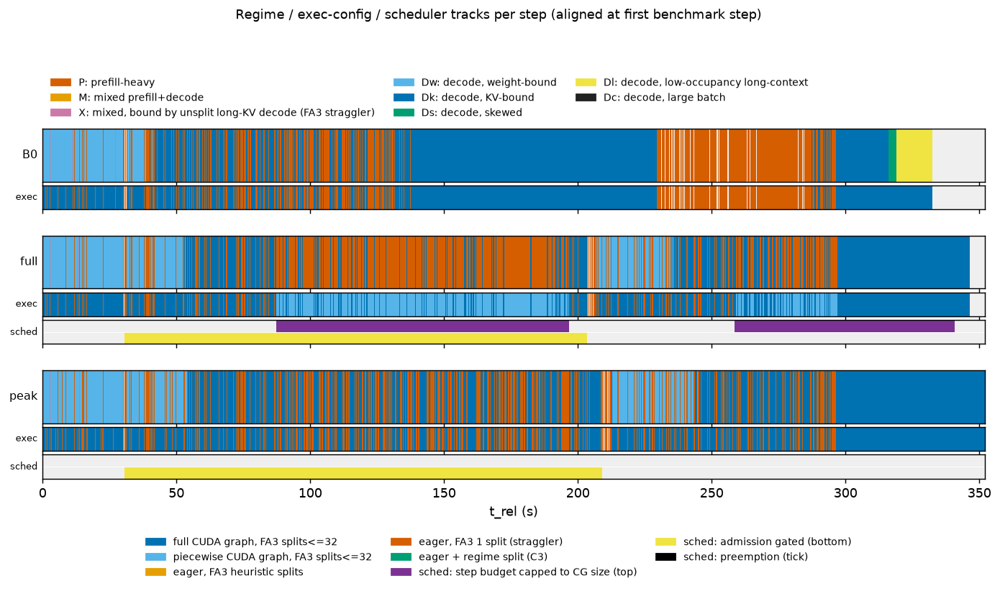

# Telemetry summary: s4b_1033

Regimes: **P** prefill-heavy; **M** mixed prefill+decode; **X** mixed, bound by unsplit long-KV decode (FA3 straggler); **Dw** decode, weight-bound; **Dk** decode, KV-bound; **Ds** decode, skewed; **Dl** decode, low-occupancy long-context; **Dc** decode, large batch.

## B0

- steps: 14818 (warmup steps dropped: 4), GPU busy 332.08 s, wall 332.33 s, utilization 0.999; bench.json completed=4784 (distinct request ids in telemetry: 4784)
- cudagraph_mode=FULL_AND_PIECEWISE, capture_max=512, cg null steps: 0

| regime | n_steps | step_share | gpu_time_share | gpu_ms_mean | gpu_ms_p50 | gpu_ms_p99 | B_mean | T_mean | maxL_mean | cg_FULL | cg_NONE | cg_PIECEWISE | fa3_dyn32 | fa3_nosplit |
|---|---|---|---|---|---|---|---|---|---|---|---|---|---|---|
| P | 2052 | 0.138 | 0.353 | 57.06 | 36.60 | 220.90 | 116.1 | 1818.4 | 4199 | 0.00 | 0.99 | 0.01 | 0.01 | 0.99 |
| X | 259 | 0.017 | 0.014 | 18.36 | 17.86 | 28.86 | 6.3 | 721.3 | 924 | 0.00 | 1.00 | 0.00 | 0.00 | 1.00 |
| Dw | 3308 | 0.223 | 0.076 | 7.66 | 7.01 | 12.52 | 17.6 | 17.6 | 932 | 1.00 | 0.00 | 0.00 | 1.00 | 0.00 |
| Dk | 7756 | 0.523 | 0.508 | 21.75 | 25.09 | 27.14 | 66.2 | 66.2 | 5780 | 1.00 | 0.00 | 0.00 | 1.00 | 0.00 |
| Ds | 202 | 0.014 | 0.009 | 14.71 | 14.71 | 14.81 | 17.5 | 17.5 | 8461 | 1.00 | 0.00 | 0.00 | 1.00 | 0.00 |
| Dl | 1239 | 0.084 | 0.040 | 10.66 | 11.27 | 13.71 | 9.2 | 9.2 | 8471 | 1.00 | 0.00 | 0.00 | 1.00 | 0.00 |
| Dc | 2 | 0.000 | 0.000 | 29.69 | 29.69 | 29.95 | 275.5 | 275.5 | 8418 | 1.00 | 0.00 | 0.00 | 1.00 | 0.00 |

Figures: `B0/a_regime_timeline.png`, `b_kv_fan.png`, `c_regime_breakdown.png`, `d_request_gantt.png`, `e_feature_scatter.png`, `trace.json.gz` (118547 events)

## full

- steps: 19300 (warmup steps dropped: 4), GPU busy 346.11 s, wall 346.41 s, utilization 0.999; bench.json completed=4800 (distinct request ids in telemetry: 4800)
- cudagraph_mode=FULL_AND_PIECEWISE, capture_max=512, cg null steps: 0

| regime | n_steps | step_share | gpu_time_share | gpu_ms_mean | gpu_ms_p50 | gpu_ms_p99 | B_mean | T_mean | maxL_mean | cg_FULL | cg_NONE | cg_PIECEWISE | fa3_dyn32 | fa3_nosplit |
|---|---|---|---|---|---|---|---|---|---|---|---|---|---|---|
| P | 5704 | 0.296 | 0.458 | 27.80 | 26.55 | 51.43 | 56.2 | 630.6 | 4909 | 0.00 | 0.29 | 0.71 | 0.71 | 0.29 |
| M | 101 | 0.005 | 0.006 | 20.44 | 19.63 | 26.40 | 56.6 | 85.1 | 5809 | 0.00 | 0.00 | 1.00 | 1.00 | 0.00 |
| X | 261 | 0.014 | 0.014 | 18.42 | 18.02 | 29.86 | 6.3 | 726.9 | 924 | 0.00 | 1.00 | 0.00 | 0.00 | 1.00 |
| Dw | 5948 | 0.308 | 0.152 | 8.82 | 8.70 | 12.25 | 27.9 | 27.9 | 1259 | 1.00 | 0.00 | 0.00 | 1.00 | 0.00 |
| Dk | 7285 | 0.377 | 0.370 | 17.60 | 17.82 | 25.36 | 46.3 | 46.3 | 5381 | 1.00 | 0.00 | 0.00 | 1.00 | 0.00 |
| Dl | 1 | 0.000 | 0.000 | 7.75 | 7.75 | 7.75 | 3.0 | 3.0 | 8511 | 1.00 | 0.00 | 0.00 | 1.00 | 0.00 |

Figures: `full/a_regime_timeline.png`, `b_kv_fan.png`, `c_regime_breakdown.png`, `d_request_gantt.png`, `e_feature_scatter.png`, `trace.json.gz` (173704 events)

## peak

- steps: 19052 (warmup steps dropped: 4), GPU busy 351.24 s, wall 352.08 s, utilization 0.998; bench.json completed=4799 (distinct request ids in telemetry: 4799)
- cudagraph_mode=FULL_AND_PIECEWISE, capture_max=512, cg null steps: 0

| regime | n_steps | step_share | gpu_time_share | gpu_ms_mean | gpu_ms_p50 | gpu_ms_p99 | B_mean | T_mean | maxL_mean | cg_FULL | cg_NONE | cg_PIECEWISE | fa3_dyn32 | fa3_nosplit |
|---|---|---|---|---|---|---|---|---|---|---|---|---|---|---|
| P | 3519 | 0.185 | 0.341 | 34.07 | 31.25 | 78.99 | 54.3 | 989.7 | 4240 | 0.00 | 0.98 | 0.02 | 0.02 | 0.98 |
| X | 243 | 0.013 | 0.014 | 20.23 | 19.34 | 33.57 | 6.6 | 738.3 | 928 | 0.00 | 1.00 | 0.00 | 0.00 | 1.00 |
| Dw | 5775 | 0.303 | 0.151 | 9.17 | 9.02 | 15.27 | 29.1 | 29.1 | 1306 | 1.00 | 0.00 | 0.00 | 1.00 | 0.00 |
| Dk | 9514 | 0.499 | 0.494 | 18.23 | 18.07 | 25.49 | 49.1 | 49.1 | 5572 | 1.00 | 0.00 | 0.00 | 1.00 | 0.00 |
| Dl | 1 | 0.000 | 0.000 | 7.76 | 7.76 | 7.76 | 3.0 | 3.0 | 8511 | 1.00 | 0.00 | 0.00 | 1.00 | 0.00 |

Figures: `peak/a_regime_timeline.png`, `b_kv_fan.png`, `c_regime_breakdown.png`, `d_request_gantt.png`, `e_feature_scatter.png`, `trace.json.gz` (171472 events)

## Comparison

| case | reqs | req/s | out tok/s | TTFT p50 | TTFT p99 | TPOT p50 | TPOT p99 | E2E p50 | E2E p99 | GPU busy s | util | P %GPU | M %GPU | X %GPU | Dw %GPU | Dk %GPU | Ds %GPU | Dl %GPU | Dc %GPU |
|---|---|---|---|---|---|---|---|---|---|---|---|---|---|---|---|---|---|---|---|
| B0 | 4784 | 14.39 | 2486.9 | 762.0 | 99216.6 | 37.6 | 153.0 | 6203.9 | 201190.4 | 332.1 | 1.00 | 35.3 | 0.0 | 1.4 | 7.6 | 50.8 | 0.9 | 4.0 | 0.0 |
| full | 4800 | 13.85 | 2389.2 | 93.8 | 5994.6 | 19.6 | 49.0 | 840.1 | 175149.8 | 346.1 | 1.00 | 45.8 | 0.6 | 1.4 | 15.2 | 37.0 | 0.0 | 0.0 | 0.0 |
| peak | 4799 | 13.63 | 2350.6 | 85.4 | 5323.4 | 20.1 | 61.9 | 840.4 | 180228.7 | 351.2 | 1.00 | 34.1 | 0.0 | 1.4 | 15.1 | 49.4 | 0.0 | 0.0 | 0.0 |

**GPU time by exec config, scheduler decisions**

| case | full CUDA graph, FA3 splits<=32 %GPU | piecewise CUDA graph, FA3 splits<=32 %GPU | eager, FA3 1 split (straggler) %GPU | shape-cap steps | gated calls | gated reqs (unique) | preemptions |
|---|---|---|---|---|---|---|---|
| B0 | 63.3 | 0.1 | 36.6 | n/a | n/a | n/a | n/a |
| full | 52.2 | 32.2 | 15.7 | 8332 | 7991 | 36 | 0 |
| peak | 64.5 | 0.3 | 35.2 | 0 | 7992 | 36 | 0 |

shape-cap steps = steps joined to a sched record with shape=true; gated calls = schedule() calls with n_gated>0; preemptions = sum of n_preempt over sched records (n/a = no sched file).

Latencies in ms. TPOT = (E2E - TTFT)/(output_len - 1) per request; percentiles over per-request values.

